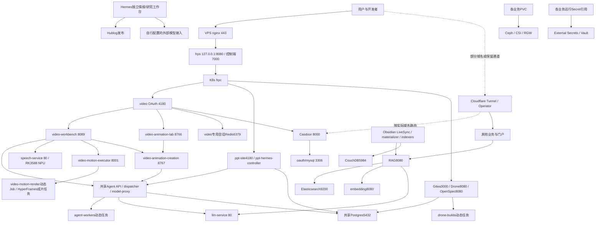

> 归档说明：这是来源文档快照，原文中的“当前/已完成/待实施”只代表其记录时点。有效规格以映射 OpenSpec 服务为准。
> 来源：`operations/server-resource-audit-20261118/dependencies/dependency-map.md`；正文 SHA-256：`c812a17c511d2f2ff42ce694644d327999b175960190094b4fed2a8303f28746`。本副本进行 UTF-8/LF 规范化并重定位文档链接，原件保留。
> [设计档案索引](../../../README.md)

# 服务依赖与下线候选审计

审计日期：2026-11-18。仅做只读盘点，未停止、扩缩、部署、删除任何服务或数据，也未改 OpenSpec。依据是本目录相邻的 Kubernetes、宿主机、VPS 脱敏现场清单；仓库文档只解释组件职责，旧文档与实时状态冲突时以现场为准。未读取 Secret 内容或完整私有配置，地址仅保留 host/port。候选不等于可立即删除。

## 已核实的依赖主线

图中箭头表示调用或依赖；不是把所有组件合成一个服务。视频正式制作、动画实验室、图片学习、视频学习共用当前创作执行器与 Agent 基础设施，彼此的业务规则仍独立。实际 Pod/端口/PVC 全表在 `../kubernetes/INVENTORY.md`。图中的仓库设计关系没有替代运行请求日志取证。

| 组件 | 现场状态与依赖 | 下线边界 |
|---|---|---|
| 视频工作台、动画实验室 | 两个 Deployment 均1/1；8089与8766；工作台PVC及实验/评估PVC分离 | 都是当前产品，不能因同用镜像/共用创作能力判重 |
| 创作执行器 | 1/1，8767；依赖Agent API，挂载Docker socket、创作工作目录和本地库资源 | 挂载的历史 `authoring-libraries-release-r1/assets` 仍在承载服务，不能删除整个旧父目录 |
| 动态渲染执行器 | 1/1，8001；`video-motion-render`实时RoleBinding授权其SA创建/观察动态任务 | 不是旧工作台；渲染namespace零Pod不代表可下线 |
| speech-service | 1/1，80；NPU device-plugin期望1/1；模型与voices是宿主机挂载 | 共享语音能力，视频仍明确依赖；本地checkout没有该服务目录不代表线上不存在 |
| Agent Service | API、dispatcher、model-proxy各1/1；动态worker；共享PG/LLM/凭据 | 空闲worker namespace与历史Host版本不能整体清理 |
| LLM、RAG、embedding、ES | 都是活跃共享服务；RAG→ES/embedding/LLM | ES不只是视频依赖；Obsidian索引/业务检索也相关 |
| PPT生产 | site/controller均1/1，共用ppt-data；当前设计使用共享PG | 三个宿主开发容器不能与这两个生产Deployment混为一谈 |
| PPT旧独立DB | STS已0副本，保留10Gi逻辑RBD申请 | 只有配置/数据候选，没有可回收的运行内存；先确认迁移/恢复用途 |
| Gitea/Drone/OpenSpec | Gitea、Drone Server、OpenSpec均运行；Drone Runner2/2 | 源码、规格与构建基础设施；不能按“开发工具”自动停 |
| Gitea数据库实证 | 在运行中的gitea-0仅提取DB_TYPE/HOST：postgres、postgres.data.svc.cluster.local:5432 | K8s Gitea不依赖宿主mysqld；5宿主gitea/mysql/mysqld/mariadb服务均inactive，实际gitea和mysqld进程都属于K8s cgroup，没有已证实的独立宿主重复实例 |
| OAuth/会话 | Casdoor+oauth/mysql；13组业务proxy各2副本，视频proxy1副本；视频会话Redis独立 | 代理与业务配对；停某业务不等于停共享Casdoor/MySQL/其他会话Redis |
| 网络/DNS | Calico5/5，CoreDNS2/2；auth split-horizon→ingress TLS；FRP与CF共存 | 仅1个K8s Ingress不等于只有1个公网服务；不要停共享入口 |
| 存储/镜像 | Ceph cephadm与registry是K8s外Docker，CSI位于K8s | 容器不属于业务Deployment不代表临时；PVC申请也不等于实际占用 |

## Hermes、Obsidian 与检索栈的具体边界

Hermes是独立的个人情报/研究工作台，保留自己的LLM接入，关联信息采集、报告与Hublog发布。它不是Agent Service的同义词，也不是PPT里叫`ppt-hermes-controller`的同一服务。现场有`hermes-web`与`hermes-publisher`两个Deployment，前者含OAuth代理，后者单独持发布凭据；现场NetworkPolicy允许发布到hublog以及DNS/数据/认证所需目标。仓库明确它曾改用自身原生调度器，因此“hermes namespace没有CronJob”不足以判断没有计划任务。本次未打开用户报告、会话或原生调度数据库，实际使用频率待用户确认。

Obsidian目前是CouchDB同步、materializer与8组小时索引CronJob，不是旧浏览器桌面。仓库索引说明明确由物化Markdown进入RAG，RAG再用ES与embedding；因此ES停机会影响知识检索。现场仅证明这些控制器与索引计划存在并Ready/未暂停，未验证每个corpus最近的真实查询量。

## 三类候选

### 有证据支持进入清理评审

这些对象已经没有运行工作负载，或其后端明显缺失；清理多数释放的是元数据而非CPU/内存。数据归属、迁移保留和恢复依赖仍需核实。

- **C01** `agent-candidate-ppt-21feed9; agent-candidate-ppt-9943b69; agent-candidate-ppt-b52f041; agent-candidate-ppt-d4eceed`：No Deployment, StatefulSet, DaemonSet, CronJob, Job or Pod exists in these four namespaces at collection. Each namespace retains a 20Gi Bound local PVC; associated PV reclaimPolicy is Retain. RoleBinding and default-deny NetworkPolicy remain.
- **C02** `ppt-service-test`：No workload controllers, Jobs or Pods; two Services and two Bound PVCs remain. ppt-data is CephFS 20Gi request; ppt-postgres-data is RBD 10Gi request. Namespace still has old DNS, FRP and database NetworkPolicies.
- **C03** `ppt-service/StatefulSet/ppt-postgres; ppt-service/Service/ppt-postgres; ppt-service/PVC/ppt-postgres-data`：StatefulSet has zero replicas and no running PostgreSQL Pod. Deployment repository documents shared postgres.data.svc.cluster.local:5432 as the current application database; live site/controller policies allow data namespace. Old dedicated RBD PVC remains Bound with 10Gi logical request.
- **C04** `zero-replica ReplicaSets across namespaces`：721 ReplicaSets total; 632 have zero replicas. Historical rollout metadata is not an equal number of running services.
- **C05** `completed Jobs and terminal Pods`：45 Jobs all Succeeded; Pod phases: {'Running': 154, 'Succeeded': 43, 'Failed': 5} Terminal agent-workers and PPT migration/acceptance Pods remain.
- **C06** `agent-service/candidate-anim-review-v4-r1; agent-service/candidate-wkc-v2r1; agent-service/candidate-wkc-v2r2`：Probe Services remain; associated proxy Pods in agent-service are Succeeded (one has an old deletionTimestamp). Related candidate worker Pods in agent-workers are terminal Failed; these are different Pods. NetworkPolicies and candidate-source hostPath references remain.
- **C07** `default/TunnelRoute/bingbichunqiu-agent; default/TunnelRoute/daofaziran-agent; default/TunnelRoute/fofawubian-agent; default/TunnelRoute/xiaotanrenjian-agent; default/TunnelRoute/yimaneili-agent; default/TunnelRoute/zhenzhuzhida-agent; default/TunnelRoute/zhongkuifumo-agent; default/TunnelRoute/zhougongjiemeng-agent`：Read-only live TunnelRoute host/backend projection shows eight routes to oauth2-proxy-<name>.oauth.svc.cluster.local:4180. Those eight backend Services do not exist in the live 104-Service inventory. Repository old aggregate manifest points some of these hosts to baijiazhengming instead; it is not current live routing truth.

### 需要确认实际用途

- **U01** `master standalone Docker: ppt-service-materials-dev-20261022; master standalone Docker: ppt-service-webdev-api-20261021; master standalone Docker: ppt-service-webdev-db-20261021`：Three running containers in Docker network ppt-service-webdev-20261021. No published host ports in whitelisted inspect; API/materials 8000 and database 5432 are private container ports. Snapshot memory 43.55+63.14+46.39 MiB = 153.08 MiB. Production PPT currently has live K8s site/controller; no direct production route to these three containers established by this audit.
- **U02** `npcheck; npx`：No Pod/workload/Job/PVC/Service in either namespace at the snapshot. Supplemental RoleBinding and NetworkPolicy projection found no records in those two namespaces.
- **U03** `kube-flannel/kube-flannel-ds`：DaemonSet desired/current is zero; Calico DaemonSet is 5/5. Repository docs state network migrated from Flannel to Calico on 2026-09-21.
- **U04** `video-motion-experiment`：No workload/Pod/Service/PVC at the snapshot; a deny-all NetworkPolicy remains. Name and policies imply an isolated experiment job target.
- **U05** `default/cf-tunnel-main; cf-tunnel-operator; Cloudflare Tunnel routes`：Tunnel Deployment 2/2 ready and operator 1/1 ready. VPS nginx/FRP is also active; coexistence may be intentional per-domain routing/fallback. Thirty live TunnelRoute objects; absence of video/PPT objects does not mean their VPS routes are unused.
- **U06** `13 legacy OAuth proxy Deployments at 2 replicas each`：26 ready Pods; each is paired with an active application namespace and public route configuration. Some redundant replicas might be tuned, but no evidence supports wholesale service retirement.
- **U07** `VPS Docker daemon/containerd and five cached images`：No Docker containers running on VPS; dockerd/containerd processes remain. VPS nginx and frps are real active shared entrypoints.

### 共享底座，不能直接下线

- `kube-system, kube-node-lease, kube-public, Calico, kube-proxy, CoreDNS, metrics-server`：Cluster control, network, DNS, health and leases; empty system namespaces are normal.
- `vault/vault, external-secrets, cert-manager`：Shared credential provisioning and certificates; deleting a consumer does not permit deleting shared secret authority.
- `oauth/casdoor, oauth/mysql, ingress-nginx`：Shared OIDC login path; CoreDNS split-horizon routes auth.panghuer.top through ingress TLS.
- `data/postgres, data/redis`：Multiple live business/Agent/Gitea/session dependencies; dedicated video session Redis has separate role.
- `data/elasticsearch, data/embedding-service, data/rag-service`：Live RAG search stack; Obsidian indexer and research/business agent consumers are documented, not video-only storage.
- `agent-service, agent-workers, llm/llm-service`：Shared task control/dispatch/model routing; agent-workers is dynamically populated and may appear idle.
- `Ceph cephadm containers, CSI node/provisioner plugins, RGW, HAProxy/Keepalived, registry`：Persistent storage and image supply outside/inside K8s; do not stop because not a business Deployment.
- `gitops/gitea, gitops/drone-server, gitops/drone-runner, drone-builds, openspec/openspec-service`：Source/spec storage and builds; live Gitea uses shared PostgreSQL, and drone-builds has live runner RoleBinding.
- `video-workbench, video-animation-creation, video-motion-executor, video-motion-render`：Current production video/lab/create/render chain; executor-to-render RoleBinding proves ongoing dynamic execution target.
- `speech-service/speech-service, speech-service/rknpu-device-plugin`：Live shared speech API and RK3588 NPU serving; production video explicitly permits speech egress.
- `VPS nginx, VPS frps, frpc/frpc`：Actual shared public entrypoints; access_log off or an idle sampling window is not no use.

## 公网、外部服务与证据限制

VPS现场nginx分别为video、PPT、Gitea和通配域名转发到本机FRPS入口；自定义LLM域名例外，直接转外部`jingsi.asia:9080`。这是现有路由，不代表本次验证了外部服务可用性。FRP客户端的目标服务映射与仓库部署说明互相支持，但本次没有输出包含凭据的原始frpc配置，也未访问Cloudflare控制台或修改DNS。30个TunnelRoute自定义对象是配置证据，不能等同Cloudflare当前生效配置。

video的nginx访问日志关闭；通用访问日志混合健康检查、401和扫描，不能用来证明业务使用量。未来是否下线某个活跃业务应由产品用途决定，不能以某次CPU接近0、无K8s Ingress、无公开日志、目录名字旧或镜像相同为依据。

三套PPT宿主开发容器当前合计约153.08MiB容器工作集，连接在独立Docker网络且没有公开宿主端口；尚未证明生产链路调用它们，也未证明无人开发使用。生产PPT链路是独立K8s site/controller，停开发数据库前仍需确认数据归属和内部直接调用。

详细候选、阻断条件和保护对象见同目录`candidate-review.json`。本次没有给任何对象授权删除，也没有执行清理。

宿主Gitea/MySQL补充核验：`../hardware/final-checks.json`表明五台宿主相关systemd服务均inactive；master的gitea进程与211的mysqld进程都属于kubepods cgroup。本次没有发现可作为重复宿主数据库下线的独立实例。
