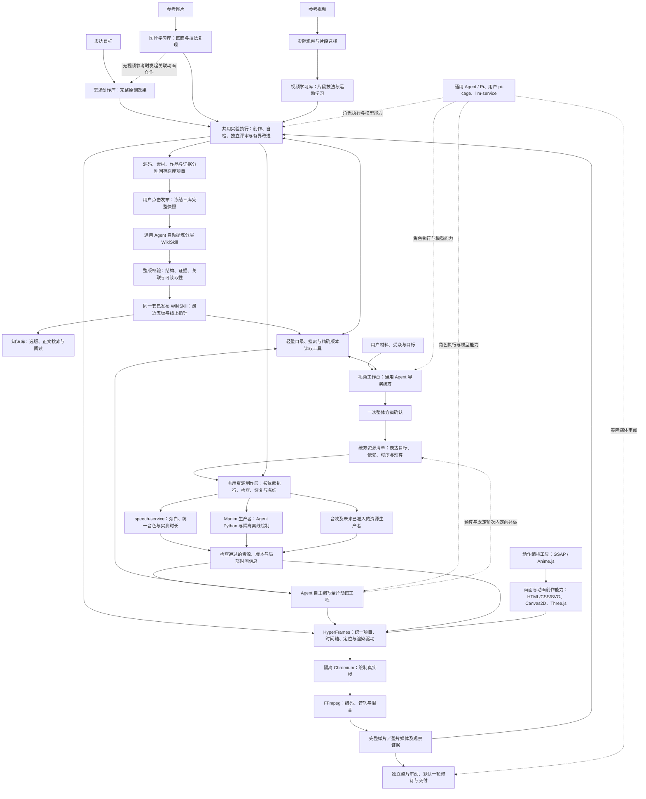
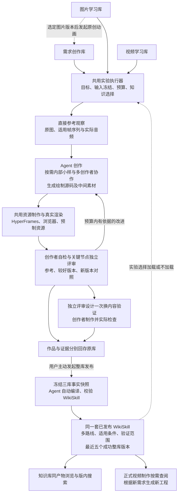
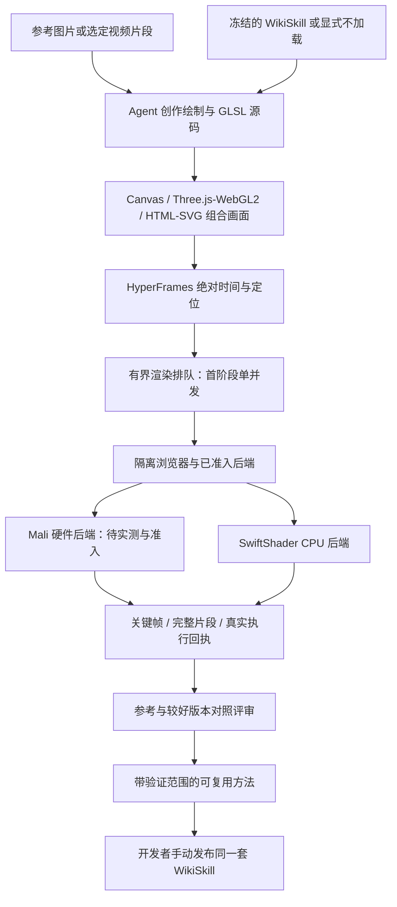

> 归档说明：这是来源文档快照，原文中的“当前/已完成/待实施”只代表其记录时点。有效规格以映射 OpenSpec 服务为准。
> 来源：`operations/shader-mali-feasibility-20261118/openspec/sync-after.response.json`，JSON 字段 `/artifacts/design.md`；正文 SHA-256：`ed8dfeee300a05e69342508a1b8d53604a5aa0f99ab315c8a94596aadac9fed6`。本副本进行 UTF-8/LF 规范化并重定位文档链接，原件保留。
> [设计档案索引](../../../README.md)

## 2026-11-18 学习库能力补齐与 WikiSkill（已验收子阶段与保留边界）

本轮 X.25–X.33 的具体子阶段已分别验收：两学习库能力选择、内部小样与依赖职责部件整合、真实 Manim 资源与图片转关联动画、完整 Git 源码构建部署、首个整库 WikiSkill 发布，以及正式新内容实际读取和应用。当前事实以 design.md 7.26–7.27、X.31–X.33 和应用验证文档最终回执为准。下方各次“待验”“尚未完成”和失败保留为其历史检查点，不能据新结果改写原输入、源码、媒体或停止事实。原 X.1–X.9 的完整三库目标、更广连续运动、真实参考音频/音画听审、水墨艺术和用户认可保持原范围，未由本轮技术与采样证据整体完成。

原 WikiSkill v1/v2 角色、原 502 条事实/503 份输入/18,686,365 字节快照、900 秒失败及 release_id=null 全部保留。新增 v3 导航解决完整索引的上下文开销，不把提高预算、技术候选或离线检查记成成功业务发布；正式使用需核对同一 release 的真实读取、作者源码和媒体应用。完整回执见应用文档 `video_workbench/docs/learning-capabilities-and-wikiskill-validation-20261118.md` 与开发机 `D:/codex-work/operations/video-learning-completion-20261118/`。

## 2026-11-18 视频学习库卡片与详情交互修正

视频学习库原先把一条参考的全部候选直接列在首页，与效果库、图片学习库的卡片入口不同。现改为摘要卡片 → 独立参考分析详情 → 选择片段进入委托表单。没有制作项目但已有参考分析时显示参考卡片；查看、返回、刷新和候选选择保持已有草稿与合理的展开状态。候选选择不启动制作。代码与范围说明见应用仓库 `video_workbench/docs/video-learning-library.md`。

完整干净 Git `d44791200b8552d2a40cff7dc6109873dc1df288` 构建 lab 的 latest 镜像并按 digest 上线，运行源码摘要已核对。既有46项前端测试、真实网页卡片/详情/返回/表单草稿和刷新验收通过；只读核对视频库六表摘要在此次UI验收前后不变，没有新增制作或模型任务。生产跨账号切换与运行中停止按钮没有另行制造任务做实测，沿用控制器回归与源码审查，不冒称新增艺术、运动或音频验收。

## 2026-11-18 视频学习首版与水墨图片继续实验

视频学习首版沿用图片学习的完整源码链路：真实参考片段 → 作者观察实际帧并生成可编辑源码 → HyperFrames 完整 MP4 → 独立评审比较 → 有界改进 → 一次换内容验证。视频库独立网页与结构化 API 已上线；长视频候选分析是独立预算任务，选择候选只填需求，不自动制作。原始参考、时间/PTS/重复帧、每轮源码、视频、海报、回执和实际角色输入分别保留，加载知识可关闭或固定整库版本。

本轮使用内部六秒动画真实跑通上传、单独候选分析、两轮预算的学习及换内容流程，项目 `5b4385351ea4466f9db78d30458b1bef`。产物下载摘要、逐角色图片传输和跨 owner 拒绝检查见应用仓库 `video_workbench/docs/video-learning-validation-20261118.md`。这是技术与实际媒体接入验证，不是用户艺术认可；默认作品未采用，未发布 WikiSkill。视频事实只读接入既有整库快照已验证，实际编译发版及正式新片消费仍待开发者后续发版和相应验收。

当前模型观察范围仅为 `sampled_frames_only`，连续运动和实际声音未验证，`continuous_motion_verified=false`、`audio_verified=false`。参考音轨保留、页面完整播放和音效学习意图不代替实际听审。按目标加密连续观察、真实音频输入、自适应多作者、内部技法小样、Manim 学习与图片转关联动画仍归 X.1–X.9 未完范围，不因首版勾选而降低规格。

技术重试修复保留原失败阶段输入，仅重绑定新实验 ID；同时保留实际较好基线、前次评审与历史作品关系。图片/视频各自第三轮渲染和评审失败四种场景通过，原服务 39 项回归通过。此前水墨真实评审重试的比较基线丢失仍作为原事实保留，不冒称那次已经按修复版本执行。独立视频评审曾因 issues/comparison 字段结构错误被拒绝，原输出和已停止证据保留；后续新评审输入提供自包含的输出类型规范，失败结果不经过类型转换伪装成功，也不向历史技术重试输入追加新规范。

水墨单独子任务已完成三轮复现及一次换内容验证，内部最佳为第2轮 `528c116665eb41bb995a07c2cc30da48`；硬切面局部改善，规则前景皴擦、自然山形和积墨仍不足，未达参考美术目标。第3轮评审原始失败与一次技术恢复、全部终止证据保留，不自动采用或发布。

角色镜像从完整干净 Git `35310d17f2430b970b442c992dd7ad26b3b43851` 构建并独立准入；界面审查发现换源后分析失败会回写旧参考编号，修复并通过10项前端回归，再从完整干净 Git `68795854120588e0cae8c787ad504ead850a7971` 构建实际受影响的应用镜像。浏览器验收又发现轮询时间更新会重建详情，已用稳定身份保留展开和同媒体播放状态，14项前端回归通过；仅重建并部署 Git `e269d4350b420120082efb316c1cef7e9a599572` 的 lab，执行中的学习任务继续使用原执行器。按 digest 部署并核对运行源码：executor `sha256:d453a0fb02809e77dbc12d9eb9b9279e12f50cef3542f978af0f09bd7454312e`、lab `sha256:76d7816a87e7ff71ca286eb4f63ee96d980bb7dfa48f047c89f39c01166b869a`；renderer 未改变。一次构建因独立资源 pin 未同步被拒绝，修复后真实资源/上下文打包和新完整构建通过，失败记录保留。部署身份与后续文档提交分别记录，未合主线。下方同日早期检查点作为历史保留，当前阶段以本检查点及各自证据范围为准。

## 2026-11-18 图片学习首版实施检查点

图片学习首版已按完整源码工作流程上线：直接观察实际参考 → Agent 编写绘制源码 → HyperFrames 真实导出单帧 → 独立看图比较 → 带入真实结果和源码继续迭代。单帧是每轮比较的产物，同时保存源码、尝试、方法和冻结输入；开发者可继续实验或从零重做。当前画面能力为 HTML/SVG、Canvas 2D、Three.js。

当前开发者真实结构化 HTTP 项目 `bcd905f38c29443faa9ec0159d309100` 完成同一次实验的两轮复现和一次由独立评审出题的换内容制作、真实渲染与评审。七个 Agent 操作实际图片运输逐项核对，九份源码/PNG/回执下载摘要一致，跨 owner 返回404；默认采用仍为空。模型评分为66、74、迁移73，画面仍有多边形山面与规律笔触，不能作为艺术达标或人工认可。未发布 WikiSkill。

图片静态事实的只读采集与既有整库快照合同通过（35条事实），仅证明手动发布输入可接入；真正发版与正式新内容消费留在后续用户操作和相应验收。网页已核对导航、参考上传预览、项目、版本与参考/结果对照；API与网页共用同一服务流程。

应用代码已推送Git，从干净完整源码构建 latest 镜像，当前应用版本 `bf9dd077c79342a22348773888a9ae9ea4276296`；executor `sha256:6039d043ec85705f4dd6a006f1fd51162e331a68505ee1c376282bf7b01e02fa`、lab `sha256:6790c00a4bed05d0273d7afd7b021c2d21f101a287d2e8fc5b20dc96b978e04b` 均已Ready并核对运行源码。真实业务循环在r2完成，r3升级后只读核对原项目和三份作品完整，未另开付费实验。新看图身份从源码70aa906独立准入，控制/worker保留其确切已验镜像。

本检查点优先完成图片首版；完整X.1–X.9继续包含视频学习、内部小样、自适应多人学习、图片Manim、关联动画及实际知识发版后的正式消费。原先可信用量、费用和生产存储回收仍归共享框架，不新增重复业务任务。详细依据应用仓库 `video_workbench/docs/picture-learning-{render,agent,product}-validation-20261118.md` 及其脱敏证据。

## 2026-11-18：需求创作、图片学习与视频学习三库（设计同步，待实施）

本轮仅同步已确认需求、代码差距与实施任务。design 7.24及X.1–X.9覆盖旧单成果入口、仅显式固定协作、活动实验读取新意见和迁移必须全通过才可提炼知识的解释。三库独立、共用执行渲染与同一WikiSkill；作者直接观察参考，复现后由独立评审出一次迁移题，预算优先复现，活动实验仅查看/停止。原已完成证据和未完业务任务保持各自范围；本次不运行模型、渲染、部署、业务知识发布或主线合并。

## 2026-11-17：单 Agent 水墨候选、实测性能与技术恢复

本轮单个业务创作 Agent 已生成一版24秒Canvas/原生JavaScript候选 f9a62e37-3c72-4389-90b2-f49291cc2e80，不启用按职责分工创作，也没有自动制作第二版。实际创作Job a9d22278-ae53-467b-a708-20997d430f98已停止，其不可变源码与业务候选相同；engine+files SHA-256 ad52b8596f331712714bc5e2e079f2a9957070da259c3a9c54582662df0f9a19，媒体SHA-256 47bf3a95ae7ad4d1ad3f72947adde0b001aea3e10264f796ffa4533f80587e6d。正式HyperFrames技术验证、1280×720/24fps/576帧及全片解码通过。少量共享图集、连续弧长显露与预生成软雾取代部分重复绘制；Codex没有手改作品源码。

在同一ARM机器及固定renderer45504cc1…中，以独立浏览器、相同8次预热及576帧真实HyperFrames绝对seek+完整RGBA读回，执行一次旧→新比较。seek中位数78.99→21.43ms，P95 88.86→33.38ms；全部序列53.205→17.989秒，初始化+预热+序列55.381→19.334秒。原生context 75→6，但像素存储下界14.46→51.56MiB，单图集36MiB；不能声称更省总内存。计时含IPC/readback，不是生产截图编码速度、重复统计或单项缓存因果实验；离线等待每帧，慢不等于成片丢帧。

静帧仍有宽笔硬切边和面片/折纸感，尚未达到自然水墨的美术目标；连续运动、节奏与全片意境未完整观看。独立评审仍未产生合法完成结果；如实保留失败状态和问题，不继续自动重试，不编造评分。 画质、技术通过与运行成本分别记录，V.4的艺术目标和T.7完整验收仍未完成，不自动采用候选或发布WikiSkill。

author运行时已从完整已推送Git31f3eed构建并准入67664e…，仅切author binding-734556c4a2c1622f7982。实际水墨Job使用新pins，httpIdleTimeoutMs=593048、禁用自动重试，成功越过此前约303秒失败点。精确旧镜像缺少该设置与Pi默认300000ms机制已证实，但因原始错误日志缺失不认定为唯一失败原因。11项离线预算/取消检查、4次准入模型请求、96帧native技术fixture与34.578秒切换有记录；该fixture不是HyperFrames艺术验证。review路由和旧任务身份不改写。

首次独立review Job07e118e0-28dc-4e8f-b8c0-2661b31fe8de输出不合法。正常三字段恢复3bf1ff03-f339-4715-b59f-ca8e96e4463c又暴露复用入库缺陷：不可变v2 package因新作者请求键被误当v3，409发生于0新创作/0渲染/0评审调用。已沿可信同owner直接重试血缘恢复原方法幂等身份，保留本次候选/演示来源，未放宽版本校验。干净Git加本两文件组合93 passed，真实本轮source/package两代离线复现通过。修复源码9c1cea5a5e517c01d91ce00930708ca4e64899a5已推送，从完整干净Git构建video-animation-creation:latest@sha256:b2a938757c247bc87837d08c1b99784f157b5aa03e6f08e6934302ec34009b36并最小部署executor；无数据库迁移。

部署后唯一正常技术恢复01ddf050-cdca-4c07-be7d-8cebc6f79ae9复用同一源码、方法与媒体，新增creator=0、render=0、review=1；实际review Job 77da26d5-bf6e-44ea-bed0-5264b65707d2，状态failed。原失败与消耗保留，未另造作品或无限重试。代码提交、运行镜像和后补文档身份分别记录。

工程摘要见video_workbench/docs/fresh-rebuild-validation-20261117.md及docs/evidence/ink-quality-perf-20261117.json；完整本地证据D:/codex-work/operations/ink-quality-perf-20261117/，样片归档D:/codex-work/archives/video-service/20261117/ink-quality-perf/。本轮未合主线。

## 2026-11-17 V节实施核验

500上限与受限显式重绑定已上线，完整Git源码提交为e08474172da4bf25f36927cde3c1dbe202b9f5fa。本轮任务使用V.1–V.3，消除与既有U节共用资源任务的编号冲突；原U节状态不变。最终统一渲染镜像使用现有Dockerfile.film，正式导出和实验室均通过真实技术再准入；四项Deployment实际digest、源码及准入文件验证一致。500/501边界验证执行真实守卫函数的测试，实际水墨原稿验证75个context；不冒称做过500个真实浏览器context压力测试。

历史原稿已完成24秒渲染与一轮评审，媒体完整解码通过，原作者输入/源码/Job保持不变。collector补齐Skill元数据导致原始模型输出与归档整结果哈希不同，已按同一规范化函数及原Job不可变API归档分别核对。艺术评审仍为inconclusive：静帧笔墨和风格不达标，连续运动未完整观察；本次技术完成不等于采用或T.7完整艺术验收。

## 2026-11-17：500 个绘图上下文与显式运行时重渲染

用户明确要求把原生绘图上下文累计上限提高到500。显示画布与内部/离屏缓冲均计入同页或正式模块独立realm的唯一原生context总数，重复获取同一context不重复计数，移除DOM不退还额度。这不是对象、笔触或图层上限，也不扩大内存、并发和执行时限。实验室、正式scene/module的守卫与后端收据校验保持一致，并向新创作Agent说明实际限额；历史冻结输入保持原样。

运行时升级不应伪装成同环境重试。对已停止、普通非协作且无Manim资源的首次渲染失败，可显式请求 `renderer_rebind: current-admitted`：保留历史作者输入、输出、Job、源码和声音事件，单独冻结当前已准入渲染身份及来源；校验资产/库版本兼容，仅派生新渲染输入，禁止跨身份复用旧视频。它不重新策划或调用创作Agent，使用独立有限渲染/评审预算。原三字段技术重试仍保留原运行时。幂等重放不能改用后来发布的运行时，未知提交仍查原操作。其他协作/资源组合暂不开放该重绑定入口。

本次真实水墨重做已生成原生Canvas源码；首渲染因每笔缓存累计需75个context而超过旧16个上限，没有产出视频。提高上限后使用原源码验证，不把基础设施放开写成水墨审美、连续观看或用户采用通过。原默认作品和WikiSkill发布保持独立。

# Agent 动画效果库、视频工作台与 HyperFrames：统一设计

## 2026-11-17：同一效果从零重做与知识加载（代码已上线，真实创作验收继续）

用户已确认[完整规则、代码差距与实施拆分](../../../SOURCE-REFERENCES.md#ref-ef166337c7a04284)。效果归属与创作继承分开：从零重做留在原效果下，创作不继承旧源码、布局、专用方法和分工，仅带入本次目标、明确约束及精简可靠问题；新作品是候选，由用户决定是否替换默认展示。标准可填写，留空由 Agent 拟定、记录后继续，不等待再次确认。

所有新创作（实验新建、继续、从零和正式制作）统一默认加载动效 WikiSkill，网页与 API 均可显式关闭；平台运行规范始终提供。从零不自动关闭。当前代码已统一冻结同一已发布整库的绑定：实验室将完整 `SKILL.md` 和附件原文分块作为 `published-release-inline` 输入，正式制作以目录、搜索和读取工具按需消费。前者不能冒称 Agent 已按需读取，超限明确拒绝；关闭与启用但无 release 分开记录，禁止工作 Wiki、默认方法或子任务回流知识。历史输入不改写，真实整库编译失败与尚无新发布版的状态不因此改变。

技术重试保留原需求、方案、标准及知识选择，只恢复或修复失败环节；改变创作方向应另开实验。内部最佳、卡片默认采用和手动整库发版分别记录，实验室持续优化不受正片 1+2 限制。T.1–T.6 的代码、网页及结构化 API 已补齐；最终组合回归、从完整 Git 构建部署与有界真实验收继续由 T.7 跟踪，见[实施验证](../../../SOURCE-REFERENCES.md#ref-cf23a61ef1e73db8)。本轮不自动发布知识或合并主线，技术检查不代表艺术质量提升。

## 当前补充：实验需求与逐轮输入查看已上线（2026-11-17）

应用代码 `2d0f2ab19c22a245d0c2505edefa8828455eea5e` 已推送开发分支，服务器从确切干净 Git 完整构建并部署 executor、lab 两个 latest@digest；实际 Ready、运行镜像摘要及16份源码核对通过，未合主线。实验详情新增默认折叠的“本次提交需求”和“各轮 Agent 输入”，按需展示表达目标、修改意见、标准、预算和实际冻结输入，支持复制需求文本、复制完整JSON和下载。首次结构化提交独立保存，迁移保留外层原请求；历史从冻结字段还原、明确非原始提交，旧身份及幂等不回填。

精确暂存源码独立验证覆盖218项Python和117项Node。初次回归发现Docker白名单遗漏，补齐后78项打包检查重跑通过，其余业务源码未变。正常鉴权只读API核验原9效果的32条输入canonical摘要全部一致；原最佳样片、媒体、源码和能力投影一致，运行委托为零。已登录浏览器核验芦塘起翼的历史来源、历史执行预算、规划/创作/评审索引、正文、复制与下载入口及跨效果切换；不读取系统剪贴板，下载原文一致性由API和自动导出测试核验。上线前19份SQLite在线备份quick_check通过。

查看不推进制作，响应上限6MiB；公网只重写索引链接，不改原输入。展示主委托真实保存的业务JSON，不重建历史系统prompt/messages或工具轨迹；Manim recipe等资源独立账本仍明确不在本页范围。真实模型、新渲染和WikiSkill发布为零；本轮不增加艺术质量或完整视听已认可的结论。S.1–S.3按上述范围完成，其他业务待办不变。证据：应用 `video_workbench/docs/lab-prompt-inspection-validation-20261117.md` 与 `evidence/lab-prompt-inspection-20261117.json`；本地 `D:/codex-work/operations/prompt-inspection-20261117`，服务器 `/root/video-releases/prompt-inspection-20261117-r2`。

## 当前补充：Manim 原生动作与按规划预制已上线（2026-11-17）

应用代码 44224793afdcc2b1003fe88138e13aecf35c8e26 已推送现有开发分支，服务器从干净 Git 完整构建并部署 executor 与 lab 两个 latest@digest；实际 Ready、运行摘要和12份源码核对通过。新含Manim候选的实验先复用既有plan，冻结实际画面采用决定后，仅采用Manim才预占、调用recipe和Cairo；未采用时零资源制作，方法不带无用producer依赖。只选Manim清空并禁用浏览器动作，新API拒绝非空motion。混选、继续、重跑及迁移遵循相同新合同；旧冻结任务和原幂等身份不改写。motion字段表示仍适用的浏览器动作允许范围，实际使用以源码/渲染证据为准。仅为Manim提供的隐式HTML载体不扩大未采用Manim时的选集；显式选用HTML/SVG与Manim时可列两项。未提供或继承能力选集的明确resource_authoring请求保留原预制语义。

资源分配后按原任务核验停止，不重复准入并提前结束；规划失败或超时且尚未启动资源时显示not_started，未采用显示not_adopted，用量均为零。候选资源参数保留供继续实验。

精确暂存源码在D盘独立导出验证：Python 276通过/0跳过，Node96通过/0跳过。真实已登录浏览器验证Manim-only禁用清空、混选恢复、可选Anime.js、返回自动选择，恢复空白表单且未提交生成。正常鉴权API三类冲突/宿主字段注入均422，零新委托；原9效果确切最佳源码、媒体与能力投影一致，0运行委托。上线前19份SQLite备份全部quick_check通过。自动执行端为模拟，真实模型、Cairo、新渲染和WikiSkill发布为零；本轮不声称新艺术质量或完整视听已验收。

R.1–R.3按此工程/部署范围勾选，未勾其它业务任务，未合主线。证据：应用video_workbench/docs/lab-plan-before-resource-validation-20261117.md及evidence/lab-plan-before-resource-20261117.json；本地D:\codex-work\operations\plan-before-resource-20261117，服务器/root/video-releases/plan-before-resource-20261117。

## 当前补充：实验室能力选择与 Manim 迭代已上线（2026-11-16）

应用源码5a93ea3323f065b0f4da6498f8c9ad44f13a0763已推送开发分支并在服务器从干净Git完整构建，只部署executor和lab两个latest@digest；Running/Ready、镜像摘要和12份源码核对通过。executor digest=4c37f2c8b1007ab9bec29d7a392a8a64ab6010ec2f80d518fbd9eda243d4c584，lab digest=de1b99cc4bc1d07903c4110a580a19602f67b7843303751985887a76221af498。19个SQLite数据库已备份且quick_check通过。

开发者表单和外部JSON API共享capability_selection两组选择；单选实质使用、多选可组合、空数组自动。新建、继续、重跑及迁移接线完成，同request_id仍冻结；继续/重跑表单清空后显式发空数组，不会偷偷继承旧限制。重新运行可用新request_id修改选择，省略则继承；未准入的选项明确拒绝。真实详情保留原Manim时长。Manim上版Python/方法/标准/评审/意见进入新recipe，后续探索轮重新制作且身份独立；取消/重启锁定真实已分配资源轮，未开始intent在崩溃后过期可持久停止而不产生新recipe。正式制作仍由Agent按目标和冻结WikiSkill选型，不新增普通用户技术选择。

干净源码Python矩阵234通过/1跳过；最后资源恢复修复后55项资源/协调器/真实service接线回归通过，88项Node控件/表单/分类/协作检查通过，分组重叠不累加。真实已登录浏览器检查两组并列选项、Manim时长展开、协作保留Canvas和Anime但禁Manim，并恢复空白表单。正常鉴权catalog返回native-js/gsap/animejs，9个历史效果及确切最佳样片/源码/媒体投影不变，0运行委托。

Q.1-Q.3仅勾工程、部署及控件/合同验收。本轮模型请求0、真实新渲染0、WikiSkill发版0；自动测试的producer/recipe/reviewer为模拟执行端，不能冒充真实模型改善、完整运动或审美认可。该历史发布的边界为：Manim网页片段24fps、0.5至2.5秒且暂不支持协作；当时混选先制作资源，即使最终未用，生成方法也保留producer依赖。该先制作规则由2026-11-17的先规划后资源规则取代。此前整库WikiSkill超时、正式新内容采用、资源补做等其他未完成项保持，不因本轮代勾。本轮未合主线。

证据：应用docs/animation-lab-agent-api.md和docs/evidence/lab-capability-selection-20261116.json；服务器/root/video-releases/lab-capability-selection-20261116；本地D:/codex-work/operations/lab-capability-selection-20261116。后文旧检查点保留为历史，不覆盖本补充。

## 2026-11-16：动作标签与正片打磨执行上线，知识编译读取修复中

源码 f9ee7ad9cc68213d111a905bfff35a00c948974b 已推送开发分支，服务器从干净 Git 正常构建并部署 executor／lab／workbench 三个 latest@digest 镜像，三个 rollout 均成功；workbench 显式启用默认正片打磨。干净 index 副本 128 项 Python、91 项 Node 检查通过。原声、冻结 WikiSkill 和 HyperFrames 整片工程保持；自动一轮、用户最多追加两轮、后续明确问题列表的协调器、私有 v4 审阅代理和页面已实现。点问题边界和过长意见在占额前拒绝的两个缺陷已修正。v4 只有至多24张有序抽帧及真实模型图片接收证据，没有连续或音频审阅；本轮未用新正片跑过真实自动打磨闭环，不能据此勾选完整3.5、3.6或4.5。

效果库真实网页仍为8条，动作编排为7条源码核实的原生JavaScript和1条实测Anime.js，原生／Anime／GSAP筛选分别7／1／0，恢复全部为8。GSAP识别支持不等于已有GSAP样片。原《雾退见山石》同题Canvas候选efc39c43-5df7-4bb1-8038-192991945727完成24秒渲染，新媒体c675e1fbd68e26fc10b61d15c0075f17f833f7798c1fc46061e134499912d818；《芦塘起翼》保持独立。新山石仍有线束感和远山重复，完整运动与审美未获认可，R2不勾。用户指定BV1BxWu6SESe的21—28秒后，已分段复看并记录山形、皴擦、墨色、分阶段成画与轻微环境运动；现有Canvas＋HyperFrames可承载，不等于同等质量已达成，不新开实验或把外链写作Skill运行依赖。

用户本轮已委托真实整库发布，因此发起首次业务编译ca5cba98-470d-436a-9116-1f5adb252067；它真实失败且停止已证明，没有release、active仍为空。根因是canonical manifest单行147374字节超过Pi builtin read的50KB单行限制；模型两次read失败，没有write，宿主返回worker_output_invalid。没有自动换身份冒充成功。正在以新compiler profile/bundle v2补有界只读输入访问，保留冻结v1合同和原始输入hash。正式验收项目6224e72c-38d3-47fb-a65c-0b14cdea2c66已正常网页创建、0镜头，表单已准备，尚未统筹、采用或制作，2.4／2.5实际采用仍待验证。

细节、镜像摘要、部署CAS／回退收据和证据局限见应用文档production-refinement-validation-20261116.md与reference-BV1BxWu6SESe-study.md。本检查点不把技术通过、静帧比较或工程上线写成人工认可；资源补做U.x、音频及完整视听缺口继续按原归属记录。本轮不合主线。

## 适用范围与现状（2026-11-15）

本文件是 `evolve-video-agent-creation-and-effect-library` 的当前设计，与该 OpenSpec 变更的 `design.md` 保持一致。它替换旧方案中不符合最新确认的默认流程；历史任务、冻结合同和验证结果保留原来的适用范围。设计同步本身不表示以下目标已经实现；用户随后已批准多 Agent 分工实施，代码、实际验证、部署与发布仍分别记录。

2026-11-14 最新资源架构讨论已收敛，用户随后批准继续实施：实验室和正式制作共用创作能力、Skill 和资源生产约定，分为 HyperFrames 运行时绘制与提前生成资源两条执行路径。7.14 保留此前 Manim 模块专属前置实现的历史；2.2 与 7.16 定义本次确认的目标，7.17 记录统一资源层实施状态。代码、部署、实际消费及开发者认可分别留证。

2026-11-15 讨论最终确认：用户点击发布，冻结效果库快照并由 Agent 自动生成、校验和上线整套 WikiSkill。知识页与正式制作读取同一产物，保留最近五版，支持历史版制作和恢复线上默认；每次制作批次固定一版。7.21 是当前发布设计，覆盖此前独立浏览版本和逐方法人工发布作为默认流程的解释。

目标是让 Agent 自主创作动画，并通过可复用的 Skill 持续提升正式制作能力。工程提供项目、时间、资源、隔离与验证合同，不用开发者手写的固定构图或动作配方代替 Agent 创作。“内化”指形成独立可用的知识与操作指导，不指训练了模型权重。

| 范围 | 已有实现与证据 | 本次确认的目标／剩余差距 |
| --- | --- | --- |
| 自由创作与渲染 | 三引擎原始 Agent 源码、正反／非顺序／重复定位、固定随机状态、实际音效及隔离清理已有专项实测 | 实验室仍为显式源码桥接；统一整片音效混合及完整运动／声音审阅分别待补，不把技术通过写成人工认可 |
| HyperFrames | 实验室已使用 `hyperframes-core-bridge`；正式新路径已部署，以真实两段旁白和两个原生模块完成一个 16 秒工程；387 次核心定位与编码同源回执已核对；后续原声对照已验证真实边界连续性 | H.3 与本轮 5.3 范围已验；原样片跳变与修复证据分别保留，独立整片审阅仍需完成 |
| 新增创作能力 | 实验室既有样片与上线证据保留；`ed678aa` 六镜像及四业务已部署；独立候选在 16 秒工程应用 Anime.js／Canvas 与 Manim，正常 API 另以两原声、两 Canvas 模块及 Manim 资源完成一个整片并实际播放 | 正常 run 未使用 Anime.js，Manim 被安排为缩略图而未直接参与主通道，不能当作完整表达达标；H.8／H.9 保留。开发者认可及 Skill 发布另计；Manim 无 TeX |
| 资源编排 | 共用资源账本、依赖执行、run 级录音采用与 Manim producer、局部资源时间／全片 placement 已实现；规划角色及四业务配置已部署，正式候选验证局部 0 帧资源放到全片 `[204,252)` | 正常 run 仅验证旧方案＋显式资源计划的制作／消费，导演新 sidecar 确认链另验；资源核心 revise／复用不等于正式修改闭环，模块入图、跨镜失效与重做、定向补做及有界替代仍待完成；U.2–U.5 保留 |
| 方法消费 | 标准 Skill 包、冻结目录、原生搜索／读取及新正式角色已实现；实际隔离候选已留下工具读取证据 | 开发者认可和真实业务发布、正式新内容采用仍需完成；operator-only fixture 不代表业务已发布 Skill |
| 整片统筹 | 新模块 Agent、独立 caller、执行运输和正式应用已接统一工程；真实网页双镜完成配音、前任交接、冻结、编码与播放器检查；稳定制作序列及原声复用派生登记已上线 | 整片独立视听审阅、默认一轮修订及用户追加流程仍需完成；技术交付、审美认可和方法发布分别记录 |
| 质量与发布 | 技术结果、模型发现、人工观看和发布分别留证 | 不替开发者认可代表／迁移结果，不把代码、媒体生成或部署成功记为发布完成 |
| 知识库 | 原经验、Wiki与任务冻结、同款页壳已有历史证据 | 7.21 改为效果库快照生成并发布整库 WikiSkill，同一产物供浏览与正式制作；五版、恢复、批次固定和只读检索待实现验收 |

不维护容易过期的任务总数或完成百分比；当前状态以服务端 `tasks.md` 的复选框及对应真实证据为准。已完成 3.4、5.1、5.2 的原验证范围不扩写为 HyperFrames 迁移完成；新增架构要求使用新的待办。

## 1. 总体结构

效果库改善的是可复用创作知识；正式制作按实际需求借鉴知识，自主生成新的工程。样片是验证和观看对象，源码是辅助材料，不要求复制样片源码。无匹配 Skill 时仍可在已准入环境内自由创作。

动画创作、独立评审和正式制作经通用 Agent 使用 llm-service 的 `llm-trusted` 路由，不启用 Guard 的提示词改写或拦截；检测仅记录日志。模型请求次数、输出长度、执行时间和产物合同校验分别管理，不能将这些限制或校验失败归因于 Guard。

## 2. HyperFrames 与各项绘制能力

HyperFrames 是两端共同的动画工程、时间轴、预览定位和渲染基础，不只是在末端接收另一套自定义动画格式的转换器。面向开发者的“画面与动画创作能力”统一包括 HTML/CSS/SVG、Canvas2D、Three.js 和 Manim；其中前三项在浏览器中绘制，Manim 由 Agent 编写 Python、离线绘制与编排动画，再以透明帧接入 HyperFrames。接入路径不同不将 Manim 降格为另一层创作工具，也不把它改称浏览器绘制引擎。GSAP 与 Anime.js 同属动作编排层，统一展示为“动作编排工具：GSAP / Anime.js”，用于控制浏览器图形、绘制参数或三维对象／镜头的属性变化；Manim 自带动画编排，不要求经过二者。它们是 Agent 可选的库，不各自形成公共微服务或互不相干的导出合同，也不要求同一作品同时使用两种编排库。二者的时间定位及 Manim 帧消费均须服从 HyperFrames 的全局时钟；能力分类不扩大各自实际准入和验收范围。7.17 已分别记录 Anime.js 整片应用、Manim 资源再生／消费的独立候选实测及四业务配置上线，正常制作 API 验收另记。

正式交付由一个整片 HyperFrames 项目描述：全片时钟、场景／子合成、对象关系、转场、资源、旁白和音效排程统一。内部可以拆成多文件、多 Agent 任务、多个场景或渲染分块；不要求一份巨型 HTML、一次巨型模型调用或一次性渲染全部帧。分块必须服从同一项目和全局时间，不能仅拼接独立 MP4 后宣称已实现统一项目。

允许开发通用的时间、资源就绪、安全和引擎桥接适配器；不将这些适配器变成固定视觉布局／动作模板。渲染留在 video-service，暂不拆公共渲染服务，也不迁到 panghu-tool。

### 2.1 已核实的支持与尚未验证的边界

已核实安装版本 0.8.149 的实际打包运行时：GSAP 按帧定位；Three 适配派发 `hf-seek`、等待 `waitUntil` 和资源加载；运行时有虚拟时间／RAF 驱动。Canvas2D 可通过绝对时间 `draw(t)`、状态重绘或适用的 FrameAdapter 接入。现有自定义 `__animationExperiment.seek` 必须显式桥接或改造，不能直接当成 HyperFrames 协议。

上游 FrameAdapter 接口仍属 experimental v0。适配须支持正向、反向、乱序和重复同帧定位；相同时间得到相同画面，异步工作在截帧前完成。累积状态、无种子随机、真实墙钟或自主 RAF 不能靠“浏览器能播放”证明导出可靠。Three.js/WebGL 可以采用环境支持的硬件或软件绘制，具体资源与性能必须实测，不预设 ARM NPU 能执行 WebGL。

核对来源：npm `hyperframes@0.8.149` 的 `gitHead` 为 `bf881bf79d68cc78b52624f6431644ac152b2723`，见上游 [Frame adapters](https://github.com/heygen-com/hyperframes/blob/bf881bf79d68cc78b52624f6431644ac152b2723/docs/concepts/frame-adapters.mdx) 和 [Three 适配器](https://github.com/heygen-com/hyperframes/blob/bf881bf79d68cc78b52624f6431644ac152b2723/packages/core/src/runtime/adapters/three.ts)。既有资源身份另记的 `hyperframes_source=2905162d925fc87fb8242e24ed0bbf025d307ea1` 是另一条来源记录，不与 npm gitHead 混称。

随后服务器已完成三引擎核心探针、正式单场景捕获，以及 SVG、Canvas、Three.js 的真实 Agent 原源码重编码，检查严格定位、独立捕获和完整解码，未升级依赖。三条 Agent 重编码样片实际均无音轨；正式协议夹具与整片技术 WAV 的声音检查另记，不能把空音轨相等当成真实音效保持。详细来源和失败保留见 [HyperFrames 运行验证](../../../SOURCE-REFERENCES.md#ref-4ae584db8ecf7eff)。这些验证使用既有依赖镜像和只读新宿主源码，不能替代新构建镜像准入、线上默认切换或全片共享工程验收。编辑器的 “canvas integration”、CSS 类名 `.canvas` 和实验性 DOM 纹理接口也不能冒充普通 Canvas2D 导出证据。

### 2.2 统一创作能力与资源预制作（2026-11-14 确认，实施状态见 7.17）

实验室和正式制作共用创作能力、方法及基础执行约定，按执行时机形成两条路径：HTML/SVG、Canvas2D、Three.js 由 Agent 生成源码，在 HyperFrames 渲染时绘制；Manim 及其他必须提前产生内容的能力，由 Agent 生成资源代码或制作指令，交给相应生产者执行，再将检查通过的产物纳入同一工程。GSAP／Anime.js 仍为浏览器动作编排工具，Manim 使用自身动画能力。不要求把运行时动画全部预渲染，也不把某次实验的样片或生成帧直接当作新视频的创作方法。

共用资源制作层先作为 video-service 内部能力，负责资源计划、依赖、任务状态、产物约定和基础检查。具体生产仍复用通用 Agent / Pi、隔离 Manim 执行器、speech-service 及后续实际准入的生产者；不搬迁这些服务，也不要求现在新增公共资源或渲染微服务。统一管理旁白、音效及预制画面，不等于本期立即实现所有可能的生产者。

统筹 Agent 在整体策划时提出资源清单，写明用途、表达目标、明确指定的能力或关键效果、输入依赖、预期时序及预算。一次整体方案确认后，按依赖制作、检查并冻结资源，再供成片 Agent 编排；互不依赖的任务可以并行。精确时序分两步确定：策划描述表达与时间意图，讲解段取得真实旁白及实测时间后，再制作依赖其节奏的动画；无旁白段由统筹安排节奏，仍可有音效。音效可绑定动画事件，不要求每种资源在画面创作前一次性全部生成。

资源计划是可恢复的依赖关系，不是一次单向批处理。编排或检查发现缺项、时长不符或表达不足时，统筹可在本次预算与既定正片打磨轮次内定向补做，记录原因、任务及受影响依赖，再继续制作。未知提交先找回原任务，补做或替代均保留实际消耗，不自动扩大预算、重开委托或补发 1+2 额度。资源失败或不达标时，允许在预算内换实现方式以达到同一表达目标；明确指定的能力、关键效果以及确认的事实与语义不能擅自替换。无法满足时保留有效成果并报告阻塞及未解决问题，不把缺失或降低目标记作成功。

资源自身内容、版本和局部时间须与它在整片中的放置位置分开。检查记录适用的来源、摘要、尺寸、时长、帧范围或音频身份及执行／消费准入，生成产物与可信固定运行库分开冻结。只改变放置位置时，应尽量复用仍有效的产物、更新全片编排；内容或内部节奏变化才重做相关资源。重做范围由真实依赖决定，跨镜对象、前任状态或声音变化可能连带影响后续内容，不承诺按镜头绝对局部重做。本轮共用资源层已分开局部时间与 placement，并以真实候选验证原 manifest 不变；资源失效、影响范围及预算内补做仍按各自任务验收。

实验室按单个完整效果片段调用同一资源生产能力，可无旁白、有音效；正式制作按整片策划调用。两端共用生产者接口、产物约定、来源与基础检查，但保留各自目标、预算、优化规则和发布权限。实验室保留确切样片、实质迁移及开发者评价的真实证据；用户按 7.21 手动发起整库编译发布，未验证范围如实保留，不追加逐方法人工审签。启用知识的正式 Agent 再按需读取已发布版本并为新内容创作。共用生产机制不自动发布候选或改变已冻结的正式输入。

## 3. 可复用 Skill、效果样片与研究记录

### 3.1 Skill 包与版本

创作方法以版本化 `SKILL.md` 包提供，分为可组合的两类：

- 基础 Skill：HyperFrames 工程、时间、资源和各绘制能力的创作约定，帮助 Agent 生成可运行、可定位的工程。
- 表达 Skill：身份追踪、群体筛选、因果关系、公式推导、空间揭示、转场等方法，描述何时用、如何判断与组织，允许 Agent 自主改变构图和动作。

正文包括适用／不适用条件、独立可理解的原理、操作步骤与判断、组合方式、取舍、常见失败和检查标准。必要附件可以是自行创作并验证的示意图、示例源码或辅助脚本；不以可复制固定模板作为成功前提。发布清单冻结包版本、正文／附件摘要、引擎和资源要求、适用证据与限制。正文、附件或适用范围变化形成新候选版本，不原地改已发布包。

一个 Skill 可由多条样片验证，一条样片也可验证多个 Skill。完整样片保留铺垫、发展、注意力引导和结果；无统一八秒或单镜限制。默认无讲解旁白，但有表现价值的音效应保留，不能把无旁白实现为强制静音。

### 3.2 参考资料先研究，再内化

原视频网址、来源身份、实际观察起止、访问限制、截图／连续观察覆盖、原始观察和溯源保存在独立研究记录，以 ID 和版本关联实验／方法。网址与逐片观看笔记属于研究资料，不写进运行 Skill 来代替能力说明。

Agent 必须将观察转化为自足的原理、适用判断、实现步骤与检查方法，不直接搬运原视频文稿、分镜或源码来充当可复用能力，也不要求正式制作重新打开原视频。Skill 的演示附件应自行创作并验证。Skill 不依赖原视频仍可理解和使用；来源记录保留溯源，但不成为生产必需资源。

声明可复用提升时的验证：撤去原网址和原片观察材料，Agent 仍能仅凭 Skill 完成创作；在实质不同的内容和结构中验证方法。整库发布按 7.21 自动校验已冻结事实，不为发版额外生成样片或新增人工迁移审签。只换标签、数字或领域名不算迁移。没有实际观察的部分如实保留未知，不能从几张截图推断看过完整视频或听过声音。

### 3.3 Agent 主动检索与使用

平台提供轻量目录、搜索、精确版本读取及必要附件读取工具，附可用范围和执行预算。导演和创作者根据表达问题自行决定搜索什么、读哪些完整 Skill、如何选择／组合／适配，或不用。宿主可校验权限、资源和冻结版本，但不能以固定关键词命中的少量候选替代 Agent 的最终创作选择。

每次新创作默认加载动效 WikiSkill，可显式关闭；开关与从零／继续模式独立。加载时固定同一发布库的确切 release：实验室提供完整原文冻结输入，正式制作保留按需目录／搜索／读取工具；两种实际交付来源分别记录。关闭时冻结明确 disabled 空知识绑定，仍提供平台运行规范；启用但无 release 记录真实空库。实际来源、搜索、正文／附件输入或读取、版本与内容摘要、Agent 选择理由及输入回执留证。仅提供正文或搜索命中不算读过，成功读取不算在画面中成功应用；后者要看实际结果。新发布不静默改变已有项目／任务的冻结输入，技术重试不重新选版。候选 Skill 不进入正式发现集合；项目中新发明也不自动共享发布。本轮实现与待验收范围见本轮补充和 T 节。

### 3.4 WikiSkill 组织方式的可行性

采用 WikiSkill 的三层组织：原始经验 → 持续维护的知识 Wiki → 候选与已发布 Skill。它补充本设计的知识积累过程，不改变 HyperFrames 渲染合同、通用 Agent 执行服务或开发者发布权限。用户在可行性讨论后已批准并行实施；阶段状态见 7.1／7.2，不以此设计声明代替知识层、维护角色或实际调度已完成的证据。

| 层次 | 保存内容 | 使用范围与边界 |
| --- | --- | --- |
| 原始经验 | 独立参考研究、确切任务输入、源码／媒体、工具调用、审阅覆盖、开发者原话和失败回执 | 作为证据；不能把某次模型解释当成已验证的普遍规律，不能改写历史失败 |
| 知识 Wiki | 从经验归纳的表达原理、适用条件、反例、失败成因、改进假设、组合关系与未解决矛盾 | 为实验室维护者和 Skill 提炼者按需检索；每项判断关联证据 ID／摘要与验证范围，可修正或标记被替代，不向正片自动注入全部笔记 |
| Skill | 自足、简洁、可执行的创作指导，以及必要的包内附件 | 候选在实验室验证，已发布的不可变版本由正式制作主动搜索／读取；原始参考不成为运行依赖 |

Wiki 不是把长视频网址和观看笔记换个目录，也不是把所有经验塞进一份 SKILL.md。一个表达 Skill 可综合多条 Wiki 结论，一个结论也可支持多个 Skill；内部知识链接用于追溯和组合，发布时所需知识必须写进 Skill 或随包冻结的附件。正式任务不能沿着可变 Wiki 链接悄悄获得未发布内容。已有网页仍以完整效果样片为主，Wiki 不成为普通用户必须操作的新步骤。

人只在对应成果库描述问题、提供反馈并在后续实验继续优化；运行中保持冻结输入，仅查看或停止；知识正文、适用范围、证据和修订说明由 Agent 根据真实经验维护，不另设人工字段表单。效果库事实快照是生成输入，WikiSkill 是唯一发布产物，正式任务冻结是对该发布产物的确切绑定。知识页浏览同一产物；旧工作 Wiki 可作为实验历史材料保留，不构成另一个发布体系。最近五版、批次固定和恢复规则见 7.21。

建议演进过程：实验委托内产生真实记录 → Agent 归纳／修正 Wiki（保留反例与不确定性）→ 提议一个有明确改进目标的 Skill 新版本 → 用固定输入对比当前版本与候选，并做未参与优化的新内容／新结构迁移 → 展示样片、分项结果与剩余问题。用户选择是否采用作品、何时按 7.21 手动发起整库编译发布，两项操作独立。候选未采用仍保留结果和教训，不自动覆盖当前已发布 Skill；Wiki 中错误结论仍须纠正，不解释为“知识永不回滚所以结论永远有效”。

评价按理解目标、对象身份、构图可读性、运动／连续性、声音与动作配合、迁移能力分别给出证据。可自动检查运行、资源、时钟和媒体完整性；视觉／声音判断须匹配实际观察范围。暂不照搬“总分严格上升即自动采用”：技术正确可能同时造成表达退化。实验有有限预算与提前停止条件，效果库可继续委托优化；正片的 1+2 修订额度不适用于 Wiki 或效果库的累计改进。

调研依据（2026-11-13）：[WikiSkill 论文](https://arxiv.org/abs/2608.27454)提出经验、知识 Wiki 与 Skill 的协同演进，不训练模型权重；[ashutoshsinghpr7/wikiskill](https://github.com/ashutoshsinghpr7/wikiskill)与[Stahl-G/wikiskill](https://github.com/Stahl-G/wikiskill)是不同的社区实现。前者公开的验证门禁案例包含拒绝和无改动，后者演示的任务也不等于动画质量验证。当前借鉴机制并复用通用 Agent / Pi，不引入其完整 CLI、另一套 Agent 服务或对共享工作树执行 Git 回滚的流程。这些链接是架构研究来源，不进入运行 Skill。

## 4. 开发者实验室闭环

参考或表达目标 → 本次标准与知识加载选择 → 预算内创作／渲染／比较／修改 → 完整候选及事实证据。继续优化可继承选中作品；从零重做只保留目标与精简可靠问题，新作品先待人工采用，不自动替换原效果默认展示。标准留空可由 Agent 拟定、记录后继续，不新增等待确认。知识发布另由用户手动发起效果库快照、整库编译和校验，见 7.21；不要求逐方法再次人工审签。

长参考先提出有实际观察依据的完整片段和学习目标供选择；开发者已经指定范围与目标时不重复选择。没有外部参考也可按目标开展实验。最新目标为需求创作、图片学习与视频学习三个独立成果库，首页按项目组织，项目详情分别保存复现与迁移作品；图片展示实际画面，动画展示完整可播放片段。名称／目标、状态及确切画面创作、动作编排技术筛选组合使用；技术标签以确切样片的源码、运行和媒体一致证据为准，不按名称或允许引擎猜测。

顶栏以“效果库／知识库”切换页面；“新建实验”为独立主操作，运行状态区保留自动更新说明与手动刷新。知识库使用与效果库一致的公共页壳，目标是选择已发布整库版本、阅读正文与版内全文搜索；人工修改只在效果库提出反馈和继续优化，取消知识字段修订表单。效果库证据继续积累，只有明确发版才自动生成并上线同一套 WikiSkill；新版本或回退只影响之后开始的制作批次。7.20 的旧高级修订界面仅保留为历史证据，新目标与分阶段状态见 7.21。

Agent 可直接修改当前样片源码以探索和比较。有效变化必须提炼进候选 Skill，并在里程碑通过重新生成和／或实质不同的内容与结构验证。不能只修好一条样片就宣称可复用能力提升。迁移失败回流 Skill，回归代表片、失败和受影响案例；每轮不必重跑全库，发布前覆盖与改动相称。

每次委托有明确的任务／时间／资源预算，可自主多轮，不要求逐轮确认。目标达成、预算耗尽、取消／失败或多种尝试无明显收益时停止，保留最佳、剩余问题、实际尝试和停止原因。开发者可以继续发起委托，没有效果或方法的累计轮数上限。表单“默认一轮”只是预算初值，不是终身限制；停止、刷新或重跑均不抹掉已消耗工作。

效果详情保留前后比较、自然语言反馈、继续优化与迁移；Skill 正文、源码、技术回归和日志按需展开。技术通过、模型判断、人工认可和业务发布分开。从零重做的默认作品由开发者明确采用；知识发布按 7.21 的整库快照流程，不新增逐方法人工审签，也不由助手补签未发生的审美或迁移认可。旧测试数据无需迁移，无用旧产品入口退场；运行正确性检查可以留在内部工具。

已有失败重跑、用户明确归组、无样片失败记录隐藏与成功重跑保留等已验证行为保持各自证据范围；业务可见性变化不删除执行账本、冻结谱系或已用预算。2026-11-15 用户批准的可恢复删除另按 7.18 实施，不扩写旧失败记录隐藏合同。

需要预制的实验内容按 2.2 使用共用资源层；运行时画面继续由原始 Agent 源码在 HyperFrames 中绘制。共用制作基础不要求实验室执行整片策划或生成旁白，实验室累计优化仍由每次显式委托预算管理。

## 5. 正式视频工作台闭环

总材料、受众与目标 → 通用 Agent 导演联合策划叙述／视觉／Skill／风格／衔接及资源清单 → 一次整体确认 → 按依赖制作、检查和冻结预制资源 → Agent 编排运行时画面与预制产物，必要时预算内定向补做 → 一个整片 HyperFrames 工程 → 渲染 → 独立整片审阅及默认最多一轮修订 → 用户观看。

导演保留事实、数字、原意和来源约束，可口语化与重新组织；明确原文不改时遵从。方案展示理解目标、讲解稿、视觉意图、已有适用效果演示和未覆盖部分的自由创作计划。默认不新增试片或逐镜确认。一个项目选择一个音色，关键点融入画面，默认不叠加字幕。

讲解段以实际配音作为主要时间依据，绑定真实音频摘要、实测时长及 spoken-text；无旁白段由导演安排节奏，可保留音效和必要留白。二者汇入同一整片时钟。estimated、forced、native 和人工修正按真实来源标注，不把估算时间说成真实对齐，不截断／拉伸旁白掩盖差异。声音自然度、读音和对齐继续由原音频规格承接。现有正式流程先取得全部实测录音再冻结时钟；无旁白资源路径及通用依赖编排不据此宣称已实现。

导演统筹全片叙述、主题／对象身份、风格、绝对排程、相邻起止状态和衔接意图，再分配创作。场景可以选择不同绘制技术，仍进入同一个项目与时钟。内部草稿候选选择与自动组合不伪装用户采用、审美或人工时序认可。旧三段交接成果是可复用基础，不等于新的统一工程已经落地。

| 修改范围 | 规则 |
| --- | --- |
| 首次正片交付 | 最多一次独立整片审阅和一次创作者修订，随后技术复验、呈现结果及未解决问题，不继续自动循环 |
| 用户追加 | 用户看完整片后主动请求，同一制作序列最多两轮；一轮可包含多段修改，不给每镜重新发额度 |
| 更后续优化 | 使用绑定版本、范围／片段、问题及期望的明确需求列表，每批有预算，不重开一套 1+2 |
| 纯视觉修改 | 复用确认文稿、原声及无关有效资源，按真实依赖重制受影响部分并核对相邻衔接；仅移动资源位置优先更新编排，跨镜关系变化可能影响后续内容 |
| 语义、顺序或声音实质变化 | 需要明确需求，失效受影响音频／时长／对齐／视觉／认可依赖，历史仍留存 |

正片制作序列和持久额度身份必须在首次自动修订提交前存在。原子预占、幂等提交、未知提交找回及失败留痕贯穿全程；刷新、重启、取消、失败、另存和新增需求不重置额度。正片 1+2 与实验室预算分开。

预制资源的补做、替代及其依赖更新计入所在制作或修订任务的预算，不构成额外打磨额度。失败替代守住已确认的表达目标、明确能力与关键效果；资源层不得通过另开任务绕过本节的确认和轮次规则。

## 6. 服务分工与观察边界

| 组件 | 职责 |
| --- | --- |
| video-service | 效果库／Skill 业务、研究记录、实验委托、认可发布、全片导演编排、制作序列／需求、历史与交付；当前渲染所属服务，统一资源层的规划归属 |
| 共用资源制作层（video-service 内部，待实现） | 两端共用资源计划／依赖、生产者调用、检查、冻结、恢复和定向补做；画面创作、声音生产及整片表达仍由对应 Agent／服务负责 |
| 通用 Agent / Pi | 观察、提炼、导演、创作者和独立审阅角色；沿用用户 pi-cage 来源与共享执行服务，不另建一套长期通用 Agent |
| llm-service | 模型路由及实际核实的图像／视频／声音输入能力，不凭角色名称假设具备视听能力 |
| speech-service | 旁白／TTS、项目音色、读音及真实音频身份、时长；沿用原自然度与对齐任务 |
| HyperFrames | 统一工程、全局时间、场景／子合成、定位与渲染驱动 |
| Chromium 与 FFmpeg | 隔离绘制、媒体编码及声音组合，不承担创作决策 |

音效通过可追溯资产或有界合成产物、事件时刻、增益与声部进入共享时间表；预览与编码使用相同声音排程，不能截断旁白。不要求任意外链、实时 WebAudio 或付费语音引擎作为前提。

独立评审必须收到确切渲染媒体、目标标准、原版／候选及观察覆盖。连续动作、遮挡、节奏、音效和声画配合要有相应实际观察；静帧或未听声音不能判全片视听合格。报告绑定版本、时间、依据、修改建议及未知项；人工看片／试听另记，不能倒填为 Agent 观察。原 E 卡片漏检、迁移失败和声音未观察等记录保留。

可信用量与费用、生产存储回收、跨服务目录整体清理由共享框架原任务负责；本业务只落实当前可执行预算与内容依赖，不重复建设或登记这些平台待办。

## 7. 实施顺序与验收

下列是已批准的实施顺序；代码实现、实际运行与业务验收按对应证据推进，不因设计同步或单元测试扩写旧勾选。3.4 的 WikiSkill 知识层从小规模、有限委托内的真实积累开始，不建设另一套执行服务或无限自动演进框架。

| 阶段 | 工作 | 验收依据 |
| --- | --- | --- |
| H1：统一合同与引擎小样 | 定义 HyperFrames 项目／时钟／资源合同，验证 SVG、Canvas2D、Three 各自真实导出 | 同环境实际调用核心运行时，正／反／乱序／重复定位、异步就绪、固定随机和媒体一致；记录性能、资源与清理，不能只检查安装版本 |
| H2：实验室统一运行 | 实验室创作、预览定位与渲染接入共同 HyperFrames 工程 | 实际样片证明核心被调用，保留自由源码、必要音效、运行隔离和确定性定位 |
| H3：正式整片工程 | 正式制作输出统一 HyperFrames 工程，可分任务／场景／渲染块 | 全局时间、音轨、对象与跨段边界贯通预览和 MP4，不以独立 MP4 拼接代替工程集成 |
| U：共用资源预制作 | 统筹清单／依赖、生产者接口、产物与局部时间、两端共用及预算内补做；先承接已有 Manim／配音基础 | 真实依赖顺序、资源复用与失效、取消恢复及替代边界；实验室与正式制作在同一 HyperFrames 基础消费产物，H.9 保留具体 Manim 正式采用验收 |
| S1：Skill 内化与主动读取 | 版本化 `SKILL.md` 包、独立研究记录、目录／搜索／读取工具及调用留证 | 撤去原参考仍可用；Agent 自主发现／读取／组合／拒绝，无匹配自由创作；冻结版本，候选不可见，来源不冒充读取 |
| S2：真实能力发布闭环 | 样片探索回写 Skill、换内容换结构迁移、失败回流、开发者认可与发布 | 开发者实际认可确切结果后，新正式内容读取并体现所发布方法，不能以未发布接线代替闭环 |
| P：正片统筹与使用体验 | 承接现有 3.x／4.x／5.x，整片媒体审阅、默认一轮、用户两轮与明确需求 | 持久制作序列、局部重制／音频复用、取消恢复、真实浏览器与交付；观察、技术和人工认可分别记录 |

引擎准入和 Skill 包／检索合同可以并行；统一整片和真实正式采用在共同合同上汇合。适配器只处理工程通用能力，表达改进由 Agent 与 Skill 完成。每次真实运行另冻结有限预算，不重开历史已耗尽委托。

### 7.1 基础实现进展（2026-11-13，历史阶段 `cc7b1a2`）

本节仅记载 `cc7b1a2` 阶段的代码与未执行边界，文中的“当前”“未完成”均指该历史时点。后续实现见 7.2，实际角色准入、部署与目录恢复见 7.3；不得用本节覆盖后续事实。

本阶段已实现版本化 Skill 包／冻结目录、原生搜索与读取工具、控制器独立采集的读取证据，以及独立的正式创作角色、业务冻结适配器、双产物网关和 creative v5 合同。研究资料与运行 Skill 分开保存，发布准备检查绑定确切样片、迁移及去参考输入。共同 HyperFrames 模块已定义项目资源与全局时间接口，实验渲染器提供显式启用的新请求；核心字节、宿主与引擎身份分别绑定。

这些是可组合的基础模块。当前业务工作流／界面尚未调度新的 Skill 创作链；既有创作者仍输出录音时间回调，新渲染器只在显式启用桥接时接收该回调。整片 HyperFrames 工程组装、真实三引擎导出、共享 Pi 新角色准入及真实 Skill 发布到正式采用仍未完成。运行身份 v3 与旧 creative 路由的 v2 要求也尚未联合迁移，本阶段不替换线上镜像。

具体代码范围、离线检查及未执行边界见[方法实验验证记录](../../../SOURCE-REFERENCES.md#ref-d229a3ceb67315b8)。H.1–H.5、2.4 等任务仍按完整验收条件保留未完成；3.4 的 WikiSkill 知识层只完成设计调研，未建立知识库或自动演进服务。

### 7.2 WikiSkill 与正式按需加载接线（2026-11-13，代码集成阶段）

本节记录已批准实施后的代码与离线集成结果，不代表该时点已完成业务实测。实际运行和上线状态见 7.3，真实 Wiki CAS、跨委托消费与发布采用继续按独立证据核对。

本轮在 `cc7b1a2` 基础上分三路并行推进，再由主 Agent 集成：

1. 知识层独立持久存储 owner 隔离的不可变经验、知识页版本、证据和冻结快照；支持比较后修正、反例及弃用。Agent 的知识候选通过确切证据与 CAS 回写为可修正知识，不需要开发者逐条批准 Wiki；不会自动发布 Skill。
2. 实验室使用新版本的通用 Agent 创作／评审合同，冻结知识与研究输入，实际产生标准 Skill 候选并落库。记录真实输出、渲染、失败和反馈；去参考迁移只能带确切 Skill 与新任务，不夹带原始材料或未发布 Wiki。人工认可绑定确切结果后才发布。
3. 正式制作接入已有 Skill 冻结适配器、保护输入树、主动搜索／读取与控制器独立证据，结果进入新的 creative 合同和当前录音时间渲染通路；没有匹配仍可自由创作。未准入的新角色必须显示不可用，不能静默退回宿主词法前三选配。

这三路分别验证数据／协议、真实业务调度和共享 Agent 的实际准入。既有 2.4、H.4 等沿用原任务，不重复登记；新增知识积累工作单独登记 W.x。整片 HyperFrames 和真实核心三引擎导出继续由 H.x 承接，不能把当前回调接线或离线测试记为其完成。联合验证、发布、部署与主线合入继续各自留证。

本轮代码接线结果：独立 Wiki SQLite、经验／版本／证据／CAS／快照与双层 HTTP 已实现；实验室新 author/review v2 冻结知识，生成标准 Skill 候选，重放归档真实操作记录并回写有证据的知识候选。反馈撤回保留历史，新快照排除撤回意见及直接依赖它的页面；迟到候选不能再用撤回意见回写知识。无参考迁移不读取实时 Wiki，只使用确切 Skill 与新需求。新发布必须通过精确 validation／media 认可接口，不沿用旧页面的泛化确认来补签。

正式制作的新整片 coordinator 路径已接通冻结目录、受保护资源上传、提交前准备检查、双产物交付和 creative v5；主输入不内联所有 Skill 正文。新版本可使用完整 runtime v3 身份的原生录音时间回调，这仍不是 HyperFrames 核心实际渲染。发布来源可由服务端 `VIDEO_METHOD_LAB_PUBLISHER_OWNER` 固定为开发者，只有已发布包进入新正式路径；最终用户的任务／目录冻结、读取消费身份与归属仍独立。未配置时保持各 owner 的发布库，不自动扩大可见范围。

本节记录代码与离线业务集成阶段，后续准入和部署进展见 7.3。原单镜生成入口尚未从冻结整片派生上下文，新模式明确要求使用整片草稿入口；不拼凑当前最新录音来伪造整片身份。

### 7.3 新角色实际准入与部署（2026-11-13 至 2026-11-14）

本节保存前轮准入、故障定位与发布状态；后续 v5 升级和真实业务结果以 7.4 为准。

实验 author/review v2 在修复后的独立完整源码和镜像上分别实际运行 4 次模型请求，完成唯一一次 4 秒原始源码渲染和真实帧评审；两个角色均通过独立技术准入。正式 production v3 以 6 次模型请求完成标准 Skill 双产物和原生 search/read 证据，原录音驱动的 13 秒原始源码渲染通过，独立准入通过。所有新 attempt 均有有限预算，失败保留；文件保管修正和工具顺序误判的修复没有重复生成或渲染。

正式角色、workbench 与 motion executor 已完成实际接线及开放前后检查，专用 caller 只允许 production v3；旧调用者、宿主和业务数据保留。实验室 author/review v2 和带迁移修复的新前端也已实际部署，Pod Ready；方法部署后的 production capabilities 回验仍通过。精确发布 UI 和迁移内容／结构绑定已有回归，部署和真人认可仍分别记录。

浏览器真实回验曾发现实验 catalog 返回 HTTP 409：新 executor 宿主字节已变化，原 engine-admission 仍绑定旧宿主。拒绝期间界面禁提交，没有为此产生业务模型任务。随后以原始、来源已核验的 Canvas／Three.js 作品分别完成一次 14 秒、336 帧技术重渲染，源码与音效不变，历史账本保全，零模型调用／构建；严格回读后建立新宿主准入，并以 CAS 仅更换准入文件参数。rollout、Pod 内 lookup 和真实 lab caller 目录 GET 均通过，三引擎 `html-svg`、`canvas`、`three` 已恢复可用，浏览器表单可提交。

首个有界真实业务委托“筛选发生时统计一起变化”已从登录页面提交，ID 为 `e73879f3-ad27-4dd8-abc6-f47424edff7c`，预算 12 秒／1 轮／15 分钟，最终 failed，没有渲染或样片。原始输出只读重放确定 `animation_skill_method_lineage_mismatch`：策划提供的 version 1 Skill 包尚无持久版本 ID，创作输出却将同一 Skill 改为 version 2，且缺少父版本 ID，服务正确拒绝。创作的 3 次模型请求均 HTTP 200 complete；实际使用 `llm-trusted`／`gpt-6.1-sol` 的 trusted Responses 路由，Guard 没有改写或拦截本次输出。未自动重试，后续优化 B／迁移 C 未执行；尚未据此确认 Wiki CAS、后续冻结快照消费、样片质量或业务发布。

随后 `a6098e58f25ffb33c7fd57a5e3a2ff3f61719b1f` 新增 `animation-method-v4`，保留 v3 原字节，明确未持久策划草稿保持 version 1、持久父版本须确切引用后才能递增。离线升级准备只更换两个现有 Skill 路由并保留旧绑定、认可、池、宿主与 UID，以及调用者凭据；新池禁用、未分配 UID。三个普通完整源码镜像已构建并推送。author-s3 因启动封装提前写入 launch 文件，在 runner 的 fresh 目录验证处被阻断，模型调用为零；只读核对无候选 UID 保留、无两命名空间候选 Pod、无输出目录。

s4 修正启动封装后实际完成 4 次模型请求，均 HTTP 200 complete。原始 Skill 输出保持 version 1、无持久父版本，谱系修复生效；但 `knowledge_proposals[0].expected_revision` 为 `null`，新 Wiki 页要求整数 `0`，因此仍为 `worker_output_invalid`／`invalid_animation_knowledge`，没有渲染、reviewer 任务或独立准入。只在内存 deepcopy 中改这一处 `null` 为 `0` 的完整 `validate_result` 通过，仅用于定位，不改原始产物、不触发模型／渲染或认可，也不证明真实 Wiki CAS 已成功。v4 的 r3 镜像未部署，旧 A 与 s4 原产物仍为失败。

`93e7626a9a27200927210de724f85d1d5c02b78a` 已仅以明确的 10 个文件提交并推送 v5 完整知识字段说明及接线，manifest SHA256 为 `3e17c8b9766568021b9fbca2ace6cc31f588c966266e169bf229cdbafb69cce0`；v3／v4／validator 保持原字节。profile／lineage／knowledge／build 检查为 174 passed、2 skipped，独立 catalog／upgrade／acceptance 检查为 15 passed。服务器 `skill-method-source-r4`／`skill-method-release-r4` 的完整 Git 源码构建已完成，三个 `latest` 镜像已推送；源码清单为 `d513471058edb07edefb9fce0b8287a9c06e7bacafbef25686ad090361579c8e`，构建回执均为零模型调用／部署。未启动 v5 新模型候选、未部署 v5，本轮实际失败后不追加付费尝试。下一阶段是 v5 author／reviewer 新独立技术验证及确切升级，不以代码或构建代替准入；旧 upgrade v1／v2、prepare_upgrade_v2 和 s4 执行器固定 r3／v4 及旧 UID，不能直接复用于 r4／v5，需新 release 固定脚本、新 candidate 目录和未保留 UID，不能把失败 s4 用作成功准入。后续真实业务链继续分别验证，W.2 所需的真实知识 CAS 与跨委托消费尚未完成，详见接通验证记录。

这里的真实候选只证明新协议、工具和媒体技术链；正式候选采用的是 operator-only Skill，不能冒充开发者认可或业务发布。真实委托的 Wiki 回写与后续快照消费、异内容异结构迁移、确切样片认可及发布到正式新内容的采用仍按独立证据验收。HyperFrames 核心三引擎导出及统一整片工程继续待办。本轮不合主线。完整来源、失败和验证收据见[WikiSkill 接通验证记录](../../../SOURCE-REFERENCES.md#ref-8b84cedf07531122)。

### 7.4 v5 修复上线、知识维护与 HyperFrames 实测（2026-11-14）

v5 author／reviewer 在独立 s5 候选中各完成 4 次真实模型调用，原始产物、唯一一次 4 秒 Canvas 渲染及六张实际评审图通过严格独立准入。v5 的 control、method worker 和 executor 已实际接线，真实 lab caller 目录回验通过，三引擎可用；保留既有身份、凭据及历史记录。技术 fixture 不替代业务作品，原失败 A 未被改写。

原筛选统计目标在同一效果下显式重跑 A，12 秒 Canvas 原始作品完成完整链路并通过技术检查；评审仍发现归集与统计标签遮挡，1 轮预算到达后停止。A 的三个 Agent 操作未提出知识更新；后续有界优化 B 已由 Agent 提案并 CAS 创建真实 Wiki revision 1，同一委托 create 的冻结输入读取该版本。独立普通委托 D 没有继承 B，其 plan／create 冻结输入仍实际纳入 B 的经验与 revision 1；D create 又通过 CAS 修正为 revision 2，review 冻结输入读取新版本，先前输入保持原样。W.2 已结合真实回写、跨委托输入、知识查询修正入口及 GET 不启动预算的代码与浏览器检查完成验证，不将其表述为模型注意力、效果保证或 Skill 发布。

B／D 均完成 12 秒 Canvas 技术链，按 1 轮预算停止；B 的 improved 仅为所供静态图片比较，D 为 inconclusive，仍需改善遮挡及核对完整运动。去参考迁移 C 已移除原参考、原源码、Wiki 和研究材料，但严格定位报 `reverse_seek_mismatch`，没有可采用候选、reviewer 或补充重试，迁移验收继续未完成。精确委托、冻结输入和 revision 1→2 SHA 链见接通验证记录，不以普通 D 的知识消费替代 C 的去参考迁移。

开发者知识页提供经验／Wiki 正文／历史版本查询及显式 CAS 修正，冲突保留草稿，未知结果冻结原请求；知识维护不会触发 Agent 或发布 Skill。界面已独立提交并从干净源码构建部署 lab/executor；浏览器已只读核对 D 完成状态、revision 1／2 正文及历史条目，修订表单打开后取消。诊断三字段归档修复 `0e0eb0e` 的 21 项检查通过但尚未部署；超限时明确保存摘要和原结果引用，后续 Agent 按需读取完整诊断仍未实现。精确证据见接通验证记录。

HyperFrames 新单场景正式适配、实验室显式核心桥接及严格证据校验已单独提交；真实三引擎探针与原 Agent 三引擎无声源码重编码通过。此前“音效保持”不构成带声证据，详见 7.6 的原始回执复核。H.2 尚未部署为线上默认；H.3 的整片合同、可组合模块、全局时钟与场景生命周期宿主已独立提交为 `887b9a8`、通过 39 项离线检查，尚未实际执行整片捕获或接通业务全片验收，不以逐镜 HF 后拼接替代。现有来源、失败与真实验收边界见 [WikiSkill 接通验证](../../../SOURCE-REFERENCES.md#ref-8b84cedf07531122) 及 [HyperFrames 技术记录](../../../SOURCE-REFERENCES.md#ref-4ae584db8ecf7eff)。本轮不代替开发者认可／发布，不合主线。

### 7.5 实验室核心部署与整片离线导出（2026-11-14）

本节更新 7.4 中 H.2 尚未部署的历史时点。基于干净完整 Git 源码 `0e0eb0e` 构建的 executor／renderer 已实际启用，三个旧 Agent 作品分别以真实 HF 核心重渲染通过，总计三次渲染、零模型调用，原源码及历史保持；三条原作品与重渲染均无音轨，不能据此宣称 PCM／音效已验证；Pod、原 Service 与真实调用方目录独立回验通过。实际选择为 `hyperframes-core-bridge`，不是将旧产物重标为新的可组合模块；详见[运行验证](../../../SOURCE-REFERENCES.md#ref-4ae584db8ecf7eff)。

`86b0cc0` 新增 opaque realm 资源加载、根工程、生命周期通信及独立 guard。修后实际浏览器矩阵共十次定位，三引擎／转场／重复 PNG 一致，import、mount、render、dispose 原始错误立即返回，无真实上下文的原型污染伪造被拒绝；清理和资源回读通过。这是受限技术夹具，尚未赋予新发布镜像或 Agent 任意自由产物运行准入，见[宿主验证](../../../SOURCE-REFERENCES.md#ref-025c702974d9e9ee)。

`aa01950` 增加冻结整片包的离线完整导出入口，首次目标环境实测因 FFmpeg 5.1 输出帧数限制提前结束音轨而被严格拒绝；失败保留。`5864ede` 改用有限 PNG 清单自然 EOF，本地 14 项检查及目标环境三组独立编码诊断通过。随后同一个三引擎／转场／三种原 WAV 采样率的技术工程完整导出 72 帧、3 秒、75 次定位通过，并对取回的实际 MP4 独立复核时长、完整解码、三段纯音位置与静音窗；累计两次整片尝试，零业务模型调用。具体摘要、AAC 填充和资源／清理范围见[离线导出](../../../SOURCE-REFERENCES.md#ref-a095633e3f2446b9)。这是技术夹具的整片底座，正式新 Agent 模块合同、执行快照／运输、业务调度和整片实际审阅仍未接通，H.3 保持未完成，后续见[正式接入次序](../../../SOURCE-REFERENCES.md#ref-bcd1c78d2670060b)。

H.4 复用已有 foundation／expression Skill 包及冻结检索，不再新建一套 Skill 系统；业务认可发布和主动读取仍分别按 2.3／2.4 验收。既有 C 迁移失败、未发布 Skill 和声音／完整运动未观察边界保留，不因实验室渲染部署补签。

### 7.6 完成条件复核与证据纠正（2026-11-14）

本次只读核对代码、既有目标环境回执和关联 OpenSpec，未启动模型、测试、渲染、构建或部署。任务勾选区分“合同及接口已实现”与“真实效果认可和正式采用闭环已完成”，不因部分进展将整个架构任务勾完。

| 任务 | 本次状态 | 依据与剩余条件 |
| --- | --- | --- |
| 2.3 权限与认可／发布绑定 | 完成 | 已实现并验证候选、代表／迁移精确认可和最终发布的独立动作；绑定方法、Skill、媒体和验证版本；未发布包不进正式目录。合成 HTTP fixture 不等于真人认可，真实业务闭环仍归 2.5。 |
| H.4 版本化 Skill 包 | 完成 | foundation／expression、标准 SKILL.md、正文与附件摘要、运行要求、冻结目录和不可变发布已有合同及验证；修改另建候选。新整片模块的具体基础 Skill 内容与实测仍需随 H.3 接线，不冒充已发布能力。 |
| H.1 共同底座 | 部分完成 | 核心三引擎、定位、异步、编码、实际耗时和清理已有实测；未找到实际随机状态专项证据，实验室带声样片也未验证。 |
| H.2 实验室共同运行 | 已上线，整项未完成 | 实际运行为 hyperframes-core-bridge，三条 Agent 无声样片通过；必要音效的真实样片与声音链尚须验证。允许显式桥接，不将桥接本身误判为不合设计。 |
| H.3 正式统一整片 | 离线底座通过，业务未完成 | 同一工程 72 帧／3 秒及技术 WAV 混合已通过；正式新 Agent 模块、快照／多文件运输、业务制作和完整媒体审阅仍未接通。 |
| 2.4／2.5／H.5／2.8 | 保留待办 | 主动搜索读取机制已有真实技术准入，尚无开发者发布 Skill 的正式新内容采用；C 去参考迁移失败，未认可或发布，不以 Wiki 回写替代迁移成功。 |

原三引擎准入摘要的 `audio_pcm_unchanged=true` 实际来自原／新摘要均为 null。原输入及 HF 输入均 `sound_events=[]`，不存在 sound-effects.wav，实际 MP4 只有视频流。因此纠正“原 PCM／音效保持已验证”的表述，原始回执不改写。三个新运行耗时约 SVG 9.03 秒、Canvas 45.86 秒、Three.js 280.03 秒，各自输出和容器移除已有原始记录；不据短片推断长片性能。紧凑只读证据为既有 D 盘研究目录 `hyperframes-task-completion-audit-20261114.json`。整片 3 秒技术 WAV 的有声检查是另一条独立证据，不因此失效，也不替代实验室音效验收。

关联旧任务复核：旧 Canvas／Three 开发者能力和旧静态策略接生产各 8 项均已完成，但验证范围不扩写为新 Skill／HF 整片。原音频变更仍保留字词对齐、时间真值、节奏／自然度／提供者及局部校正；可选 BGM 的上传、ducking 和混音验收也未完成。整体策划、确认、整片审阅及浏览器体验按第 8 节交叉引用共用证据，不重复报为两份业务工作。

### 7.7 随机状态与必要音效补验、正式模块接线（2026-11-14）

独立冻结的 H.1／H.2 专项已在目标 ARM 环境完成：固定种子 Canvas 的正反、乱序、重复、空闲和重载帧一致；未冻结随机状态被真实核心检查拒绝且没有编码。原 Agent SVG 视觉源码逐字节保留，仅用现有事件合同加入两个技术音效，真实 HyperFrames 核心完成一次 4 秒／96 帧编码。独立重建的 192000 个 PCM 样本与原 WAV 完全相同；实际 MP4 经独立探测及完整解码，440／660Hz 音效位置和静音窗通过，AAC 的 512 个填充样本及有损误差分别记录。实际消耗为一次短编码、两个定位 fixture，零模型／TTS／下载／构建／部署，容器均已清理；没有借用此前整片 2/2 预算。首次准入预检失败、宿主缺 ffprobe 的独立分析失败及补验均保留，没有重复生成或改写旧失败。

结合此前三引擎、异步、原声、实际耗时与清理证据，H.1／H.2 的技术验收现已完成；现有实验室仍显式使用 `hyperframes-core-bridge`。旧无声回执中 null==null 的纠正保持原义，本次是新增非空音轨证据。技术通过不等于人耳试听、美学认可、Skill 发布或正式整片完成。冻结输入、实际脚本身份、原始媒体摘要和独立分析见[随机与音效验证](../../../SOURCE-REFERENCES.md#ref-a82b2af145d7c97d)。

H.3 正在并行实现新 Agent 可组合模块合同与自足基础 Skill、独立网关／禁用候选目录、多文件冻结快照／PVC 运输及完整源码 renderer 打包。新模块原生提供 `mount/renderAt/dispose`，按同一录音时钟和精确前任状态创作，不把旧单镜源码改名。正在接既有执行 journal 的提交、找回、取消与整片回读，并独立审查可信身份和镜像实际入口。离线合同及资源生成不记为真实集群或模型准入；正式业务尚未切换，完整工程业务验收、实际边界及整片审阅仍待完成，H.3 保持未勾选。

### 7.8 整片组装、执行 journal 与真实 Job（2026-11-14）

H.3 新模块合同、独立网关、禁用候选目录、整片组装、受限多文件快照、PVC staging、现有执行 journal 的新 schema 分派与独立 HTTP 客户端均已实现。原声以同一工程输出 48kHz 双声道，保留精确前任、模块源码与录音身份；未由 `ProductionRunStore` 调度，也未部署启用新的执行 API。根任务最终联合检查 185 passed、1 Windows 符号链接权限 skipped；合成调度检查不当成真实业务验收。

普通完整 Git `642fe32` 构建的 renderer `latest@sha256:701fea4765af8808647ac9f2defc63d0f3cf89a74279a0bf6455b4b30045aef8` 已通过镜像内依赖及断网／只读／非 root 启动检查。随后在既有 Kubernetes／PVC 实际执行一个三引擎、转场及三份技术原 WAV 的冻结工程，完成 3 秒／72 帧、75 次定位和一次编码。恢复入口对实际结果严格回读且禁止 exporter 再运行；第二个 Job 在 Running 时取消，确认 Job／Pod 不存在、无完成产物。RWO PVC 的同节点约束在任何导出 Job 提交前重新冻结，预算与输入录音未重开；先前冻结、清理检查待终止及 API 空数组比较失败记录均保留。技术 Job／helper／本批策略已清理，业务部署及数据指针未改。

实际 MP4 取回后独立验证外部身份、完整解码、音画零起点／3 秒、48kHz 双声道、三段音调位置和静音窗，AAC 填充 384 样本另记。MP4 SHA 为 `5071e2047dc1d48ad9d6d263188e1d490178832dd3ca9705e424476c0c6772e5`，独立检查回执 SHA 为 `4e3160fcd894570485ac9dca32ddf21eb75af0f7e782d4584aea32c8fe47d259`。这是复用技术图形与纯音的 Job 验证，没有调用模型／TTS，没有代替新模块真实准入、完整内容体验或人工认可，统一 mixer 的音效混合也仍未实现。

H.3 保持待办。正式制作持久编排与应用入口已补齐：先取得全部原 WAV，再按确切前任逐段生成生命周期模块，最后只组装／提交一个整片工程；父任务保存引用和摘要，模块包／快照／媒体由业务 SQLite 子任务表保存。工作台现有播放器、下载、取消和回收站保护已接入新产物。新角色使用独立凭据，宿主身份绑定六文件摘要 map，执行准入绑定确切 image／runtime／宿主与实际 Job／媒体／取消证据；配置失配不回退旧逐镜渲染，重启不伪造用户取消。当前导出上限 60 秒，制作方案先作预算检查，录音完成后再按实测时钟检查。

上述编排、本地已停止 Agent／非媒体夹具以及 HTTP 回归只证明代码与持久边界，尚未替代执行 API 发布、完整讲解内容的整片预览／草稿／下载、真实边界及独立整片审阅。新模块角色的独立真实候选已按 1 次初作、最多 8 次模型请求、600 秒、0 TTS、0 渲染、0 自动重试执行：实际 6 次请求成功，真实 Skill 搜读、双产物与原进程停止核验通过，原始 Canvas 源码保留；另一个预算仅用 1 个实际 K8s Job 完成 1280×720、24fps、3 秒／72 帧整片导出，并在禁止再次 export 的恢复检查后清理。Windows FFmpeg 独立完整解码与原始源码／WAV／snapshot 绑定通过，MP4 SHA 为 `b2e182ae05a9991beb53683224c4ec198b5cfa5d315d2bfb664cd9af9521b6e4`。原 WAV 及实际解码均为全零 PCM，明确记为静音技术时钟，不能算真实旁白／音效／时序听审；分析时错误假设非零音轨的失败原件保留，仅重验现成媒体。不得将技术时钟与 operator-only Skill 夹具记作真实方法发布或人工认可。源码接线已推送 `983d0da`，新正式路径尚未部署启用，H.3 仍待真实讲解、多镜 Agent 交接及整片审阅闭环。详情见[应用接线](../../../SOURCE-REFERENCES.md#ref-bcd1c78d2670060b)及[持久编排](../../../SOURCE-REFERENCES.md#ref-dd49429f75f6417a)。完整先前构建身份、来源、预算、失败与媒体证据见[整片 Job 验证](../../../SOURCE-REFERENCES.md#ref-8c3a91a7ceec58d2)，配置及恢复合同见[Kubernetes 接线](../../../SOURCE-REFERENCES.md#ref-5d94cf829df92a5a)。本轮不发布 Skill、不代签人工认可、不合主线。

### 7.9 Manim 与 Anime.js 的能力扩展（2026-11-14，实施中）

用户新增并明确名称为 Manim 与 Anime.js，而非同名 Manim.js 或 Manim Web。两者是 Agent 可选的创作能力，不替换 HTML/SVG、Canvas、Three.js 的绘制职责，也不替换 HyperFrames 的全片工程、音频真值或全局时钟。

Anime.js 采用固定版本及官方许可证，以暂停状态创建时间线，再由 `renderAt(context)` 按绝对时间 seek；禁止另启自主播放时钟。Manim Community 是 Python／Cairo 离线工具，须由既有隔离执行机制运行 Agent 的原始场景代码，生成受限且可验证的帧资源，再由原全片时钟取帧。资源合同区分固定运行库和本次生成资源，绑定源码、版本、帧号、尺寸及每个文件摘要，保持现有存储和渲染预算，禁止以每段 MP4 拼接代替统一工程。

新增 H.6／H.7 独立跟踪实际接入、依赖镜像、资源运输及预览／编码准入。当前正在实现合同、执行与消费适配，不修改 H.3 正在验证的冻结 profile v1、运行库或镜像；任何后续角色／产物扩展须另有版本与实测。仅文档、Skill 或选项出现不代表库已可用，源码、技术准入、开发者样片认可、Skill 发布和正式制作采用继续分开记录。

### 7.10 真实双镜业务制作与正式部署（2026-11-14）

工作台及执行器已从完整 Git `0f68475` 普通构建并部署，应用 gate 已开启；新模块角色采用独立 caller、凭据与真实准入，六份整片宿主和固定依赖均核对。一次真实网页联合策划、操作员测试采用和制作任务完成两段各 8 秒的真实云健配音，顺序创作两个原生 Canvas 模块，在同一个 HyperFrames 工程编码为 16 秒／384 帧 MP4；原始 Agent 源码、精确前任与 WAV 字节不变，没有独立逐镜 MP4 或自动重试。

只读导出与独立 Windows FFmpeg 完整解码、双声道逐段原声窗口校验通过，浏览器播放到结束与约 8 秒定位成功。另从现存 PVC 回执独立核对 387 次真实核心定位：0–383 帧顺序及 383／0／192 重放的实际时间、帧摘要和时钟计数一致；capture、音轨、export、completed 与业务快照贯通同一冻结工程。原 PNG 随正常导出清理，未声称重新读取全部 PNG 原字节。H.3 的统一工程、预览定位和编码技术范围完成。

实际边界三帧检查发现小球位置和通道连续，但点纹样由两点变三点、投影和描边消失，已通过原模块源码确认；该问题需要完善前任外观表达及独立边界评价，不能记成完全连续。独立整片审阅、默认一轮修订、统一音效、人工认可和 Skill 发布继续保留。真实运行、预算、身份、媒体与失败细节见[真实双镜验证](../../../SOURCE-REFERENCES.md#ref-57ffba87e50c89f1)。本轮不合主线。

### 7.11 本轮能力接入与正式修订基础（2026-11-14）

H.6/H.7 已进入实机技术验证与业务接线阶段，尚未部署开放。Anime.js 的暂停适配器遵从全局绝对帧；Manim 以独立 source-only recipe 角色产生 Python，再经私有 Cairo executor 的持久单次 claim、真实停止和精确 PNG envelope 进入同一 HyperFrames 工程。运行库与本次资源分别绑定。基础技术通过、实际 Agent 样片、开发者效果/迁移认可、Skill 发布和正式消费分别留证；新增工具不会自动发布任何 Skill。正式 producer 再生链未准入时，其依赖方法从正式目录排除。

原声复用是新 run 的可选、严格校验入口，不能修改旧 run、复制旧 intent 或通过再次合成音频消耗旧预算。为比较跨镜修复建立的新测试预算必须独立记录，不能重开原 H.3 已用完的运行。

正式修订采用独立的稳定制作序列账本，不按源码摘要重建额度。一次自动轮次和两次用户主动追加绑定同一序列；派生候选与原声复用 run 显式登记其来源。预占永久消耗，未知执行只找回原协调器；明确需求另设预算，不重开正片 1+2。当前账本为未接线基础，不代表整片审阅或额度执行已上线。现有图片 reviewer 不能被描述为看过连续全片或听过音轨；相关要求必须继续保留未观察范围。

### 7.12 服务器能力上线与真实跨镜对照（2026-11-14）

以下更新 7.11 所记录的当时状态。独立 Manim recipe 角色已从真实 source-only r3 准入并激活；四业务的 0b6913b／9fab624 完整 Git 版本已摘要部署，原配置、媒体与记录保留。宿主机到 Agent Service 的既有网络隔离使 operator 预检超时，现改为从现有 creation Pod 走真实业务网络，不开放新策略。llm-service 的 Responses 明细扩展误拒已由隔离分支普通完整构建修复上线；原 r2 uncertain 记录不改。

H.6 技术范围已完成：真实原创 Manim recipe 与 Cairo 60 帧透明资源进入全局 [12,72)，最终为 4 秒／96 帧 HyperFrames MP4（2bf7ce3e…4108）。原 Agent 源码、资源、v5、核心时钟、原任务停止和独立解码均验证；有限边界帧无残留。细标记偏暗偏小及连续运动／审美未获真人认可仍单独记录。当前无 TeX，正式 producer 再生未准入；不将任务 PNG 发布为可复用 Skill。

Anime.js 已开放实际准入能力，但首个 Agent 初稿在 absolute seek 被拒收：每次 reset Anime 自己管理的状态，使缓存 tween 与外部状态产生冲突。原失败不动，另在同效果中建立有限预算关联委托 5a5ffbd5-a9ae-47a8-b5c9-c53158c8c64b，仅给予诊断反馈，由 Agent 原创修正并内化到方法。H.7 现已完成技术范围：该修正稿真实出片为 8 秒／192 帧 MP4（5a0bb2a4…ba8f），原 Agent 源码中的 35 条 Anime 轨道承担主要动作，201 个帧／seek 探针与完整 MP4 解码通过，原任务停止清理可核对。方法草稿及未发布基础 Skill 草稿都记录状态所有权原则，不改变已冻结或已发布包。依赖加载、实际源码应用、审美判断仍区分；没有开发者认可或 Skill 发布。

workbench/motion 已进一步以普通 Git 7633be2 上线原声复用 API，creation/lab 保持原样。真实新 run 06163975-8b2a-4122-b8ff-ed584c137e9f 没有新增 TTS 或方案，精确复用原两 WAV，完整原前任模块源码与退出状态进入后一 Agent。两原创新模块由单个 HyperFrames 工程渲染 16 秒／384 帧 MP4（0303bc49…de43）。独立完整解码、原声字节、AAC 时窗相关度及 snapshot 原源码绑定通过。

5.3 已完成本轮实际边界评价：第 168–215 连续窗口和 191/192/193 原尺寸图中，12 个圆片的对象、位置、纹样、细描边、柔影、背景和通道样式保持，随后通道逐渐展开，没有黑帧、换物或突然重置。独立媒体技术记录和逐帧观察分开；此结论不泛化成任意动画连续性、PBR 或全片视听／用户认可。完整正片独立审阅、一次自动修订、用户追加与明确需求闭环仍由 3.5／4.x 承接，不用已有账本或 base_module 源码代勾。

实际发布、失败及媒体身份见应用文档 authoring-libraries-server-validation-20261114.md。浏览器安全检查服务当前不可用，保留页面未验收；本轮无 Skill 发布、人工认可或合主线。

creation 的失败原因展示已进一步以完整 Git aa4de322 普通构建并单服务上线，其他三个业务 Deployment 保持。新失败对精确绑定的收据只提取固定诊断码；旧 Anime 失败委托真实 HTTP 返回非空通用 container_failed，不回填它从未保存的具体 seek 码。升级及只读查询前后十个原 SQLite 账本、全部挂载与凭据元数据保持，没有新增模型、TTS 或渲染。该诊断修复不增加完成勾选，也不代替页面、审美或全片视听验收。

### 7.13 正式制作序列与原声派生登记（2026-11-14，已上线）

正式 HyperFrames 制作已接稳定制作序列：新 run 先冻结原始或派生来源，只有真实草稿完成并通过子任务停止、snapshot、模块、运行配置及成片原字节校验后，才登记 source 的 run_id、不可变 render id 和实际媒体 SHA。相同媒体摘要的两个独立原始制作仍是两个序列；显式原声复用及其多级派生继承同一序列，不按新 run 或源码摘要补发额度。旧成片只在显式派生 mutation 中接入，不批量迁移历史，GET/list 不隐式登记。

业务 run 先持久保存登记意图，再写同一 PVC 中独立的 production-sequences.sqlite3，最后保存回执。两库之间中断后，现有 tick 先精确读取原 run/version/source，再恢复同一意图；版本冲突保留旧意图并冻结新的元数据尝试，不重跑配音、动画或编码。登记故障保留真实成片 completed，并单列 pending／blocked。已有登记或待回执意图而账本缺失时，启动检查拒绝建立空库；运行中缺库会阻止新付费子任务，已有媒体仍按原身份保留。回收站与恢复不删除序列身份。

这是 3.5／4.1 的正式身份及恢复接线，不执行独立审阅、不预占或消费打磨轮次，review_status 仍为 not_reviewed。真正的整片审阅、一轮自动修订、用户追加与明确需求协调器／UI 仍未完成；当前图片 reviewer 的实际观察边界不变。此阶段发布记录和本地故障验证见 authoring-libraries-server-validation-20261114.md，不能据此勾选 3.5／4.1 整体。

完整 Git 0364cdf 已普通构建并仅升级 workbench，固定镜像摘要 6932277d…e727。真实 readiness、Pod 源码与挂载校验通过；原九个工作台数据库的全表／结构、媒体以及十个 creation 账本保持，只新增空的八表序列账本。原两条真实 run 的 HTTP 读取仍是 completed／draft_only／not_reviewed，没有凭空创建序列。68 项制作／接口集成、55 项序列测试通过；另 25 个新业务用例分批覆盖恢复与拒绝边界，最后四项窗口验证含三项重复回归，不累计成唯一用例。该部署没有新模型、TTS、渲染、历史迁移或轮次预占，也未代替真实新片登记链或浏览器验收。

### 7.14 新增工具的正式制作链路（2026-11-14 历史检查点，后续由 7.17 承接）

当时由一个独立子 Agent 承接 H.8／H.9，形成 `0c7d2c9` 的正式工具接线代码。creation／workbench 两个完整源码镜像已构建，均未部署；该历史切片没有真实 recipe、module、渲染或 TTS，也未发布 Skill。当时的 Manim 模块前置方案暂停后，已由 7.17 的共用资源层实现、新镜像与真实消费候选承接；当前实施与验证以 7.17 为准。H.8／H.9 按新的完整验证范围核对；H.6／H.7 保留原实验室接入证据。

- Anime.js：复用正式 v2 资源封存和绝对时间适配，在实际正式 Agent 原创模块中使用，进入一个 HyperFrames 整片工程。核对真实使用、原声、非顺序定位、完整媒体及停止回收，不以依赖存在或实验室样片代替正式采用证据。
- Manim：正式任务先通过既有通用 Agent 的 source-only recipe 角色生成 Python，再由独立 Cairo 执行器产生透明帧。生成资源与固定运行库分开冻结，按项目／运行／模块绑定，通过资源准入和预算检查后交给正式 Agent 编写消费模块；同一全片时钟逐帧读取，不拼接独立 MP4。原模块角色不获得 Python 或渲染执行权限。
- 取消、超时、结果不确定和恢复须沿用原任务身份，阻止重复生成、越界资源、过期结果和跨项目读取；完成的原声、资源与冻结旧版本不被新运行改写。
- 先完成必要离线验证，再以最少有界真实任务复用既有原声验证；完整 Git 源码构建、latest／digest 部署与独立媒体核验分别留证。技术通过不代替开发者效果认可、方法迁移、Skill 发布或自动一轮修订。

### 7.15 效果库空白页修复（2026-11-14，已部署并浏览器回验）

用户反馈效果库无内容。实际页面 HTML 可读，但入口模块依赖 `authoring-tools.mjs`；methods-only 静态路由遗漏该文件，线上返回 404，整个模块入口未初始化。原目录接口为 200，保留 10 个效果和 22 条委托，不是样片被删除或筛选隐藏。

完整 Git `946ad138e63ef5d6e5f03190829e0ab57ecc4b87` 将该文件加入确切 UI 路由，并让静态分发复用同一 UI 路由集合。新增真实 HTTP 依赖图测试从 HTML 入口逐层读取模块，修复前准确复现该 404；修复后 methods-only、部署及方法 HTTP 共 106 项通过。鉴权、旧接口关闭和正确 JavaScript MIME 保持。

仅 lab 从干净完整源码普通构建、推送并部署到 `video-animation-lab:latest@sha256:46d56998142dcbaafc995b299172dbb0eb087de1c65b9faa9786f5ecc3d8e819`。实际 Pod 源码与构建回执一致；workbench、motion、creation 未部署，0 新模型／TTS／渲染。原受保护源码、挂载和配置保持。

浏览器刷新实际确认 10 个效果、Anime.js／Manim 工具筛选及 HTML/SVG／Canvas／Three.js 标签恢复显示。观察范围限效果库首页与加载链，不扩写成整片制作、完整声音审阅或 H.8／H.9 完成。证据为服务器 `skill-lab-module-route-r1-release/build-completed.json`、`skill-lab-module-route-r1-rollout/rollout-completed.json` 及 D 盘 `animation-gallery-routing-fixed-20261114.png`。

### 7.16 统一资源层讨论结论与后续任务（2026-11-14，仅设计同步）

用户已确认统筹先规划、跨类型资源按依赖制作、预算内定向补做、讲解段依实际旁白定节奏、明确要求下的有界替代，以及实验室／正式制作共用资源生产能力。用户进一步明确：SVG／Canvas／Three.js 属随 HyperFrames 执行的运行时路径，Manim 等属预制路径，二者同属统一创作体系。

本次将该结论写入本地与服务端统一设计、生产／实验／修订规格及新增 U.1–U.5 待办：资源计划和接口；依赖执行与生产者接入；局部时间／放置及失效复用；两端共用、补做和替代；实际执行与媒体验收。H.9 调整为经共用资源层完成 Manim 正式再生和消费，避免将模块专属前置路径固化为终态；H.8 保留 Anime.js 的独立正式采用验收。

这是设计与任务整理，不新增服务代码、镜像构建、部署、真实生成、方法认可或完成勾选。可信用量／费用、生产存储回收和跨服务整体清理继续归共享框架；本次只约束当前业务预算与依赖执行。

### 7.17 统一资源层实施检查点（2026-11-15，部署、候选与正常制作）

用户批准继续后，新增共用 `ResourcePlanStore`／`ResourcePlanWorkflow`，统一有限预算、依赖、产物版本、原任务恢复、取消和明确停止状态。实验室将原 Manim recipe／Cairo 协调器接为 producer；正式制作在 run 级采用真实录音资源，等待所有必需资源后再编排模块，避免每个模块各自制作预制动画。未获得真实停止证明的任务继续查询原身份，不因超时或账本缺失重新开付费任务。

统筹新增独立 source-only `video.resource-plan.v1` 角色，在原联合方案后提出资源 sidecar，原冻结 v1 结果与 bundle 不变。资源规划完成前候选不可采用，完成后在原整份确认中展示资源目标与适用段落；采用时把 segment 身份投影为真实 scene 身份并冻结对应摘要。生产者目录只在当前生产与消费准入实际通过后提供 Manim；Agent 可明确选择无需预制资源。

Manim 资源以局部第 0 帧生成，透明帧、manifest 和原代码身份独立于整片放置；模块接收确切资源版本和 placement。真实旁白文本、WAV 身份、采样数和实测时长进入依赖动画任务，不冒称字词级对齐。原正式 v1 仍要求真实旁白，本轮没有用静音 WAV 假装支持无旁白正式段落。新 formal consumer 目前只接透明 PNG 资源；通用接口不意味着全部未来资源生产者都已实现。

资源核心的 revise、placement 与历史保留已有定向检查；正式 `ProductionResourceStage` 仍无实际 revise／retry 入口，模块编排产物尚未纳入共享依赖图，跨镜前任变化到资源／模块重新生成也未接入正式修订协调器。输入变化后的失效与复用证据因此限于资源核心，U.3 及 U.2–U.5 保持待办，不能推广成正式修改闭环已完成。

已通过 core、正式资源／完整 snapshot、局部定位、实验室、独立资源规划及工作台交互的定向测试。完整 Git `ed678aa` 的六个 `latest` 镜像已正常构建与推送，renderer 为 `31a2516d…`；Canvas、Three.js、Anime.js、Manim 四种原组合各进行一次新镜像技术再准入，共 144 帧。原源码与原 Cairo 资源保持，未新增模型、Cairo 或 TTS。方法准入与正式整片准入分别保留，不能换摘要复用历史结果。

资源局部时钟的完整浏览器测试也已在该确切 renderer 实际执行：3 pass、0 skip；同一个合成 descriptor 在 placement 0／12 各捕获 24 帧，正向、反向、重复定位、idle、fresh reload 和窗口外 hidden 均通过。默认浏览器未启用时的 1 pass／2 skip 仅是单独基线，不计入实际浏览器通过；两次捕获共 48 帧，0 Agent／TTS／Cairo／整片渲染／MP4，没有改写镜像内宿主或 Agent 产物。证据为 `manim-placement-browser-r1/completed.json` 及实际 TAP，范围限局部时间和放置协议。

独立 `video.resource-plan.v1` 已在 Agent 控制服务激活，三个 control 使用 `8ec0291d…`，独立 caller 为 ready，API health 200。旧 routes、凭据、worker 配置及历史表保持；原 FilmModule 路线继续使用其已准入组合。独立激活回执产生时四业务尚未变化，后续四业务部署另记。角色候选使用空 `producer_catalog`；含 Manim 的生产者选择、新联合方案 sidecar 到整体确认及策划质量均未由此验证。

真实正式消费候选复用原连续 run 的第一镜原包及两段各 8 秒的完整 WAV；恰好新增一个 recipe Agent、一次 Cairo、一个第二镜 FilmModule Agent 和一次完整渲染，TTS、生成重试、源码改写与 Skill 发布均为零。新第二镜 Agent 的原始源码实际以 Anime.js 时间线驱动 Canvas 动作，并在全局 `[204,252)` 消费局部第 0 帧起的 48 帧 Manim 资源。16 秒／384 帧 H.264/AAC 视频 `e44d0a95…` 完整解码通过；窗口前、中、后 7 个实际编码帧与原 RGBA 资源像素对照通过，原 manifest 与 WAV 字节保持。新整片执行准入 `11137e52…` 绑定成功 Job、媒体和唯一一次取消探针的真实停止补证；Manim 正式消费 v2 准入 `8ce09a00…` 已按原包与五件证据重新读盘校验，成功 Job 和 helper 已清理。

以上候选通过纯工程编译接口保留第一镜旧运行身份与原包，不修改旧包来满足新身份，不能当作正常制作 API 已通过。四业务随后按固定 digest 部署：creation `f18f6630…`、workbench／motion `5ec54ec7…`、lab `32ce5677…`，四 Pod 均 Ready、0 重启。workbench 首次方法级 host 身份误用于正式配置的拒绝记录保留；仅派生正式 capabilities 身份并新建 ConfigMap 后恢复，原准入、候选与源码未改。实际镜像 UID／配置、原账本行与摘要核对通过，仅建立空的 resource-plan schema；部署没有新增模型、TTS 或渲染。

正常 API 唯一 POST 的 run `6cc51e62…` 已完成，render 为 `003a4231…`；实际一个 recipe、一次 Cairo、两个 Canvas module、一次整片，0 新 TTS／方案／规划／自动重试。16 秒／384 帧 MP4 `73613008…` 完整解码和原声相关性核验通过；浏览器实际观察资源制作进度并完整播放至结束，无媒体错误。它复用旧联合方案和原声并显式提供 `resource_plan`，`resource_plan_source=None`，只证明正常 run 共享资源制作／消费，不能代替新导演 sidecar→整份确认或 Manim 策划质量验收。

正常模块未使用 Anime.js，H.8 不因独立候选或库已加载而勾选。Manim 48 帧资源实际在 `[192,240)` 作为右上缩略图消费，原始局部时钟保持，第 192 帧因淡入为透明；实际第 200 帧可见该缩略图。其未按原表达目标直接参与主通道展开，属于尚未解决的表达偏差，技术消费通过不代替目标达成，不追加生成或手改作品。效果库另有旧 Manim 标签读投影修复与分类核对，生成侧准入保持；实际发布与页面结果见验证文档。U.2–U.5／H.9、导演定向补做、有界替代、完整视听、开发者认可与人工发布仍分别验收。来源见 [服务器接入验证](../../../SOURCE-REFERENCES.md#ref-c6ad87d55267e3b2) 的 2026-11-15 段，构建、规划激活、正式候选、四业务部署及正常 API 各自保留回执。

用户要求子 Agent 按画面创作／动作编排整理已有内容后，完整 Git `6a02aa0` 的 creation 单服务补版 `ca5d0dc…` 已上线，修复历史 Manim descriptor 被当前 helper 身份误拒的只读标签投影；新生成准入不变。独立 API 与实际浏览器筛选确认10个效果：HTML/SVG 3、Canvas 6、Three.js 1、Manim 1（保留同片 HTML 承载标签），动作编排 Anime.js 1、GSAP 0。无可验证样片的4条实验不猜测分类。三个原数据库20张表、1105行完整指纹一致，未改源码作品、媒体或冻结历史；不需要为分类原地迁移不可变数据。定向回归32项通过，分类报告与原数据证据分开保存。

卡片能力展示统一为固定的“画面创作：”“动作编排：”两行，使用同一个组件和一致的间距／换行；列表徽章只显示名称，确切库版本保留在悬停说明。HTML/SVG 与 Manim 可并列，复制文本也保留分隔；已验证样片缺少可核对的额外编排库记录时显示“未记录”，没有已验证样片时两行均为“待确认”，不推断没有动画或默认使用 GSAP。完整 Git `4cbdf42` 的定向前端检查59项通过；这是展示修正，不改动既有分类、样片和运行准入。

### 7.18 效果库删除与回收站（2026-11-15，已上线并验收）

开发者可明确删除本次实验，或删除整个效果及当时的关联实验；默认软删除到回收站，支持恢复。单次实验删除不影响同效果的其它实验和样片，删除代表实验后重选可见代表并保留稳定效果身份。整效果操作冻结确切成员，恢复只解除本次删除，之前单独删除者继续留在回收站；旧失败记录隐藏不因新功能重新显示。

服务端按账号、确切对象与版本快照重新检查资格，发布或正式制作引用受到保护；活动任务、未知提交或缺少真实停止证明者拒绝删除。确认窗口说明对象与范围，过期页面不扩大删除成员；重复请求不重复执行。删除与启动、继续实验、发布等冲突操作串行协调，不以取消任务代替删除。

本功能只改变业务可见性，不删除原作品、媒体、冻结输入、历史、已用预算或已发布 Skill，也不属于框架物理存储回收。验收使用专用零模型／零媒体终态夹具和隔离保护测试，不删除用户已有样例。实现、发布、浏览器验证及完成勾选分别留证，不代填其它创作／视听／正式修订任务。

完整 Git `95d070c` 已正常构建并按 `latest@sha256` 仅更新 creation 与 lab。前端、独立两跳 HTTP、后端生命周期及并发意见回归通过；严格历史副本检查保留全部原身份、媒体地址、能力标签与关联。真实浏览器使用两个零模型／零媒体终态夹具，完成单实验删除／恢复、整效果删除／恢复及最终移回收站；单删后自动切到保留实验，恢复后两条历史完整。最终原 10 个效果、22 条可见实验及 4 条旧隐藏记录未变，原 26 条委托／106 条执行逐行 SHA 保持；只有夹具新增及其回收站元数据。原 17 个库其它旧表、其它业务与 Agent 配置保持。详情底部“整理效果与实验”和首页“回收站”均已实际点击验收；技术／发布保护由隔离用例验证，没有删除真实用户样片、代签认可或发布 Skill。具体失败修复、镜像与回执见应用仓库 `authoring-libraries-server-validation-20261114.md` 的“效果与实验回收站”。

此前L.4通过历史caller只读网关临时修复旧任务删除核验，`7bfd678`和原上线证据保留在验证记录中。用户随后要求统一身份，L.5已将这套临时凭据接线替换为一次性归属迁移；当前以以下统一身份方案为准，不再配置历史身份客户端。

L.5身份统一迁移已完成：将 `internal/video-animation-methods` 下全部57项旧实验任务及369份输入迁到 `internal/video-animation-skill-methods`，包括隐藏和回收站任务；没有旧检查点。单事务只更改caller归属列，原任务ID、v1 profile、请求／输入／产物、幂等键、执行pins、停止证明和预算保持；旧版本读取仍按冻结协议查询。迁移前已有完整PostgreSQL及配置备份，真实plan通过，实际全库指纹精确等于预期投影。当前身份拥有迁入的57项与原21项，共78项任务／462份输入，旧归属为零。

新身份具备原v1记录的历史读取范围，旧v1执行路由关闭；旧caller与token配置、creation旧凭据挂载、历史参数及gateway接线均移除。最终完整Git `14807c7` 正常构建单creation并按 `latest@sha256:996f5afd16eee98ae284abaf57d267e7d218811bf54da5895582e661a2e6a9cd` 上线，三个Agent进程加载新配置／Secret，同一当前凭据通过57项任务及原幂等键、369份输入和已有52份产物读取；5项原失败无manifest的409保持，旧key返回401。真实工作台构造使用当前Skill身份完成目标十项Agent及四项渲染停止证明核验，未创建历史客户端或启动执行泵。177项唯一定向回归通过，原17业务库、完整目录／回收站和其它业务／登录配置保持；没有重新制作、删除、恢复或发布作品。L.5完成，具体失败、流式扫描补修、迁移、发布和临时管理资源清理见应用验证记录。

### 7.18.1 本次四项回收站内容永久清理（2026-11-15，已完成并核验）

用户明确要求清除当前回收站四项及其不再需要的关联内容。本次为一次性运维清理，不把默认软删除改成永久删除，也不新增永久删除网页。冻结四个条目及八条成员实验的确切身份、版本和资源闭包；检查停止证明、其它效果的续作／迁移、Wiki、发布及正式制作引用，只清除独占实验正文、源码、样片及中间资源，共享部分保持。原业务记录与对应回收站／恢复记录须一致移除，避免缺原记录导致目录失效或旧实验重现。

保留必要的用量／预算、原幂等键、请求摘要、停止及清理证据；包含独占正文的旧请求结果改为最小 ID／摘要／已清除状态，旧键重放不得重新生成或重建回收站内容。Agent 输入与产物调用既有释放／删除能力并检查残留引用，不旁路共享资源保护。按冻结清单核验本次清理前后现有效果、样片、其它旧隐藏记录和发布／正式制作保持；不扩大到四项外的数据或历史运维备份，不新增模型、TTS 或渲染。实际删除、回收量及保留的共享引用以完成回执为准。

实际清理已完成：四个当前条目共八条实验，连带清除两条只覆盖相同验收夹具成员的已恢复历史条目；没有扩大成员范围。删除191条独占业务记录和8条资源记录，28条旧请求结果只保留原ID／摘要／已清除状态，创建请求的8个原键／摘要／结果不变。删除1604个线上独占文件，共195896808字节；17个已停止Agent任务的78份输入、17份产物、17份候选结果正文副本及52份模型响应正文均清除，95份blob读取返回404，任务ID／原请求／用量／停止证明及幂等账本保留。

回收站为零，现有7个效果／16条可见实验、4条其它旧隐藏及其媒体身份保持；已被现用实验和知识页引用的31条经验、4个知识修订及冻结快照保持。原方法／发布／正式制作、其它保留行及服务配置通过精确核验。隔离副本正常构造服务验证旧键重放、新恢复404与目录保持，再用文件协调库、DELETE日志与FULL同步执行多SQLite事务；Agent使用既有Store释放／删除能力。没有模型、TTS、渲染、运行服务代码修改、重新部署或合入主线。此次只清理在线独占内容，不扩展到历史运维备份；私有目标备份与摘要回执保存于既有操作根。验证细节见应用仓库 authoring-libraries-server-validation-20261114.md 的“四项回收站内容永久清理”。

### 7.19 外部 Agent 的结构化 HTTP 接入（2026-11-15，现有会话接入已上线）

复用效果库现有公开 JSON 路由，不新增第二套委托、预算、执行或媒体存储。外部 Agent／harness 可提交和网页同义的结构化任务，查询任务、读取样片和源码、记录反馈、明确取消；继续优化通过新委托绑定旧候选与意见。request_id 必须显式稳定，提交超时不自动补发、不生成新编号；用户刷新或换客户端不重复执行。

第一版只补可访问的中文接口指南、OpenAPI 3.1 合同和无额外依赖的 Python 客户端。仍由既有 OAuth 登录会话与开发者 allowlist 识别 owner，写请求携带确切 Origin 与 catalog 提供的 CSRF token；调用者自行安全提供有效会话文件，客户端不提取浏览器 Cookie、不自报转发身份，不取得内部 executor／Agent 凭据。独立 Bearer／API key、无浏览器授权与机器凭据管理尚未实现，不以脚本化登录会话冒称已完成这些能力。

标准任务保留目标、标准、时长、预算、参考区间与续作关系；画面代码与方法依旧由通用 Agent 生成并沿既有 HyperFrames 链处理。GET 只读取，客户端默认不自动重试写请求、不发布 Skill、不代填样片或迁移认可。认证跳转、HTML 登录页、跨来源或基路径外资源与超限响应明确失败，Cookie、CSRF 和响应原文不写诊断。只读指南、机器合同与客户端下载同样受既有开发者边界保护，不为文档打开匿名业务入口。

验收使用本地真实 HTTP 与隔离替身覆盖客户端传输、幂等提交、CSRF／身份拒绝、状态轮询、下载与错误；上线仅更新 lab 的静态帮助和交付客户端，保持原数据与其它服务。线上只读验证指南、合同、下载和原目录，未经额外真实实验不宣称完成外部 Agent 的付费生成验收。

完整 Git `4391263` 的单 lab `latest@sha256:75edb7768fda1c356bc9be421d9a646a1be65e21789e0425b06530490dbaeb85` 已部署，Pod Ready、0 重启；90 个运行源码文件、3 个新增 HTTP 文件和旧静态文件摘要保持正确。指南、OpenAPI 3.1 和客户端分别为 `/dev/animations/agent-api.html`、`/dev/animations/agent-api.openapi.json`、`/dev/animations/agent-api-client.py`，后者下载名为 `animation_lab_client.py`。客户端支持目录、原 JSON 提交、查询、有界等待、反馈、取消、视频／源码下载；仍须调用者安全提供原登录会话，不支持独立 Bearer。客户端87项、静态路由与构建82项、既有HTTP29项定向检查通过，OpenAPI 118个本地引用及示例检查通过。线上6次缺失／错误开发者身份读取均403；原17个执行器库、3个lab库、其它业务库、目录／回收站、其它业务／Agent／OAuth／Casdoor配置和Pod保持。上线未执行业务POST、模型、TTS、渲染或夹具；因此没有把既有样片技术能力当成新外部付费生成验收。仅完成新增M.1–M.3，不代勾其它创作、声音、正式修订或Skill发布任务。

### 7.20 效果库导航与知识页阅读体验（2026-11-15，历史上线与浏览器验收记录）

本节记录当时默认阅读、可选高级人工修订的真实上线结果，不作为当前人工维护目标。用户随后明确取消知识字段人工修订，并改为用户明确发版的整库阅读模式；新目标和未完成范围见 7.21，不据此抹去本节验收事实或扩写为整库版本已实现。

效果库将页面导航、进度读取与新建实验分开：导航提供效果库／创作知识库，状态区解释运行中的自动更新并保留手动刷新，唯一主要创建操作为新建实验。状态区在详情、表单和回收站切换时仍可访问；保留既有只读刷新、活动任务轮询、待核对请求及回收站刷新分派，不新增生成或修改任务。

知识页默认用于阅读知识正文、适用条件、局限和可理解的经验来源，明确正常制作无需预先填写知识。按ID查找、原始ID／指纹／JSON及人工修订默认折入高级区域；当前编辑时保持维护区展开，未确认保存、CAS冲突草稿、核对与原样重送保持显著可达。真实经验和历史版本只读，人工修订仍创建新版本；不改变Wiki供后续实验参考与已发布Skill独立生效的边界。缺少可验证的原作绑定或可用深链时不猜来源样片链接。

本轮仅调整前端及文案，保持原有API、鉴权、数据、预算、发布权限与执行器。定向验证后从完整Git构建单lab latest并固定digest上线，核对实际页面和原目录／知识／媒体保持；不运行模型、TTS、渲染或创建验收实验，不代填知识修订或发布认可。

完整Git `0c4823e9d7f109bf4604ce73788ca16ef3050df6` 已按普通Dockerfile构建并推送单lab latest，部署固定digest `sha256:aa67ae9ea98870ffdd648177ae9466d263fe7654ea204728f568edf68e1e800e`；Pod Ready、0重启，90个运行源码与7个UI静态文件摘要一致。Node两套UI定向检查72项通过（包含知识页20项），Python知识HTTP／构建／部署116项通过。真实登录浏览器已核对导航分层、只读手动刷新、新建表单打开返回、空回收站、知识正文／证据／历史阅读、高级维护打开与取消、中文经验类型搜索及390像素窄屏；证据返回保留历史第1版，编辑预填与取消后的焦点正确，临时视口已恢复。

原7个效果／16条可见实验／4条旧隐藏、空回收站、2页Wiki／58条经验、全部SQLite指纹、Agent计数及其它服务／OAuth／Casdoor保持；未提交生成、知识修订或发布，没有模型、TTS或渲染。服务器 `lab-gallery-reading-r1-completed.json` 与D盘 `library-reading-ui-r1/browser-acceptance.json` 分别保存发布和真实界面证据。本轮仅完成N.1／N.2，不代勾其它创作、声音或Skill认可任务；不合主线。

### 7.21 效果库快照生成与发布整库 WikiSkill（2026-11-15，讨论确认后实施）

本节替换此前“整库浏览版本与正式 Skill 独立发布”的错误解释。知识库页面浏览的就是正式视频制作使用的同一套 WikiSkill，不再维护独立浏览发布链或人工知识字段。先前页壳上线证据保持原范围，不代表本链路完成。

用户一次明确点击发版，工程按最新三库目标冻结需求创作、图片学习与视频学习事实的同一不可变快照，记录真实需求、参考与实际观察、操作输入和输出、源代码、素材及生成过程、复现/迁移作品身份、验证范围、评价与撤回、失败和停止状态；现有单效果库采集的代码基础仍须由X.8扩展，不据此声称三库已上线。Agent 通过通用 Agent/Pi 按需读取快照材料，归纳、去重并生成分层、自包含 WikiSkill：原则、适用条件、实现指导、局限、反例及确切来源记录。所有真实记录可作为取材证据；失败可形成反例，未验证推测不能升级成确定能力。参考视频内容须内化为独立能力，不能把网址或外部素材当作运行依赖。

每次生成完整版本，以本次效果库快照为依据；不无条件继承旧版独有知识。效果修改或移除在下次发版体现。无需额外逐效果认可或第二次内容审签；一次点击完成冻结、Agent 生成、自动校验和上线。自动校验包括产物结构、证据成员、内部关联、运行兼容和实际可读取性；不额外制作测试动画，也不把这些检查称为任意题材的审美或迁移验证。

必要环节整版通过才原子上线。失败保留旧线上版本、原快照、任务和失败原因；提交未知仅核对原任务身份，不另建任务重跑。同一发布者并发发版串行或明确拒绝，防止旧任务晚完成覆盖新版本。浏览、刷新、搜索或实验结束均不触发生成或发版。

最近五个成功发布的完整 WikiSkill 版本可供浏览、正文全文搜索及明确恢复线上默认；恢复不重新调用模型。搜索遍历选定版本真实 SKILL.md 和下层文件正文，不只查标题，也不混入工作 Wiki。无版本时真实空态，不导入旧候选冒称已经发布。超出窗口不再供新制作选择，但现有任务冻结和恢复所需确切产物继续保留；本项不是共享框架物理回收。

一次正式制作批次从统筹开始。新批次默认加载知识，可在高级选项显式关闭；加载时冻结当时线上版本，用户也可指定保留的历史版，关闭时冻结关闭状态且保留平台运行规范；统筹、资源创作、绘制及该批次打磨按需读取同版技能，不按镜头刷新。已采用统筹方案继续使用原冻结版本，不因线上更新而失败。旧项目重新发起完整统筹/制作可用新版或指定旧版进行对比。所有消费者使用真实发布身份，不伪造旧方法的样片/迁移人工认可。

页面只提供发布状态、最近五版、版内搜索阅读和显式设置线上版本；人工内容优化回到效果库。旧经验与冻结合同作为实验事实或历史证据保留，不再要求用户维护另一套知识内容。实施以 O.2–O.7 及相关正式消费任务真实验证为准；设计同步不勾完成，不自动发布生产版本或合主线。

## 7.22 同一效果从零重做与知识加载（2026-11-17 代码完成，T.7 待验收）

2026-11-17，讨论确认后已完成 T.1–T.6 的服务、页面与结构化 API；应用源码 `70ee657` 已从完整 Git 构建三个 latest 镜像并按 digest 上线。T.7 的真实创作与完整视听验收继续跟踪；组合回归与页面通过不代表艺术效果改善。本设计补充[统一设计](../../../SOURCE-REFERENCES.md#ref-92428f23400b77ec)，对应 OpenSpec `evolve-video-agent-creation-and-effect-library` 的 T 节；实际测试、部署身份和验收边界见[实施验证](../../../SOURCE-REFERENCES.md#ref-cf23a61ef1e73db8)。

### 用户操作与边界

| 操作 | 作品归属 | 创作上下文 | 结果 |
| --- | --- | --- | --- |
| 新建实验 | 新效果 | 本次目标、标准、明确约束与平台规范 | 新效果的作品与实验记录 |
| 继续优化 | 原效果 | 明确选中的旧作品、意见和本次需求；允许大改 | 原效果下的新实验及候选 |
| 从零重做 | 原效果 | 本次目标、明确约束、精简问题摘要；不继承旧实现 | 原效果下的新实验及候选，等待人工采用 |
| 技术重试 | 原效果及原创作方向 | 原需求、标准、知识选择与已完成方案，修复或恢复失败环节 | 可追溯的技术尝试，不偷换创作方向 |

同一个效果的身份与某次创作继承的基线必须分开。以《雾退见山石》为例，从零重做保留它的卡片和实验历史，但不把旧画法当作新作品的起点。若换成新的表达题目或独立能力样例，应新建效果，不靠归组掩盖题材替换。

继续优化可以重新组织画法，不代表只准做保守小改。从零重做也不强制改变已经明确指定的技术或关键效果。创作模式、技术选集、协作开关和知识加载开关彼此独立，仍遵守当前真实准入；本设计不据此开放 Manim 协作等未准入组合。

### 从零重做允许带入什么

- 本次表达目标、时长、画幅、预算，以及用户明确的能力、风格和关键效果约束。
- 精简问题摘要，优先保留用户明确不满意之处与可靠观察；每项保留来源及观察范围。摘要不是逐字原话时要明确标识，不伪造用户发言。
- 未验证的推测可标为待检查项，不升格为必须遵守的事实或固定解法。
- 按用户选择加载的动效 WikiSkill，以及始终提供的平台接口、已准入工具、资源约定和 HyperFrames 运行规范。

旧源码、布局、旧作品专用方法、资源配方及旧职责分工，不进入初始规划、普通创作、协作部件、整合或 Manim recipe 的创作上下文。不能只把 `base_source` 置空，却通过旧候选、方法回填、历史读取工具或资源描述把同一实现带回来。

旧媒体和完整实验事实仍留存，可在新作品完成后供比较与评审；保留历史不等于向创作者注入历史。加载的通用 WikiSkill 可能包含从旧作品归纳的知识，这是用户独立选择加载的结果；关闭知识加载时也必须阻断这条路径。

### 验收标准不构成等待步骤

提交前可填写本次标准；留空时，Agent 按目标与已确认问题拟定、记录后直接继续，不等待用户再次确认。网页和外部结构化 API 均能一次提交完成。

从零重做不强制继承旧标准。标准及来源须先于对应创作和评审冻结；后续修改形成明确的新版本或新实验，不回写旧输入。展示标准可以调整，不表示允许修改正在执行的同一操作。若目标或标准改变，比较报告说明可比范围，不能自动声称在原条件下取得改善。

### WikiSkill 是独立开关

实验新建、继续优化、从零重做与正式制作，**每次新创作统一默认加载动效 WikiSkill**；网页与 API 都可显式关闭。不能因为选择从零重做就偷偷默认关闭，也不能因为属于同一效果就覆盖本次显式选择。技术重试继承原选择，不重新取默认值。

| 状态 | 允许提供的内容 | 必须记录 |
| --- | --- | --- |
| 加载 | 同一已发布整库的确切冻结版本；实验室提供整库原文，正式制作按需发现、搜索和读取 | 选择、来源类型、版本或快照身份、摘要、实际输入或读取 |
| 关闭 | 本次任务材料、平台规范与已准入工具；继续优化仍可带入明确选择的旧作品 | 显式关闭、空知识绑定、任务输入摘要 |
| 默认加载但没有可用发布版 | 真实空目录与平台规范，不伪造发布版本 | 启用选择与实际空状态，不能混同用户主动关闭 |

关闭后不得通过默认方法、工作 Wiki、经验检索、知识工具或子任务重新注入被关闭的动效知识。仍可把本次新实验写为事实记录，为未来用户手动发版提供证据；“不读知识”不等于“不记实验”。普通继续优化保留的旧源码可能已经体现既有经验，不能宣称关闭知识就抹除了这段来源；需要摆脱旧实现时应选从零重做。

当前代码已将实验室与正式制作接到同一已发布整库的确切冻结绑定，交付方式不同：实验室适配既有输入合同，将该版本完整 `SKILL.md` 和附件原文分块作为冻结 inline 输入，来源明确标记 `published-release-inline`；正式制作通过目录、搜索与读取工具按需取得同一版本内容。实验室的“已提供原文”不能冒称 Agent 按需读取或已在画面有效应用；超过输入合同上限明确拒绝，不静默截断或改取工作 Wiki。旧工作 Wiki 和经验记录留作实验事实，不在新创作阶段重新取可变页面／经验。关闭时提供明确 disabled 空绑定，阻断知识注入；默认启用但无 release 则记录真实空库，两者不可混同。历史任务继续按原冻结来源恢复，不改写身份或旧输入；本轮不自动发布知识库。

正式制作从整体策划开始冻结开关；加载时按现有规则固定当前或指定历史整库，关闭时固定关闭。资源、模块、整片编排和该批次打磨继承同一状态，不按镜头刷新。新批次才可重新选择；不改写已采用方案或历史任务。最近五个成功整库版本、用户手动发版及同产物浏览规则保持原义。

### 候选、默认作品与发布分开

从零重做完成后，结果留在原效果历史中作为候选，不自动替换卡片默认展示。开发者比较后显式采用确切候选；采用应校验归属、完整媒体、版本和并发状态，不能用过期页面覆盖另一项选择。

委托内部可以记录最佳候选，但它不等于效果卡片默认作品，也不等于用户认可或知识库发布。新效果尚无默认作品时可按其创建流程显示首作；这不构成重做自动替换的例外。已有默认作品在重做失败、取消、完成或恢复时保持，直到明确采用。

卡片标签和筛选跟随其实际默认作品的源码、资源与渲染证据；历史候选显示自己的标签。采用不发布知识库，手动发版也不补签未发生的审美或迁移认可。发布仍是用户明确点击后冻结效果库快照、自动生成和校验整套 WikiSkill，不新增逐方法内容审签。

### 技术重试保留创作方向

原需求、标准、技术约束、WikiSkill 开关与确切知识、已完成的规划／职责接口及有效成果须保留。仅针对失败环节恢复或修复，例如修正接口错误、资源格式或编码失败；不能把技术重试变成重新规划构图和职责。

提交结果未知时找回原操作，刷新不新增任务。旧任务消耗、失败和停止证据不清零；需要新的技术尝试时，额度明确计入相应预算，不伪装免费恢复。确认原任务停止、核对可复用成果后才提交新的必要工作。若要换方向、改变标准或改知识选择，使用继续优化或从零重做的新实验；不在原幂等键下改输入。

实验室可持续发起有界委托，不受正片自动一轮、用户最多追加两轮的限制。正式制作的知识开关不重置制作序列和已用打磨额度。

### 实施前代码差距（历史基线）

下表保留实施前只读核对的差距与当时行号，不代表当前仍缺少这些代码。T.1–T.6 后续实现见下一节及实施验证；历史差距本身不作验收完成证明。

| 环节 | 已有行为与缺口 | 主要位置 |
| --- | --- | --- |
| 请求与归组 | 无独立 fresh 模式；`base_commission_id` 同时连接分组和继承 | `animation_method_service.py:306`、`:1078` |
| 初始基线 | 提供 base 就复制完整候选，并作为初始 best；无法只保留归属 | `animation_method_commissions.py:336` |
| 创作隔离 | 普通作者传旧源码并回填方法；协作整合仍能拿旧源码；清空 methods 不足 | `animation_method_service.py:1690`、`:1720`、`:1791`、`:2303` |
| 知识加载 | 无关闭开关；实验室计划冻结 snapshot，后续创作／评审仍可能重取工作知识 | `animation_method_service.py:683`、`:1279`、`:1856` |
| 正式冻结 | 已能固定 release，但没有显式 disabled 绑定；null release 也表示真实空库，不能复用为关闭 | `animation_wikiskill_production.py:47` |
| 重试 | 只锁部分关系字段，多项输入允许改；可能重取知识、重跑规划 | `animation_method_service.py:1101` |
| 默认作品 | 效果投影可沿续作／重跑谱系选择代表，内部 best 与人工采用需分离 | `animation_method_service.py:443`、`animation_method_commissions.py:633` |
| 网页与 API | 已有结构化提交、能力选择和输入查看；缺上述独立选项、严格重试与人工采用语义 | `animation_lab_web/`、`animation_lab_web/agent-api.openapi.json` |
| 提交留档 | 新字段及动作还须进入首次提交快照和有效需求投影，否则可能被白名单拒绝或无法追溯 | `animation_prompt_inspection.py:18`、`:65`、`:81` |

### 分阶段实施与验收

| OpenSpec | 工作包 | 依赖与可并行范围 | 验收重点 |
| --- | --- | --- | --- |
| T.1 | 请求与持久契约：效果归属、创作模式、知识开关、标准来源、候选采用 | 先确定共享字段及默认行为 | owner 隔离、幂等重放、不改历史输入；把归属与 base 分开 |
| T.2 | 普通／协作／Manim 从零上下文与标准 | T.1 后，与 T.3、T.4 并行 | 检查每个角色真实冻结输入与可读取文件；无旧源码方法分工回填，留空标准一次运行 |
| T.3 | 实验室与正式知识开关及同版冻结 | T.1 后，可分两端实施 | 实验室接已发布整库；默认加载、显式关闭、真实空库区分；关闭无知识回流，所有下游继承 |
| T.4 | 技术重试恢复 | T.1 后，按最终上下文契约集成 | 失败阶段恢复，完成方案与有效资源保留，不重规划；未知提交不重复工作 |
| T.5 | 候选人工采用、卡片投影与比较 | T.1 后，与创作执行并行 | fresh 完成不改默认；明确采用后更新，越权／过期拒绝，不发版 |
| T.6 | 网页和结构化 API 对齐、输入查看 | T.1 后可先做控件与契约夹具 | 三类入口语义清楚、加载默认开、记录实际值，API 无需网页代填 |
| T.7 | 集成、构建、部署和有界实际验收 | 前述集成后 | 从完整 Git 构建实际受影响 latest 镜像并按 digest 部署；验证输入隔离、重试与候选采用，技术通过不等于美术提升 |

协议、页面和恢复测试可使用零模型夹具，不为模拟行为生成昂贵视频。实际验收另记录真实模型、资源、渲染和完整视听的覆盖；不因文档同步或单元测试勾选生产效果已改善，不擅自合主线或发布 WikiSkill。

### 当前代码实施状态

- T.1–T.2：`creation_mode`、独立 `effect_id`、`use_wikiskill` 和带来源的问题摘要进入冻结需求；普通、协作及 Manim 从零输入不回填旧实现，标准可由 Agent 在创作前拟定。旧效果身份只负责归组。
- T.3：`animation_laboratory_library.py` 将已发布整库转换为有明确来源的原文输入；`animation_wikiskill_production.py` 区分启用空库与显式关闭，统筹、资源、模块、恢复和打磨继承同一冻结绑定。正式制作保留按需知识工具，关闭时目录与包真实为空。
- T.4：技术重试锁定原需求与知识选择，复用已完成计划、协作职责及有效成果；资源账本保留原 recipe、消耗、失败和停止证据，仅恢复必要阶段。未知提交查原任务。
- T.5–T.6：效果默认作品通过独立采用记录和并发版本校验确定，fresh 完成只产生候选；网页、结构化 API、OpenAPI 及需求／输入查看同步模式和知识选择。采用不自动认可或发布知识。
- T.7：22 文件组合回归 463 项及前端 105 项通过，三个镜像已从干净 Git 源码构建并部署，运行 digest/源码及已登录网页入口已核对。真实任务和完整视听覆盖继续单独验收；本轮没有新增模型请求或渲染，不代表实际艺术质量通过，也不更改旧编译失败或未发布状态。

## 7.24 三库参考学习：完整需求与实施依赖（2026-11-18，待实施）

2026-11-18，依据本轮讨论确认。本文件是新增需求与实施方案，不是已上线功能或艺术验收记录。用户本轮授权同步需求文档、OpenSpec 和代码差距；应用代码、部署、真实模型创作与知识发布分别进入后续工作。

本文补充[统一设计](../../../SOURCE-REFERENCES.md#ref-92428f23400b77ec)，沿用[从零重做与知识加载](../../../SOURCE-REFERENCES.md#ref-ef166337c7a04284)中已确认的归属、继承、技术重试和确切版本规则。有效规格与任务由根仓库 `.openspec-project.json` 指向的 OpenSpec 项目 `ec663f5a-53d3-4a0e-9037-933eb788d183` 管理，主要变更为 `evolve-video-agent-creation-and-effect-library`。文档中的工作包是依赖与验收说明，不另外维护一份实时完成计数。

### 1. 目标与三库边界

需求创作解决“希望预先探索某种表达效果”；图片学习与视频学习解决“已有实际参考，希望复现指定技法并学会制作方法”。三者分别拥有成果库、项目列表和实验历史，共用执行器、创作能力、资源生产、渲染、预算、证据与 WikiSkill 发布基础。

| 独立成果库 | 输入和目标 | 主要成果 | 判断依据 |
| --- | --- | --- | --- |
| 需求创作库 | 表达目标、允许能力、标准和可选参考；探索原创表达 | 完整动画作品、源码、资源及实验过程 | 本次表达目标与作品表现；Agent 可自主安排时长和节奏 |
| 图片学习库 | 实际参考图片，以及明确或由 Agent 提出的学习目标 | 实际渲染图片、可继续开发的绘制源码、素材、比较和方法证据 | 指定造型、笔触、材质、光影或构图技法是否得到复现 |
| 视频学习库 | 一个明确效果片段及目标；长视频先分析候选片段 | 完整可播放复现片段、相关音效、源码、素材、比较和方法证据 | 指定画面技法、运动机制、参考节奏与音画关系是否得到学习和复现 |

“学像”针对用户选定的技法与效果，不默认复制图片比例、字幕、水印、页面界面或全部物体位置。参考中的具体内容与制作技法分开识别；用户明确要求还原的部分进入本次约束。

参考复现优先学习参考如何形成目标效果，包括适用的动作先后、持续、蓄势和收束。它不受“Agent 可随意改变参考节奏”的默认解释支配。需求创作与自主探索可自由安排时长和节奏；明显偏离学习目标的改良另存，不能用“另一种效果也很好看”替代复现成功。

#### 图片继续制作动画的归属

图片学习完成后，若没有参考视频，只要求“让这幅画动起来”，应新建关联的需求创作项目。它可沿用明确选定图片版本的源码、素材与已验证技法，动作和节奏独立创作、验证；原图片项目及验证范围继续保留。

若有明确参考视频及模仿目标，则进入视频学习库。视频学习内部的关键帧研究是该项目的过程，不自动生成一批图片学习项目；需要独立研究或保留为独立作品时，使用明确的关联操作。

### 2. 共同基础与正式制作的关系

图中节点表示本轮目标职责，不能据此认定三库、直接参考创作、音频观察或迁移闭环已经实现。预算不足、停止或未解决关键难点时，可以在迁移尚未进行的状态交付已有结果，见第 7 节。

画面创作沿用 HTML/CSS/SVG、Canvas 2D、Three.js、Manim 等平台实际准入的能力；原生 JavaScript、GSAP、Anime.js 属于动作编排。Manim 等需要提前生成的内容继续走共用资源制作层，再供 HyperFrames 消费。图片实验保留实际绘制源码与渲染回执，不能退化为只保留一张 PNG 的素材展示。

三库是独立产品入口与成果组织，不要求新建三个执行服务或三个渲染微服务。普通视频用户仍使用正式视频工作台；开发者在三库改进创作方法，正式 Agent 经已发布 WikiSkill 按目标借鉴方法，再创作适用于新需求的工程。参考原图或视频不是技能的运行依赖。

### 3. 学习项目、实验和产物

首页以学习项目为条目。一个明确学习目标可以有多次实验、不同有效路线及比较记录；每次委托冻结自己的输入与预算。换参考或核心目标时创建新的关联实验或项目，不能改写正在运行或已经完成的原输入，也不能用归组掩盖题材替换。

| 层级 | 应保存的内容 | 展示与身份规则 |
| --- | --- | --- |
| 项目 | 所属库、学习目标、参考身份、关联项目、默认作品选择 | 三库分别列表；图片到原创动画保留明确关联 |
| 实验委托 | 需求、标准及来源、能力范围、知识绑定、协作选择、预算、状态、停止原因 | 新建、继续、从零、技术重试保留各自语义；执行中不可改输入 |
| 内部尝试 | 技法小样、不同路线、局部问题、实际观察及对应源码 | 在项目内部展开，不逐条铺满库首页；消耗计入本次预算 |
| 复现作品 | 自身源码、资源、渲染结果、参考比较、版本和验证范围 | 明确标为“复现作品”，独立保存，不被迁移作品覆盖 |
| 迁移验证作品 | 新任务、出题依据、自身源码和资源、实际结果及验证结论 | 明确标为“迁移验证作品”，与复现作品收在同一项目详情 |
| 方法证据 | 观察事实、假设、局限、改善或退步、适用条件 | 不把作者意图或技术通过自动标成视觉、运动或音频已验证 |

默认复现与迁移不会自动增加两个内容相近的首页条目。用户可以将某份成果另存为独立作品，保留来源与关联。不同产物独立保存其源码和媒体，不因详情聚合而混成同一个版本。

内部最佳、用户选定的默认作品、开发者认可和知识发版分别记录。新候选不自动替换用户已采用作品；最新版不自动等于最佳版。发生局部改善、整体退步时，保留较好的版本和具体差异，允许继续研究、回退或在证据支持下整合改进。

### 4. 参考接入与实际观察

#### 图片

参考以原始图片及明确的内容身份进入实验。保留来源、文件摘要、尺寸、裁切关系和观察记录；原始完整构图与局部细节可分别供创作和评审读取。详情裁切用于看清技法，不默认把裁切比例当作作品画幅要求。

创作 Agent 必须能够直接读取适用参考像素以及自己实际渲染的结果。研究 Agent 可以解释观察、建立索引，文字转述不能成为作者唯一的视觉输入。记录哪些文件或帧实际进入哪个角色的请求或读取结果；这证明材料到达角色，不证明模型理解正确。

#### 视频与长视频候选

一次视频学习围绕一个明确效果片段。只提供长视频、没有明确范围时，先实际分析并给出候选片段的起止、可学习技法、主要难点和实际观察范围，由用户或调用 API 的外部 Agent 选定，再启动对应实验。候选分析也记录消耗与预算，不能把“尚未开始创作”解释成没有消耗；不自动把全部候选变成一批创作任务。

已经提供片段和明确目标时，直接进入该范围的学习，不增加重复选片或逐步确认。链接本身只表示来源；无法获取或尚未观察时，明确状态与缺失材料，不伪造全片分析。

观察按目标组织，而非固定只取几个截图：

- 先获得整体过程、关键阶段与事件的实际依据，再对动作密集、转场、遮挡或形变难点按需加密。
- 保留原始时间、实际解码帧的时间、请求与实际帧映射；重复解码到同一帧不增加观察覆盖。
- 画面质感难点可先做关键帧研究；群体运动、转场或节奏难点可直接创作连续片段。视频学习不强制先完成独立图片实验。
- 引用事实时指向实际画面、帧序列、时间或音频范围；参考与复现分别记录自己的媒体身份和观察覆盖。

#### 连续运动、音效与证据范围

抽帧能帮助理解画面和关键状态，不能单独证明帧间流畅、整段播放、声音质量或音画同步。最终作品保留完整可播放片段，运动结论基于实际覆盖的连续过程；未观察部分保持“尚未验证”，不能由源码、缩略图或播放文件存在补签。

按目标学习有表达作用的音效及其时机，例如落笔、撞击、群体响应。原参考音轨的获取、分析范围及新作音轨分别记录；波形、文件存在、文字说明和静帧都不等于已经听到声音。旁白文案与背景音乐不默认照搬。没有音效表达需求时可以静音。

模型或工具暂不支持某类实际观察时，保留具体缺口和可播放产物，不能将准备好材料写成已经观察、将模型意见写成人工认可。接口与角色准入需要补齐，不以修改展示文案冒充直接多模态创作已经成立。

### 5. 创作方法与上下文

Agent 先把学习目标变成可观察标准，区分画面技法、连续运动和音频要求。用户可在提交前指定标准；留空时由 Agent 拟定、留档后继续，不增加等待确认。参考实际支持的特征与创作假设分开记录，用户指定目标优先。

遇到明显难点时，允许先做少量内部技法小样，例如先研究一块岩石的皴擦或一段墨迹扩散，再进入完整复现。小样是解决本次问题的手段，不是每次必跑的固定流水线，也不是逐项新增到库首页的能力回归模板。

创作者以参考、当前较好版本、新版本和适用细节对照判断差异。评审描述实际问题，创作者决定解决方法；造型逻辑错误时可以重构，不限制为增加笔数、调整参数或保持旧画法。工程提供能力、时间、资源和可执行合同，不手写每种风格的固定画法替代 Agent 创作。

#### 中间素材

允许按需要制作纸纹、笔刷、烟雾贴图、预制几何等中间素材，与程序绘制组合。保留实际素材、生成源码或生成过程、参数、版本和引用关系，保证项目以后能重新渲染、修改及继续研究。参考材料用于观察与比较，作品及其素材由 Agent 重新制作；不能用参考截图作为交付成品来宣称学会绘制。

#### 按需协作与信息加载

Agent 可按难点自主判断是否使用多个创作者，用户可明确禁止协作或限定能力。主创负责统一目标、构图、风格、坐标、时钟、共享资源及整合；专项创作者获得相关参考、整体必要信息和明确问题，不仅接收文本转述。

每个任务读取本次目标、适用原始参考、选定基线和待解决问题，历史记录与大文件按需读取，避免将全部实验史堆进一个 Prompt。拆分以难点和实际依赖为依据，不强制按固定图层、Canvas、固定角色或固定部件数量拆分。整合后仍要实际渲染检查整体风格、遮挡和节奏，多个 Agent 交付源码不是整体质量改善的证据。

所有任务计入同一委托预算。自主协作是新增目标规则；现有显式协作的任务数、轮数、能力和资源限制仍是旧合同现状，不能据此声称已开放 Manim 协作或所有组合。需要先建立新的实际准入和执行协议，再按真实能力提供。

#### 继续、从零和知识选择

三库延续既有操作语义：继续优化可继承明确选定作品；从零重做仅保留目标、约束和精简可靠问题，不带回旧源码、布局、专用方法或分工；技术重试恢复失败环节，保持原需求、标准、知识绑定和有效方案，不暗改创作方向。

所有新创作保留独立的 WikiSkill 加载开关，默认加载，可显式关闭；从零不自动关闭。加载时冻结确切已发布整库版本，关闭时不给知识正文、默认方法或工作 Wiki，也不经子任务隐性回流。启用但尚无发布版与主动关闭分别记录。已选基线源码可能体现旧经验，不将“关闭知识”描述成来源完全清空。

目标是沿分层 WikiSkill 按需发现适用方法。当前实验室的同版整库 inline 输入只是已有适配方式，其“已提供原文”不冒称按需读取、已理解或已有效应用；新三库的任务上下文与工具接入需要据此补齐。

### 6. 独立评审与换内容验证

创作 Agent 自检，完整复现、重要改版和迁移验证等关键节点由独立评审对照实际材料。评审检查是否改善、哪里退步、哪些尚未确认；技术更复杂、代码更多、使用更多库或模型自述“更好”都不能代替实际效果。

判断分别记录，不以一个总分抵消未覆盖的关键要求：

| 维度 | 应回答的问题 |
| --- | --- |
| 参考复现 | 选定的造型、笔触、材质、运动或节奏是否接近参考，证据在哪里？ |
| 作品质量 | 画面、连续运动、相关音效与整体表达是否达到本次标准？ |
| 迁移验证 | 改变内容或结构后，所学方法是否仍在该条件下成立？ |

正常学习计划包含一次换内容验证。由独立评审依据学习目标设计任务，创作者完成，再检查实际结果。用户可以提交预先指定的验证要求。题目应改变影响实现的条件，例如山体结构、视角、前景关系，或群体的数量、布局和空间关系；只改标题、颜色或随机种子通常不足以证明复用能力。仍围绕同一技法，不强制跨到无关领域。

迁移单独冻结本次任务及允许读取的材料，可接收本次刚形成、尚待验证的确切方法和适用自制资源作为检验对象。这些是本次实验材料，不等于已发布 WikiSkill；关闭发布知识不禁止验证本次新方法，也不要求迁移必须打开整库知识。已有 v2 transfer 清空知识快照、禁止原参考、研究和旧源码的约束可作为去参考复用检验的基础，新角色或协议仍须明确材料边界，不能把原参考截图或完整基线伪装成通用资源带回。复现、迁移各自实际可见的材料与知识绑定都要留证。

复现成功不自动代表迁移通过；静态效果通过不自动代表运动通过；已验证音效存在不自动代表音画配合成立。每项保留具体范围与局限。

参考复现不错但迁移失败时，允许沉淀有实际证据支持的局部技法，明确适用条件和未通过范围，不宣称通用方法。迁移失败也不能直接推导为该方法普遍无效。主观意见、模型假设与已观察事实分别保存，不能为了更新知识编造原因。

### 7. 预算、停止与运行中操作

每次实验有明确总预算，涵盖参考分析、内部小样、协作、素材制作、真实渲染、评审和本次适用的验证。Agent 可在预算内自主迭代，不要求逐轮确认；效果库开发者可以持续发起新的有界实验，不受正片自动一轮、用户最多追加两轮的限制。

预算不足时优先攻克目标效果，不要求为了凑齐流程交付无效迁移结果。可以结束为“复现已有进展、迁移尚未验证”，保存最佳结果、已做尝试、剩余问题与停止原因。正常规划包含迁移，不把延期解释为默认取消。多种尝试仍无明显收益时可以提前停止，后续由开发者继续发起实验。

运行中只允许查看或停止，不接受意见改变同一委托的目标、标准或计划。新增意见用于下一次实验；停止时保存已完成产物、实际消耗和执行状态。停止请求与原任务实际停止分别记录，未知状态不冒称已经停止，也不因此自动重跑、移除记录或清零消耗。

查看、刷新、比较、复制输入与下载均为只读，不启动新模型任务。重新创作、继续、从零、重试、采用和发版使用明确动作与各自身份；提交未知时找回原操作，不能换幂等键重复消耗。

### 8. WikiSkill、证据与正式使用

三库共用一套已发布 WikiSkill。用户主动发起整库发布，冻结三库当前实验事实及其确切作品与证据，编译 Agent 自动提炼、校验和发布；新成果出现本身不触发发版。不新增直接编辑知识字段的人工维护线，也不要求用户逐条手写技法。

同类效果可保留多条有效路线，例如程序笔刷和自制笔刷纹理，各自说明目标、做法、条件、验证依据和限制；一次样片评分较高不自动淘汰另一条路线。WikiSkill 按层级组织，正式 Agent 按需选择方法，而非把全部实验史或完整源码一次注入上下文。

静态技法可以在尚未制作动画时发布，明确“画面效果已验证、运动尚未验证”。局部有效但迁移未通过的方法可按证据支持的窄范围提炼。不同路线、技术事实、艺术判断和未验证推测不能混写成普遍结论。

参考来源、原始研究内容和实验产物留在实验记录；发布技法必须内化为自包含的方法与检查指导，不将外部视频 URL、原视频内容搬进 Skill 充当运行依赖。源码和样片可作为确切证据或按需示例，不将整条作品代码变成所有新内容必须套用的固定模板。

知识库浏览、版内搜索与正式制作使用同一套发布产物，保留最近五个成功整库版本；用户可选历史版制作或恢复线上默认，新任务冻结所选版本，运行中的批次不跟随更新。退出最近五版选择窗口，不等于删除仍被历史任务引用的确切产物；底层存储与回收由共享框架生命周期承接。

源作品采用、知识编译通过、知识发布、正式 Agent 读取和新视频实际应用分别留证。静态方法用于新视频时，运动质量由新作品的实际检查负责，不补签来源图片已经验证过动态效果。

### 9. 网页与外部 Agent API 的同等语义

三库能力需要同时支持网页与结构化 API，外部 Agent 可直接提交规则化 JSON、参考资源和选定片段，无需模拟填写网页表单。新字段及资源传输形式在实施阶段形成正式版本合同；本节描述目标语义，不宣称现行 API 已接受它们。

| 契约方向 | 需要表达的内容 |
| --- | --- |
| 创建或分析输入 | 所属库、目标、参考文件及身份、已选片段或长视频候选分析请求、预算、标准及来源 |
| 创作选择 | 当前允许的画面创作和动作编排能力、用户明确约束、自主协作或明确禁用、知识加载及所选发布版本、继续或从零模式 |
| 状态输出 | 项目与实验身份、冻结需求、阶段、实际消耗、角色执行、停止请求与核验状态、当前最佳及未解决问题 |
| 作品输出 | 复现与迁移作品的独立身份、实际媒体、源码、资源与生成过程、父版本、比较和验证范围 |
| 长视频选择 | 候选片段身份、实际观察范围、目标和难点，选定后启动对应实验；不因 GET 状态而启动创作 |
| 只读检查 | 原提交、实际冻结输入、参考读取证据、角色输入、前后与参考对照、源码及素材下载 |
| 后续动作 | 停止、下一次继续或从零、技术重试、作品采用、另存关联作品；运行中不改原需求 |

沿用既有身份、归属、权限、幂等与并发校验，不通过新库绕开现有隔离。查询接口不隐式推进业务。API 的标准、参考观察、知识关闭和新意见处理与网页一致，不能只有网页正确、外部 Agent 仍沿旧表单语义执行。

### 10. 已有基础与实施差距

本表是 2026-11-18 只读核对与本轮静帧研究形成的设计基线，不是新增功能已经完成的清单。实际上线摘要见[当前架构](../../../SOURCE-REFERENCES.md#ref-2cf99bdaa1397e74)，原验收范围不随本次文档扩大。

| 环节 | 已有基础 | 新目标仍需补齐 | 核对位置 |
| --- | --- | --- | --- |
| 库与项目 | 现有效果库、委托、候选、人工采用与谱系；已有迁移产物可依基线谱系归回原效果 | 三个独立成果库、学习项目及复现/迁移独立产物的统一契约与清楚的 UI/API 布局；不将已有迁移归组写成完全缺失 | `animation_method_service.py`、`animation_method_commissions.py`、`animation_lab_web/` |
| 图片渲染 | 本轮曾用 Agent 绘制源码，经真实 HyperFrames 定位输出一帧并归档 | 产品化参考接入、静态实验执行、源码/素材保存、局部和整体比较；已有归档不代表网页已提供图片库 | 现有 HyperFrames 渲染底座与静帧研究归档 |
| 作者直接看参考 | 视觉观察与独立评审角色可读取给定图片 | 当前 method-author v2 为文本/工具调用输入，`observation.frames` 要求为空，额外 PNG 不被接受；需要新版本角色与真实视觉输入，不以审阅角色的视觉能力替代作者能力 | `agent_service/profiles/video_animation_method.py`、`agent_service/deploy/animation_method_catalog.py` |
| 视频观察 | 有窗口抽帧及概览加重点加密，至多 24 帧；新路径保留实际 PTS、请求映射与重复帧别名 | 参考与新作两侧覆盖、按目标连续过程与实际音频观察、长视频候选及选定流程；单次抽帧不是全片观看 | `animation_observation.py`、`animation_review_gateway.py`、`agent_service/profiles/video_animation_review.py` |
| 前后比较 | 已有两候选播放器按共同原始秒数定位 | 图片整体/细节、参考/较好版本/新作的关联比较，以及视频关键事件与真实观察范围；不冒称已有语义或逐帧锁定对齐 | `animation_lab_web/method-comparison.mjs` |
| 技术证据 | 已有源码、实际库加载、渲染摘要和原始媒体留证 | 源码或运行库证据不能证明运动质量；需新参考学习证据链 | `animation_motion_evidence.py`、`animation_prompt_inspection.py` |
| 协作 | 已有与绘制技术无关的 DAG、预算和停止核心，浏览器能力适配 | 按难点自动判断、直接参考与精简上下文、内部小样和多轮学习整合；当前显式协作仍受一次制作和实际能力限制 | `creative_collaboration.py`、`animation_collaboration.py`、`animation_method_service.py` |
| 迁移与质量 | 既有标准、评审、比较及最佳候选；已有 transfer 请求冻结方法、基线及结构/内容变化，v2 要求实质变化并禁止旧源码作为迁移输入 | 独立评审自动出题、学习默认复现后一次迁移编排、三类验证结论、局部知识与停止优先级 | `animation_quality_policy.py`、`animation_method_service.py` |
| 活动任务反馈 | 已有冻结委托输入及停止机制 | 当前 `_document` 在 review 阶段、`_manim_iteration_context` 在资源迭代仍实时读取反馈；需冻结本次意见截止点，运行中新增意见不得进入活动任务，不能因已有 input 冻结就认定只读/停止目标已实现 | `animation_method_service.py` |
| 知识 | 已有手动整库快照、编译/校验/发布、五版、同产物浏览和正式版本冻结机制；快照采集已有 effect、commission、operation、demo、method、research、feedback | 新三库及验证维度的类型化采集、静态/动态/音频/迁移范围、多路线条件、按需方法读取及实际业务采用验证；保留既有真实编译失败与未验记录 | `animation_wikiskill_*`、`animation_laboratory_library.py`、`animation_knowledge.py` |

本轮静帧研究证明了“直接观察参考、真实渲染、对照较好基线、记录局部改善和退步”的可执行性；没有因此完成用户艺术认可、迁移验证、连续运动验收、实验室产品化或 WikiSkill 发布。不能用画家 Agent 的临时可读图能力证明现行生产作者协议已经支持图片。

### 11. 分阶段工作包与验收

以下均为新增待实施工作。服务端 OpenSpec 保留最终编号、状态和既有任务关联，本地按依赖说明划分；原有待办与完成证据不重置。

| OpenSpec 工作包 | 范围与依赖 | 主要验收 |
| --- | --- | --- |
| X.1 共同项目、参考和作品契约 | 先确定三库、项目/实验/产物、参考与片段身份、冻结需求、版本关联、能力及知识选择、预算与状态；作为后续并行工作公共接口 | 旧归属/继续/从零/技术重试语义保留；复现和迁移各自独立，不重复首页条目；幂等、越权和过期操作拒绝 |
| X.2 作者与评审的实际媒体输入 | X.1 后，可与三库页面并行；新版本角色、原始视觉和实际音频输入、读取回执、范围与限制 | 作者确实收到参考与输出像素；素材缺失/重复帧/音频未读如实记录；不改写冻结旧 profile 或旧任务 |
| X.3 图片学习闭环 | 依赖 X.1、X.2 和现有渲染资源基础；接入 X.5 的有界执行 | 参考原图/局部、内部小样、源码和中间素材、真实一帧、较好基线比较、预算停止、静态限定技法；产品入口可实际操作 |
| X.4 视频学习闭环 | 依赖 X.1、X.2；与图片页面可并行，复用已验证共同能力 | 长视频候选选择与已选片段直达；按目标先静帧或直接片段；完整媒体、适用音效、关键过程比较及未覆盖范围 |
| X.5 协作、自检与独立评审编排 | X.1 后可并行准备通用编排；复用 P/T 等既有能力，接入 X.2 的实际材料输入 | 按难点内部小样和自动分工、明确禁用、总预算；关键节点独立评审；冻结活动任务反馈截止点，运行中只读/停止，新增意见下一实验生效 |
| X.6 迁移任务、预算与验证范围 | 依赖 X.1、X.2、X.5，并分别接入 X.3/X.4 的实际作品 | 独立评审出题、一次实质迁移；复现优先、提前停止及迁移未完成如实留档；局部证据与有效多路线不冒称通用能力 |
| X.7 三库网页与结构化 API | X.1 确定后可分别并行；需要 X.3–X.6 提供真实状态和产物 | 三库分别浏览；一个项目收纳复现/迁移；输入及证据可查；API 与网页同语义；图片到无参考视频动画归需求创作库 |
| X.8 三库知识编译与正式消费 | X.1 后可准备快照和校验；真实验收依赖各库作品与 X.6 的范围证据 | 用户手动快照、自动编译与发布；静态/局部条件、有效多路线及无外链依赖；同产物浏览搜索、最近五版、冻结版本与关闭无回流；正式新内容实际读取和使用 |
| X.9 集成与有界真实验收 | 前述契约、执行、UI/API 和发布消费集成后；代码执行与发布需对应后续委托 | 图片复现、适用视频片段、按需音效和迁移各有实际证据；停止/恢复/技术重试/关闭知识场景；独立记录技术通过、模型结论、人工认可与发布 |

协议与界面行为可通过低成本夹具核验；必要的真实作品再以明确预算验证。一次静帧通过不能勾选视频闭环，模型收到图片不能勾选已理解参考，上传媒体不能勾选音画审阅，文档和 OpenSpec 同步也不能勾选应用实现或艺术提升。

可信用量、费用和全平台生产存储回收继续由共享框架任务承接，不因新增三库再创建 video-service 的重复业务任务。这里记录业务预算约束、作品依赖与验证证据要求；底层全平台治理沿既定归属处理。

## 8. 旧规格归属与有效证据

本变更是当前方法库与正片新流程的唯一主设计。旧变更在其开头标注适用范围与承接，不把已退场的固定题库、静态规则包或逐镜确认步骤继续要求为新默认，也不把历史固定编译器结果解释成自由创作能力。

| 工作 | 归属与边界 |
| --- | --- |
| 方法、实验、迁移与发布 | 本变更 1.x／2.x 及新增 Skill 任务；旧 `connect-animation-capabilities-to-video-production` 仅保留静态规则包／单镜桥的完成证据 |
| HyperFrames 统一项目与主动读取 | 本变更新增 H.x；旧 `add-hyperframes-motion-video` 只证明受限计划路径使用过该引擎 |
| 联合策划、音频驱动与整片修订 | 本变更 3.x／4.x／5.x，承接 `improve-video-audio-clock-and-expression` 5.1／6.1–6.4，不重复计为独立产品工作 |
| 字词对齐、语义锚点、自然度与提供者 | 保持 `improve-video-audio-clock-and-expression` 原音频待办；本次不扩大为完成 |
| 可选背景音乐 | `add-video-workbench-audio-production` 原 5.1–5.3，保留音量、ducking、响度与混音验收 |
| 用户反馈与原生 OOM 证据 | 原 `fix-video-user-feedback-reliability`、`harden-video-render-lifecycle` 继续按对应实际缺口核查，不凭新文档勾选 |
| 可信用量／费用与生产清理 | `add-pi-first-agent-execution-service`、`harden-shared-platform-production-readiness`、`consolidate-service-workspaces-and-execution-artifacts`，不列为视频业务重复任务 |

架构讨论时核对的应用基线为 `48cdac5`；已有实现见[整片编排验证](../../../SOURCE-REFERENCES.md#ref-c6516d4be36dcf1c)、[相邻状态验证](../../../SOURCE-REFERENCES.md#ref-13ed5ce3be5b9bcd)、[方法实验验证](../../../SOURCE-REFERENCES.md#ref-d229a3ceb67315b8)。这些文件是具体版本证据，不是当前目标的替代规格。任务完成、发布认可、上线和主线合入各自留证。

后续构建从完整 Git 源码同步，镜像使用 `latest`，以标签、部署注解和 digest 记录身份；不拼接增量应用镜像。当前开发分支不因文档同步而合入主线。多图层专门交互／分层导出仍只记录为后续讨论，不新增到本期验收。

## 附录 A：实施前代码复核（历史基线）

本节是最初规划时的源码快照，不用于判断当前服务状态或剩余代码量。原始开篇记录保留在文末，最新进展查 tasks.md 与实际验证回执。

本表针对最初规划 HEAD `720c2dbcf8dc3feb9834a399a2a8af4919194c00` 的代码和已归档证据，不等同于本轮重新运行生产验收。未提交的 animation_effect_library.py 仅为本地数据层草案，不是线上产品。当前未提交的旧批量审阅操作器和测试不纳入本轮文档工作。

| 范围 | 已有基础 | 与本次目标的差距及源码依据 |
| --- | --- | --- |
| 任意参考与目标 | 有实验定义、输入冻结和幂等请求 | animation_creation_service.py:218 只收固定题目／输入组；:240–243 从题库构造输入，assets为空、base_source为空；没有参考、可调整标准、关联方法或上一版反馈 |
| 表达范围 | 已有真实 HTML/SVG Agent 作品 | animation_experiment_definitions.py:15 要求语义标记从首帧可见，:170 固定8秒／HTML-SVG；这是旧技术约束，不是完整片段的创作边界 |
| 开发者持续优化 | 已有持久任务和单次审阅修订 | animation_creation_service.py:30 固定初作1／审阅1／修订1／渲染2；creation-runs.mjs:55 要求没有已有record才能开始；缺多轮委托、继续优化、最佳结果与提前停 |
| 方法与样片 | 未接线库草案有不可变版本、人认可和幂等思想 | animation_effect_library.py:169 将参考、实现和一次改编聚合，:458 读源码、:485记源码使用；没有独立方法实体／多对多，未被运行模块引用，不能按原source-first模型直接接线 |
| 实验反馈 | 旧区有时间意见、版本比较 | animation_lab.py:750／915代理新creation-runs，:933反馈仍走旧experiment；新上区作品与旧下区标注不相通，需统一绑定当前样片 |
| 主界面 | 已有播放、定位和来源详情 | animation_lab_web/index.html:14 仍为能力实验／组件回归并列，:35为单轮制作，:43–56旧作品标注，:82–100工程矩阵／任务包；需按样片库与单实验详情重组 |
| 正式方法应用 | animation_capabilities.py:54有共享静态规则版本 | creative_contract.py:85／98绑定整体固定规则与HTML/SVG，没有按表达问题检索和组合方法；base_result只是本镜原源码，不是方法读取 |
| 音频时钟 | motion_store.py:158／313的creative单镜已经要求有效录音并绑定实测时长 | 不应把当前所有路径说成先画面后配音；batch_store.py:21仍motion→audio→draft，:470默认motion路径，缺新的整片统筹执行 |
| 策划和跨镜 | 旧讲解改写、图解跨镜、采用与历史可复用 | video_explanation_contract.py:111固定镜头数和顺序；continuity_store.py:127拒绝creative连续计划；旧编译器连续不等于自由源码跨镜连续 |
| 独立评审 | 已有独立角色、24图真实输入和时间证据 | video_animation_review.py:36／89／228限制静帧及visual_only，:181–198没有标准／前后比较／方法迁移结论；animation_observation.py:418如实不宣称完整视听 |
| 审阅已知失败 | r4真实初作→审阅→修订→复验及浏览器播放成功 | agent-creation-phase1-validation.md:29／97／151中的预登记E问题仍漏检；新网页案例通过不补签旧1.3，也不证明方法质量提升 |
| 音效 | 已有单旁白和整片原声组合 | motion_renderer/creative.mjs:61／67禁audio，run.mjs:65–68只混单份audio.wav；缺音效事件、真实音效产物、多轨混音、声音观察和试听，不能把无旁白实现成强制静音 |
| 正片修订 | animation_revision_store.py有原子预占、幂等和重放 | 文件:9明确用户追加和需求任务未实现，:200固定automatic round0；这个单次基础不能直接作为实验室终身上限，也不是正片1+2已完成 |
| 自由引擎 | 有隔离Chromium／FFmpeg、旧HyperFrames及固定Canvas/Three演示 | creative_contract.py:98／111、animation_creation_renderer.py:151只准HTML/SVG，creative.mjs:61禁canvas；分别缺自由源码运行准入，不能通过放开枚举冒称支持 |

已有单镜自由源码、项目统一音色、录音绑定、无字幕动态输出、候选／采用／冻结历史、旧图解连续和取消恢复仍有用。本次纠正方法和实验架构，不将此前工作清零或转记为新目标完成。

## 附录 B：最初规划开篇留档

以下只保存实施前的基线、阶段授权和路径记载，不作为当前部署或授权状态：

# Agent 动画创作方法、效果库与正式制作：目标和实施计划

2026-11-11，讨论确认后完成现状复核、规格更新和实施计划。用户随后批准实施并要求使用子 Agent 并行推进。实现按下述阶段进行；真实运行、人工验收、发布和合入主线分别保留实际状态，不因代码或单元测试通过而自动完成。

应用仓库：panghu_agent；核对分支：codex/video-capability-experiment-redesign；核对 HEAD：720c2dbcf8dc3feb9834a399a2a8af4919194c00。当前运行源码基线为7cf5f2a3865f5ef1a0068832f833ee811c5eb9f1，运行证据见[阶段1验证](../../../SOURCE-REFERENCES.md#ref-a1592b7364f2c271)。本轮未重新检查服务器部署状态。

OpenSpec 项目：ec663f5a-53d3-4a0e-9037-933eb788d183；服务：https://openspec.panghuer.top/mcp ；当前变更：evolve-video-agent-creation-and-effect-library。本文件与该变更的 design.md 保持一致；后续实现按服务端 tasks.md 跟踪。

## 7.23 复杂效果的职责协作创作（历史协议与证据，最新目标见7.24）

统筹 Agent 先原创构图、材质、空间、绝对时钟与接口约定，提出 2～4 个有向无环职责组件；宿主最多两个组件并行，输入仅含精简约定、自身职责与直接依赖。整合 Agent 再自主生成完整 scene.html/js/css、音效和方法草案，沿用既有 HyperFrames 最终合成与证据链。组件不单独进入效果库、不默认分别产 MP4。工程代码不固定水墨对象或代替 Agent 绘画。

以 collaboration.max_components（2～4，默认3）显式启用，历史首轮仅验证 Canvas；当前业务适配保留任务准入的 HTML/SVG、Canvas、Three.js，单委托仍为一轮；预留 N+2 个创作操作、1 render、1 review，另每个新 profile attempt 最多10底层模型请求。共享原委托/截止时间，未知提交查原 operation；失败/取消先 drain 同委托活跃任务；独立 caller/凭据/组合准入，普通模式默认保持。效果库可另发委托持续优化，不把此轮数约束套给效果库累计工作。

首个业务验证为同题 Canvas 山石水墨重构，原样片作为对照；技术通过不等于画面达到参考质感。keyframe_times 仅为规划；真正先验收关键画面再制作动画的门控单列P.6，未实现前不得宣称已通过。整库WikiSkill编译故障独立保留。详见应用文档 collaborative-effect-authoring.md。

### 2026-11-16 协作 Worker HTTP 等待修复与同题重试检查点

状态：P.1—P.4 工程与首轮干净 Git 构建、独立技术准入、五目标窄部署完成，首轮源码 ec152213cc7b0d5b25bb6aa0704a8242f2936767、17库备份及86旧host保留证据不改写。首轮真实同题委托 e548a419-59ef-458d-9c16-12a8c718183a 的plan与3个component成功，integrate在313.516秒model_error失败、14次admission/13complete/1unknown、render0/review0，没有新candidate；旧失败与已成功部件保留。

已核实旧Pi原生设置缺省httpIdleTimeoutMs=300000，能覆盖SDK600秒默认；旧adapter漏设该值。该机制与历史约300秒失败一致，但不声称唯一历史归因。最小修复源码 0ad1e3e558f916ba65c8b139ec618750b43f26a8 已推Git；新Worker正常完整源码构建并推latest@digest：arm-cluster-master:5000/agent-service-pi:latest@sha256:9c61ed62cc36dcbd616300fd05cd62cd1502b85fc46ab946def70607412cd061。仅worker新构建，control/executor/lab和renderer明确复用原镜像。新容器实际adapter的600/60/20秒预算、取消和截止5项离线fixture通过，原Pi入口/模型无变更、重试仍关闭。candidate-collab-transport-r1 仅plan真实4次模型请求，worker/proxy均exit0/restart0、过期租约401；新独立disabled准入报告SHA 8d0b8c65b87fb35dcd0fdc1c5bf3adc18e76e96c2ccbfc55ce98c16c3f487c60，不冒称component/integrate、美术或业务验收。

activation-transport-r1 实际完成 dispatcher/proxy/API 三个公共目录配置切换；实际 spec 和旧 control 镜像摘要一致，consumer image/caller/Secret 对象读写均0；新 UID 永久预留、旧 binding/host/pool/UID 与业务镜像保留，17个SQLite备份quick_check通过。实际挂载凭据的只读preflight为8次GET，scope独立且新binding与准入一致；0任务/模型/渲染。

本轮同题Canvas委托46458bff-5ed0-4bd0-b5a0-2b04f8fa76cd以completed/budget_exhausted结束：统筹、三个职责组件、整合、一次HyperFrames渲染与一次评审均完成，耗时1083.832秒，后两组件真实并行138.430秒。新候选0c930ade-4fff-41d0-a6ea-23e7521d9951的24秒1280x720/24fps/576帧MP4全量解码通过，媒体SHA9b616266068b2013f50e20975910fc68fc56d7084eee12cfdbd428e25ce134b0；本地原始源码canonical SHA4c95511e0ca8eb63999c21a848af70e622e0985c24da9fb08a8aedae83465744与原integrate及候选作者/输入完全对应。18模型请求全complete、0unknown；provider上报input377877/output35848/total413725，仅为未核实用量，可信计费、价格、金额未知。六个Agent任务均单attempt且退役、原render容器清理与停止证明匹配。已实际播放至末帧并记录0.230/19.8319/23.958333秒画面及新旧最终抽帧：构图和体块有实质变化，但仍明显多边形分面、折线裂缝、笔墨不足；水墨目标未达标。稀疏播放观察不冒称完整逐帧运动验收，也不能把画面变化单独归因为协作。P.5勾选仅表示有限同题实验、源码/媒体/成本/停止与对照记录完成，不表示质量通过、用户认可或Skill发布。

P.6继续未完成：keyframe_times仅规划，最终抽帧与技术检查不能替代先行关键画面预览/验收门控。此前整库WikiSkill业务编译503输入、900秒超时、release_id=null的独立未完成结论及其它待办保持；不因本次Worker修复/准入/协作业务代勾。未代开发者认可或发布Skill，本轮不合主线。

原字节收据位于D盘协作目录下 `build-transport-r1-captured`、`captures/candidate-collab-transport-r1`、`captures/admission-transport-r1`；服务器同一ROOT下为 `build-transport-r1`、`candidate-collab-transport-r1`、`admission-transport-r1`、`activation-transport-r1`。新结果须按独立commission/request/candidate身份核对。

### 2026-11-16 开发者复评：协作水墨退步

开发者看过本轮样片后明确表示：“感觉这个效果还不如之前的版”。该原话已通过正常反馈API保存为旧候选efc39c43-5df7-4bb1-8038-192991945727优于新候选0c930ade-4fff-41d0-a6ea-23e7521d9951，绑定委托46458bff-5ed0-4bd0-b5a0-2b04f8fa76cd；反馈id=e838746b-1a6a-4ff4-8ccd-c15e0b8aa3c8。自动评审此前将新候选选为best_candidate，现有偏好接口仅记录意见、不自动改选，保存后推荐仍未改变；不能称已恢复旧代表版或已修复自动推荐。工程P.4/P.5完成状态只证明部署和有限实验评估，不表示水墨作品升级。水墨质量目标仍未达标，P.6前置关键画面检查仍未完成，无开发者认可或WikiSkill发布。

只读源码与22秒实际画面对照表明：新版大量直线多边形、均匀色面和较单一的收细描线形成硬块面和折线裂缝，松冠在720p稀薄；旧版仍有线束问题，但曲线轮廓、压力带和笔丝保留了更多水墨感。此为本轮创作选择及整合结果的回退，不足以证明上下文长度或多Agent并行本身是原因。后续优先围绕形体构图、共用笔墨材质、显露环境三个美术职责研究，并先检查实际关键画面；自动评审也须更重视核心风格失败。该段记录复评和后续方向，不自动发起新实验或修改此前冻结预算。

### General collaboration and quality decisions, 2026-11-16

The previous Canvas-only business restriction is superseded for new work: a capability-neutral pure scheduler handles scoped DAG responsibilities and original task identity, while a video adapter binds the frozen admitted HTML/SVG, Canvas and Three.js engines to the existing v1 contract and HyperFrames delivery. Manim resource preproduction and transfer integration are separate pending boundaries. No frozen profile or bundle bytes are changed.

A bounded creative_direction is frozen before paid collaboration, preserving the exact original goal/criteria/feedback and scoping baseline identities and developer opinions. Plan shared visual language and reusable material primitives where necessary rather than fixed object roles. Raw model review remains immutable; separate host selection vetoes new promotion on explicit failed standards with a usable baseline, and prevents goal completion or passed method validation where required motion/audio observation is unavailable. Exact-pair preferences are frozen in the review input, not read live during review replay. Feedback storage itself still does not change best or publish a Skill. UI explains the host decision. P.6 true sparse rendered preview gate and the independent WikiSkill compiler timeout remain open.

General-collaboration deployment checkpoint: clean pushed source 1929851f7af58aaaa97ca13e3691c84347d987ed; executor latest digest 5d7dae0d34942f9e9d527f8cb993ed88626ef291311a74f91ce9b014778e7236, lab latest digest 86907bbf0dd90abe7c9ad9c9678b989a93f6f2023267e8798af4ecec8f2d480d. Offline image smoke, Ready/Running runtime digests and exact source hashes passed; 19 SQLite backups quick_check=ok. Worker, renderer and frozen profiles unchanged. Core/profile regressions134, service74 and clean-index UI53 passed (overlapping sets). P.7-P.9 engineering completed. Two finite 6s real non-Canvas commissions are running: f28f72ca-3b24-435d-b566-516ac1963cd7 (html-svg) and 110816a7-bce3-4121-b9d9-b4bcfe90b24f (three); both completed plan with correct engine and unchanged frozen creative direction, but P.10 remains pending until terminal/media validation. P.6 and the independent compiler failure remain open; no artistic acceptance or Skill release.

Finite non-Canvas validation completed: f28f72ca-3b24-435d-b566-516ac1963cd7 (html-svg, candidate9df3ed8c-4559-4c38-af11-55ef2eae2380) and 110816a7-bce3-4121-b9d9-b4bcfe90b24f (three, candidate9ad565e6-ae5f-434d-9808-b1a47aa14571) are completed/budget_exhausted, each with exactly four creator operations, one HyperFrames render and one review; every original operation is terminal. Frozen direction/input/result and integration-to-render-to-candidate source/media bindings passed. Both real six-second 1280x720/24fps/144-frame MP4s fully decoded. Media SHA256: HTML0c578e556873ebacd8997ae80b448101ecb9886f7e2e4ad2d3b274ed5992e910; Threef329bffbd3f2790992da5f1343a23fec57efb87bbe8fe8fdac2085924f840d82. Each real review passed its static criterion and retained two motion criteria as insufficient_evidence; model and host outcome inconclusive. Source/media decode success is not artistic acceptance or relative improvement. SVG signal is small and expression remains restrained; Three sampled states show a volume-lit segmented enclosure opening to reveal the core. No continuous-motion human acceptance, budget extension, replacement attempt or WikiSkill publication. Independent read-only audit confirmed all eight historical effect identities and actual best-media hashes unchanged. P.10 finite engineering evaluation is complete; P.6 and the separate compiler timeout remain pending. Validation doc pushed in d1d2070 (deployment application source remains1929851).

### Collaborative object-interface motion attribution, 2026-11-16

Derived motion-orchestration labels trace the registered absolute seek clock through bounded lexical function identities and exact locally returned factory APIs, including SVG aggregate attribute values. Same-named methods are resolved by receiver and lexical owner. Unused functions, constant calls, unknown receivers, nonunique/nonfactory reassignment and local parameter/declaration shadows cannot borrow another API's motion evidence. Ambiguous factory analysis does not fall back to the old flat name map. Exact candidate/source/media/render admission binding remains mandatory; Anime.js/GSAP retain real dependency evidence requirements. Native JavaScript requires positive time-to-visual-write source evidence, never the absence of a library record. Unsupported syntax remains unknown, and source verification does not certify visual quality. Existing immutable artwork records are read without migration or regeneration. Release and live checks are recorded under P.11.

### 2026-11-16 主线与临时产物收尾

用户已明确授权并完成主线合并，应用main=4c322af063f442036961f776461d7616f5659e5c，外层main=7900c435964868404bd7e54257c05d3dd65ffe35。当前文档入口为video_workbench/docs/README.md和current-architecture.md；历史不合主线状态不覆盖本次决定。清理仅针对审计确认无运行引用且可再生成的测试、镜像导出、Git检出与构建上下文；在线媒体、数据、冻结技能、被挂载资产、发布/回退收据及未提交草稿保留。具体证据和保留项见P.12及mainline-cleanup-20261116.md。业务验收缺口和共享框架归属不变。

### 2026-11-16 实验室能力选择与 Manim 自身迭代

正式制作由 Agent 按目标和冻结 WikiSkill 自选能力，不向普通用户新增技术表单。开发者实验表单及外部结构化 JSON API 统一使用 capability_selection，creation 支持 html-svg/canvas/three/manim，motion 支持 native-js/gsap/animejs。每组空或省略为自动，单选要求实质使用，多选允许在选集中选择或组合。选择由服务器按当前准入冻结；继续和重跑保留，不由请求方提供 runtime identity、依赖摘要或资源证据。卡片仍依据真实源码与渲染证据派生标签。

Manim 是实验室并列画面创作能力：recipe Agent 自行创作 Python，隔离 Cairo 生产资源，HyperFrames 按全局时钟消费。继续优化传入同 owner 确切上版 Python、strategy、标准、真实评审及意见；同一委托后续探索轮也独立重新创作资源，不能只改 HTML。新资源使用稳定的逐轮身份并计入本次既定预算和截止时间；旧身份保留，取消恢复不重开额度。16k guidance 超限明确拒绝，不静默截断。此处不新增正片轮次限制，也不自动发布 WikiSkill。

当前 Manim 片段仍为24fps、0.5至2.5秒，协作尚不支持Manim。新含Manim候选的委托先复用既有一次plan，由宿主根据方法依赖冻结实际画面采用决定，并绑定原plan操作和结果摘要；只有实际采用Manim后才预占资源、启动recipe与Cairo。未采用时资源进度明确为not_adopted且制作次数为零，方法不得保留无用producer依赖。Manim-only必须用资源表达主几何，浏览器动作选项清空并禁用，API非空motion明确拒绝；混选可选用或组合，必要HTML载体不能替代真实主几何。决定中的motion是规划后适用的浏览器动作允许范围，实际使用仍看源码和渲染证据；纯Manim采用时motion为空，Manim内部仍用Manim API。不能只加载库或让外围假动画冒充Manim改进。协作支持任务冻结的HTML/SVG、Canvas、Three.js，旧首版仅Canvas文案不再代表当前能力。历史冻结委托按原身份与输入读取、恢复，不因新规则改写；新建、继续、重跑与迁移使用同一新合同。当前实施/发布证据由Q节跟踪，其它未完成业务任务保持。

### 2026-11-17 实验需求与逐轮输入可读性

开发者希望从实际成功和失败样片学习如何写需求。实验详情新增默认折叠的“本次提交需求”和“各轮 Agent 输入”，支持文本复制和 JSON 导出。新委托保存首次结构化提交快照，另列实际冻结有效需求及继承关系；旧记录没有原提交时，只从公开冻结字段还原并明确来源，不回填或重写历史身份。原始提交、默认/继承后的有效需求、每轮执行输入是三种不同事实，不能相互冒充。

逐轮索引覆盖主委托的规划、创作、独立评审及协作角色，绑定原 operation、mode/phase、轮次、候选关联和原 input_sha256；展开具体轮次才读取完整冻结输入。正常详情轮询不携大输入。UI优先显示表达目标、当次修改意见、标准、能力和预算等可读内容，JSON提供完整核对与导出。切换实验、异步返回与轮询重建不能串入另一个实验；加载、复制、下载和刷新是只读，不运行模型或渲染。

接口沿用既有开发者登录和 owner/commission 可见性，冻结正文不得因公网URL改写而改变摘要；响应有明确上限。数据取自原持久账本，不从新部署的profile重建历史完整系统prompt，也不冒充模型完整messages、工具读取轨迹或已读取外部视频。Manim资源recipe属独立账本，当前主委托视图明确未覆盖此部分。独立制作能力及正式用户流程不因此变化。

## 7.25 学习能力补齐与大快照编译：实现合同及验收分层（2026-11-18）

本节细化7.24，不降低作者直接观察、按目标时间/音频观察、一次迁移、原作品保留及静态限定结论等完整目标。具体实现和阶段证据见应用文档 `learning-capabilities-and-wikiskill-validation-20261118.md`，X.25–X.30为具体工程子范围，X.31–X.33的部署、真实发布和正式使用已各有独立验收，最终事实见7.26–7.27。

### 能力选择与目标驱动的小研究

两学习库网页、结构化JSON和OpenAPI共用 `capability_selection`、`allow_probes`、`allow_collaboration`。实际 `/catalog` 按当前学习renderer和资源生产者返回能力；选项仅表示允许范围，多选不强迫每项装饰性出现，未准入不可因需求创作库已支持而自动开放。本轮学习renderer仍不准入Anime.js；纯Manim清空并停用浏览器动作选择，Manim原生动画负责资源内部动作。

第一次复现作者可以直接交完整源码，也可因实际难点提出最多两个内部技法小样和/或两至三个有接口和依赖的职责部件。小样实际创作、渲染、独立评审；部件取得必要整体上下文、直接依赖源码和小样证据后交付，由作者整合完整作品再渲染评审。当前DAG顺序执行 `max_parallel=1`，不得称为部件并发。开关关闭即拒绝相应计划，不另开递归学习委托。

所有观察、作者、recipe、部件、整合和评审使用同一冻结目标、意见截止点、知识绑定、能力范围、预算与截止时间；内部证据不变成首页效果卡、作品计数、默认采用或迁移结果。同一实验的轮询、提交未知对账和主动停止核验不重置预算。显式技术retry创建新实验，继承原冻结目标、能力/知识选择、max_rounds、max_seconds及工作阶段，保留已完成计划、小样、部件与资源；以新created_at加继承max_seconds建立新deadline，不冒称沿用旧绝对截止。正常retry只传request_id、mode，不能夹带反馈或预算修改。只补精确未完成阶段，不把已完成部件输入套用到下一个部件；原记录及付费结果保留。

### 同一Manim生产基础，图片单帧与视频短资源

直接看过参考的作者先提出几何/材质目标和资源计划，真实共用recipe/Cairo生产者完成后，完整作品源码才消费。recipe自身不看图，不能把转述目标冒充实际媒体观察。图片使用局部frame0就形成已完成画面的单帧透明资源，保留完整Python；视频Manim资源限于当前24fps、最多60帧、128MiB解码像素预算，可置于更长的完整影片。这不是“60秒Manim序列”的准入声明。

内容身份与整体半开时间区间分开；资源、摘要、源码、实际渲染消费、终止分别留证。Manim-only不能用HTML替代主几何，必要承载标记不改变这个约束。当前采用Manim资源的方案不与内部小样/职责部件组合。新复现轮次和迁移各自拥有独立资源，continue可参考确切旧Python；fresh隔离实验前源码，但可改进本实验自身较早轮次的已验证作品。retry复用已完成、已停止资源，不重复支付recipe。

### 图片版本到原创动画的显式桥接

`POST /api/picture-lab/projects/{id}/animations` 由用户选定已真实渲染的图片版本，校验owner、候选、实际图片和源码摘要，内部绑定来源后创建关联需求创作委托。公共JSON不能伪造来源；相同请求键与正文恢复同一委托，即使跨库回执曾中断也不能重复付费。原图片项目、采用和静态结论保持，新动作独立验收。

Manim来源从可信生产记录保留真实Python作为创作参考，默认重新规划动画资源；可显式选用其他准入画面能力。旧单帧PNG和描述符不直接作为新动画运行依赖，不能把静态资源存在记成新运动成功。

### v3 完整导航、v4 自检及真实整库发布

新增角色 `video.animation-wikiskill-compile.v3`，不改写旧v1/v2身份及原失败输入。发布仍手动冻结三库完整事实。v3先读取所有导航页，再按需读原始方法、源码、反馈及评审；原件逐字保留，索引记录对应hash并明确“仅索引，正文未读”，不能把目录读取冒充理解具体内容。Agent编写知识正文和依据；宿主只把紧凑半开范围展开为确切原记录ID，不补写知识、成功评价或未观察的结论。

原失败502条事实、503份原输入共18,686,365字节。对应v3导航为4页共86,523字节、最大页24,268字节，实测32,117个o200k_base token；此计数仅导航正文，不含提示、按需原文或输出，不等于上下文总成本或业务编译成功。未通过延长原900秒预算掩盖旧失败。

离线生成与校验、真实技术候选准入、真实业务整库发布、正式新内容实际消费分别留证。只有完整编译校验成功才原子激活，失败保留原活动版和原请求；保留最近五个成功整库、版本内正文浏览搜索、历史批次固定和关闭知识不回流。正式消费必须是后续新内容固定同一release、真实工具读取及作者源码/媒体应用，候选激活或发布结果本身不能代签。

### 本轮验证范围与剩余目标

原service39项、内部策略20项、前端/能力53项、HTTP/执行器/构建初轮169项分别通过，新增静态模块Docker allowlist漏项已修并定向回归。Manim五文件组合43项通过，后续fresh两项和bridge最终七项存在重复，不累加为唯一总数；真实SQLite/shared ledger与合成模型/生产/浏览器端验证不代表新Cairo艺术作品。Wiki编译相关最终组合419通过/2跳过、driver21通过、运维脚本11项离线通过，分组不累加。原fixture与Windows长路径等失败及重跑记录保留。

完整源码latest@digest构建部署、实际运行身份和网页、真实编译候选、真实大快照手动发布、同release正式新内容读取应用分别由X.31–X.33记录，最新完成证据见7.26–7.27；本节上述测试数字保留其历史范围。目标自适应密集运动观察、实际音频/音画听审和用户艺术认可没有被静态、采样或本次工程检查完成；X.1–X.9、P/T/V及原未完业务任务保持其原范围。可信用量、费用、生产存储回收继续归共享框架，不新增重复业务待办。

## 7.26 实际整库发布和正式消费（2026-11-18）

v3真实技术候选通过，但当前大快照业务编译合同失败，原47,416字节输出和失败保留。新增不可变video.animation-wikiskill-compile.v4，保持v1–v3合同与身份；复用完整导航和按需原件，并提供只读check_compilation_output。Agent自行修正结构/索引覆盖/包文件/链接错误，宿主不编写正文，最终仍由停止写入后的完整Python校验决定发布。工具调用提议不等于已经持久化每项原生返回正文。

最终v4对754条当前记录发布六包七文件：31条用于方法提炼，723条显式排除，不声称学习全部原文。release=8b1de934-ba84-430f-96a5-c08725a75021，sequence=1，sha256=69093b9b54466343ea6db3f346750023857d3416e5d3d3b05d83b65a73f80ef9。原502条导航基准不是本快照。完整产物、active与页面正文/搜索一致；方法自包含，不依赖外部参考视频继续在线。保留最多五版的工程证据与实际只有一个成功版分开，未做生产多版回退。

正式夜航灯列项目从统筹到创作固定同release，实际原生搜索/读取、原文对照、作者声明、源码实现和真实HyperFrames媒体分别留证。实测旁白8秒后量化画面，输出192帧720p草稿，HTTP与存储一致并完整解码。该技术验收没有正式导出、自动精修或人工时序/艺术认可。历史绑定和关闭知识不回流仍引用既有合同回归，不冒称新增实测。

学习计划、小样、职责部件和最终整合的create均遵守原非空source及scene.html/scene.js/scene.css三文件合同。新增冻结输入明确逻辑模块与依赖实现组织在允许文件内，不改写旧profile、bundle、历史输入或错误输出。旧exact-input retry不取得新增说明，不能据其成功声称新说明生效。

X.31的内部阶段整合及一次换内容、Manim图片转关联动画已分别实际完成并核对停止和媒体；最终事实见7.27。原X.1–X.9及连续运动、真实参考音频、音画听审和水墨艺术目标维持原范围；可信用量/费用和生产存储回收继续归共享框架。

## 7.27 学习分支部署与实际产品闭环（2026-11-18）

两学习库能力选择、内部技法小样/独立评审/依赖职责部件/完整整合、图片版本转关联动画、知识页及结构化 API 均分别保留工程、真实执行和媒体证据。内部职责按 DAG 顺序调度，max_parallel=1；没有宣称并发创作。完整 Git 源码构建及实际 digest、运行源码、健康状态、历史记录保留与实际作品链分开验收，不用发布成功代签学习分支。

Manim 帧网格修复只对严格等于 N/fps 的规范时长使用 k/fps，保持作者 Python、非整数时长、相邻浮点值、自定义采样、未显式 override 的 skip 及严格 writer 的原边界。新生产者 latest@sha256:e4583e9dcd9e1a3a73350faa765a5ca434269466af335f81d285dd99e2672a53 以原失败 Python 零模型回放真实输出 48 帧；method 和 film 另有真实消费准入。r1 执行器接入新生产者和两个准入，随后工作台只切 immutable ConfigMap 重载新 film 准入；该实际 film 基础设施准入的 16 秒载体不是新 Agent 艺术作品。

真实图片转动画最终正常委托 c65d68cb-b863-414a-8345-562e58e4b17a 保留原图片来源与计划，由 recipe Agent 新生成 Python 4df75eb111549c25c705ad481e63e7eeeec55418d8faed832dffe1f7a4a27d55，真实 Cairo 输出 48 张 640×360 RGBA 帧，再经作者、HyperFrames 与独立评审完成。实际 2 秒/1280×720/24fps/48 帧成片 SHA256=ef05abf8257ec1dca8a603ffc63cb17c4c0e9559dd3fcb871c7ece44085c48ad，计帧与完整解码通过，原计划和新 recipe/作者/评审均取得完成及停止凭证。这与原 Python 的零模型回放是不同证据。采样评审 inconclusive，不构成连续运动、声音或用户艺术认可。

内部学习原实验 0bae77e15f1941f2b3d193790c45d610 正常复用了已完成停止的 compose 作者，真实渲染复现 f8e4cac78f004026960e70c7d0669760 并取得 85 分采样评审。其唯一换内容作者 0bae77e15f1941f2b3d193790c45d610-3/job806f9ba3-6806-446b-96ed-f37d6ebb3f88 已完成，但箭头 IIFE/Object.freeze 接口的词法检查漏识别造成平台门禁误判；旧失败、冻结输入、已支付源码和观察凭证保持。新恢复只绑定该 transfer，不沿用已消费的 compose 意图；重新核对原目标、知识、迁移任务/方法、复现评审谱系、输入结果及观察摘要，且重新轮询原 job completed+stopped 后才按当前合同接收。

修复 d119cd12a9d3311cd56d940c57e53d6ddbdd1915 由干净已推送 Git 与原 Dockerfile 完整构建，r2 仅更新执行器主/初始化容器至 latest@sha256:f200a2fd6fc506e4bc9a463f0dd329f2bd0ab5a570714340c5898637e33afe07，精确计划 SHA256=a091933a2eb7421aeac170e3d374425cdd6fa8342a65c877a7ad2ede9e9bac8e。54 份运行源码、三个 Manim 参数、两份准入、12 项核心证明和18份数据库备份均核对；r1 的真实准入、工作台已重载的新 ConfigMap、其他五个部署、公共资源规划配置和已发布 WikiSkill 均保留。独立只读审计 learning-final-r2/live-readonly-audit-20261118T114017Z.json，SHA256=b70632eb7d216729c868f3c446758874844c10d0a91007e11b0dbc40b0fe7d76。r2 没有重新准入 Manim、重发 WikiSkill 或替换其他服务。

唯一正常技术 retry 0c2a3025867f4027a1baa1aba6b60636 已 completed、stop_proven=true、transfer_status=reviewed。它继承复现 f8e4cac78f004026960e70c7d0669760，原 transfer 操作、job806f9ba3-6806-446b-96ed-f37d6ebb3f88、输入/结果/观察摘要和源码 SHA256=4525471bc7eec57c1bfdc235754d753a9f217ea074da968d961d9cd9552abbea 全部不变，没有新作者。新候选 8c311ffebc0745e09544e50e488c8244 只有正常 render 与独立 review 两个新操作；评审 job00cab40c-1ba1-4e20-9ca4-be7949b81cf5 实际 completed+stopped，读取8张输出采样并给出90分。这是模型采样意见，不等于连续观看、声音或用户艺术认可。

原三实验、11个操作及计划、小样、两部件、compose历史逐对象不变。复现 MP4 SHA256=bf693214bf4c948ed940bee3b69d561cc1359a7edfa132813ae838c295268af0，37,978字节；新迁移 MP4 SHA256=b06e4b80b17a1a8a02bbd4560d97cb4476ef34c1b786e314af799115533e2f05，71,749字节。两条均640×360、24fps、6秒、144帧、H.264且无音轨，认证下载与存储摘要一致，ffprobe计帧及FFmpeg完整解码通过。最终审计 video-learning-internal-transfer-final/final-media-and-lineage-audit.json，SHA256=2d7577ad69d36f93eadc0ce8b0fd6107523b67ed8d92751de7666b04b510e63a。

箭头工厂动作识别128项正反检查通过；已完成transfer恢复新增24项、既有compose恢复17项、既有picture/video/strategy重试回归6项分别通过，范围不累加为唯一测试总数。测试、实际原源码重放、正常产品retry及完整媒体分别留证，未用测试合成端替代真实任务。

上述 X.31 子范围已完成；X.32/X.33 的真实整库第 1 版发布及正式新八秒草稿消费事实保持。当前只有一个成功 WikiSkill 整库版本；最多五个成功版保留和历史固定/回退仍只有对应工程回归，没有制造多版生产回退证据。原 X.1–X.9、更广目标自适应连续运动、真实参考音频/音画听审、水墨艺术和用户认可继续保留；可信用量/费用与生产存储回收属于共享框架。

## 7.28 Shader 画面学习与现有 Mali 有界验证（2026-11-18）

2026-11-18，经讨论确认。本文是新增目标与技术验证方案；当前仍是 SwiftShader 软件渲染基线，尚未证明 Mali 已经通过 HyperFrames 硬件渲染准入。有效规格由根仓库 `.openspec-project.json` 指向的 OpenSpec 项目 `ec663f5a-53d3-4a0e-9037-933eb788d183` 管理。后续实际结果应单独记录，不把方案描述当作上线或艺术验收。

## 1. 已确认的目标与范围

首要目标是提升画面表现力。第一项效果使用现有水墨参考和已有较好作品，先比较关键帧中的造型、笔墨与层次，再验证墨色、云雾和笔触的连续运动；速度与资源消耗是必须记录和控制的执行约束。

| 决定 | 本轮约定 |
| --- | --- |
| 创作方式 | Agent 读取实际参考、编写完整绘制与 GLSL 源码；平台提供执行接口、资源约束和检查，不维护固定水墨效果模板 |
| 技术组合 | 可结合 Canvas 2D、Three.js/WebGL2 与 shader；现有已验证方法可以继续使用，不要求整段效果全部改写为 shader |
| 时间与成片 | 沿用 HyperFrames 的绝对时间、定位、捕获和编码链路；先接入现有执行器，暂不新拆公共渲染 API 或搬入 panghu-tool |
| 硬件范围 | 先用现有 ARM 集群的板载 Mali，不以新增 GPU 节点或云 GPU 为前提 |
| 并发 | 首阶段单个 shader 渲染任务持有执行名额，其余排队；CPU 回退也计入同一本次任务预算与排队约束 |
| 不可用处理 | GPU 不可用或执行失败时，可在剩余时间和资源预算内回退 CPU；不足以完成时明确结束并保留原因 |
| 验收 | 参考、已有较好版本和新结果真实对照；记录后端、耗时与资源，技术通过和画面改善分别判断 |
| 技法发布 | 有证据的方法进入现有 WikiSkill，仍由开发者手动发布整库，保留最近五个成功版本，再供正式制作使用 |

此次授权先同步文档和 OpenSpec，再进行小范围技术验证。完整水墨优化、生产后端切换和全链准入属于后续阶段，不由小样探针自动视为已完成。

## 2. Shader、绘制能力与执行后端的关系

Shader 是画面内部的可编程绘制方法。Three.js 可以用材质和渲染目标组织二维全屏效果与三维效果；shader 也不等同于三维场景。它不属于 GSAP/Anime.js 所在的动作编排层，也不是独立的业务微服务。

Canvas 路径生成、普通 JavaScript、Manim 预制作和 FFmpeg 编码不会因 GPU 接入自动全部加速。原 Canvas 画笔与 shader 墨色、软遮罩、光影或场计算可以各自承担适合的部分，具体选择由本次创作目标和实测决定。NPU 是语音推理设备，不承担通用 WebGL/shader 执行。

正式制作继续由 Agent 根据目标和冻结 WikiSkill 选用能力；三库继续遵守现有网页/API 同等行为、知识开关、从零重做、版本保留和人工采用规则。新后端不改写历史任务的源码、输入或原执行身份。

## 3. 当前已知事实与尚未验证的内容

资源依据是父仓库 [2026-11-18 宿主调查](../../../SOURCE-REFERENCES.md#ref-96141772d92076b8)，主要采样约北京时间 20:51，随后已补核现有容器启动代码。它是时点记录，不代表当前空闲量或长期峰值保证。

| 范围 | 已知事实 | 仍需证明 |
| --- | --- | --- |
| 101 / 211 板卡 | Orange Pi 5 Plus / RK3588 OPi 5 Max，Mali-G610 与驱动可见 | 用户态 EGL/GLES/GBM 与内核驱动能否配合指定浏览器，在容器中形成真实硬件上下文 |
| 当前视频容器 | 未暴露所检查的 GPU 设备；HyperFrames 浏览器含 `--use-angle=swiftshader` | 硬件设备与用户态库的准确映射、最小运行依赖和资源约束 |
| 当前 Three.js | 固定本地 0.170.0，WebGL2 已有软件路径准入 | 自定义 shader 的目标功能在 Mali 和 CPU 上分别能否正确执行 |
| 当前运行守卫 | `hyperframes_film_realm_guard.mjs` 只有 `software=true` 且无 GL error/context loss 才通过 | 按确切后端与准入身份核验的扩展合同，不能只改浏览器参数或删除原检查 |
| 当前语音 | 211 speech-service 已申请 RKNPU；GPU/NPU 共享整机内存和带宽 | 图形任务对语音、系统资源及其他业务的实际影响 |
| 水墨作品 | 已有参考、绘制源码、静态尝试和退步记录 | shader 是否改善指定技法、画面稳定性与连续运动，而非仅生成不同的效果 |

板载 GPU 存在、`getContext` 成功、加载了 Three.js、浏览器没有报错或输出了一张 PNG，都不能单独证明实际使用 Mali。也不能用 CPU 软件结果冒称硬件通路已经成功。

## 4. 后端身份、运行证据与任务合同

以下是待实施的证据要求，不宣称当前 receipt 已有全部字段或允许新后端：

- 冻结作品源码、种子、尺寸、帧率、时间范围、库、字体、浏览器、镜像 digest、运行守卫和准入版本；图像参考与已有较好版本有各自摘要。
- 记录请求后端、实际后端、节点和设备/驱动映射、可信宿主观察的 WebGL vendor/renderer、GL error/context loss、开始/结束时间及停止证明。
- 分开记录排队时间、初始化/着色器编译、帧渲染与读取、捕获/编码，以及峰值内存等实际可测资源；未采到的指标保留缺失，不填成零。
- GPU 成立需要将浏览器上下文报告与宿主设备/驱动及进程证据相互核对；硬件型号或 Agent 自述不替代这组证据。性能结论以同内容、同尺寸和同时间采样比较，不能只比较不同作品的总耗时。
- GPU 与 CPU 执行各有独立尝试身份、回执和产物摘要。回退原因至少区分上下文无法创建、不支持所需功能、context loss、执行错误、资源不足与剩余预算不足。
- 后端变化会影响原生图形结果与数值精度。需分别评估可接受的像素或视觉差异；不能预先承诺跨后端逐像素一致。

原 WebGL2 上下文、500 累计绘图上下文、有限画幅、隔离与资源约定继续适用；500 是上下文限制，不是所有画作的笔触数、图层数或每帧运算上限。新能力需要确切准入，不能借硬件探针绕过正式源码与渲染协议。

## 5. 单并发、预算和 CPU 回退

首阶段一个 shader 渲染任务占有一个执行名额；排队者不提前创建浏览器或分配大纹理。创建、排队、渲染、评审等消耗沿用本次实验预算；学习实验不受正片 1+2 打磨规则限制。队列等待和实际执行各自记录，预算耗尽的排队请求结束时说明未执行范围。

小范围验证先使用一个明确候选节点，211 可作为候选，实际需根据设备映射、当前余量和语音共存核验决定；不能因为 master 也有 GPU 就直接把它加入高负载池。分辨率、纹理大小、缓冲数量、样本时长和执行时限从小样测量得到，不将固定的“500 笔”当性能控制。多 pass/ping-pong 纹理尤其要记录尺寸、格式和估计分配与实际峰值。

GPU 失败后先检查剩余预算及 CPU 路径适用性，再创建回退尝试。回退也遵守单并发和资源上限；无法合理完成时明确结束，展示已保留产物、缺失范围和原因。不能无限重试、静默降低分辨率或改变作品目标来制造成功。中途失败的 GPU 帧与 CPU 帧不直接拼接为一个未经验证的成片；从同一冻结源输入重新执行相应完整捕获范围。

任务完成、停止、超时或失败后释放执行名额、浏览器、GPU 资源和临时缓冲，保留产物与回执。硬件不可用、CPU 回退成功和艺术目标未满足是不同状态，页面/API 最终都应表达清楚。

## 6. 学习过程与画面验收

第一项使用现有水墨参考和明确选定的较好作品，不默认继承全部历史失败版本。保留参考和基线身份，学习画面技法而非图片比例、水印或现成内容。无明显收益时允许停止，保留较好结果，退步的新版本不自动替换默认作品。

### 先关键帧

关键帧检查造型、近浓远淡、黑白灰层次、笔墨浓淡干湿、边缘渗化/沉积、飞白和皴擦、留白与虚实。标准要指向实际参考与局部对照，由创作/独立评审提出并记录；不因为技术名为 shader 就提前填入高分。原有水墨六维评价可用于归纳，但应附可见依据、实际缺陷及未验证范围。

### 再连续片段

验证稳定纹理、自然的扩散或雾流、动作节奏、反向与重复 seek、重载后相同时间画面、无闪烁/context loss。涉及积分模拟时，应明确固定种子、固定步进和从基态重放/检查点恢复方式，确保 HyperFrames 能定位任意时间；不能依赖连续播放累计状态冒充绝对定位。

抽帧与单帧比对只支持对应画面的结论。扩散是否自然、纹理是否闪烁和节奏是否成立需要连续播放或适当连续帧证据；生成了 MP4 不自动代表已连续观察。若有帮助表达的音效，沿用既有资源、实际音频观察和验证范围，不默认加入旁白或背景音乐。

技法需要换内容验证一次以检查可复用性；预算不足时可明确保留“迁移未验证”，不为补知识而编造结论。静态技法可以在静态证据支持下手动发版，但不得宣称其运动、音效、跨后端或迁移能力已经验证。

## 7. 分阶段任务与完成条件

下表用于拆解依赖与验收，不另维护一套已完成计数；OpenSpec 为任务状态来源。设计确认和硬件基线调查不自动勾选技术或艺术任务。

| 阶段 | 工作 | 可复核完成条件 |
| --- | --- | --- |
| SH.1：设计同步 | 将已确认目标、事实基线、阶段任务和边界同步到本地设计及 OpenSpec | 本地文档与 OpenSpec 任务对应一致；设计确认不冒称硬件、生产或艺术验收完成 |
| SH.2：环境与源码差距 | 对照现有节点、用户态图形库、容器设备、浏览器及守卫 | 保存实际版本与设备映射、现行软件参数、守卫限制和可行/不可行条件；无完整环境变量、凭据或无界硬盘扫描 |
| SH.3：有界技术小样 | 低分辨率、少量帧、固定时间的自定义 shader，分别尝试 Mali/CPU | 实际像素输出、上下文/设备证据、错误与停止回执；能解释每种路径实际后端。探针只证明该范围，不代表生产准入或水墨改善 |
| SH.4：水墨关键帧 | Agent 依据参考和较好版本创作、真实渲染、独立比较 | 源码/图像/参考和基线摘要、可观察标准、差异与未解决问题；较好版本保留，静态范围明确 |
| SH.5：水墨连续运动 | 将已学画面方法用于连续片段并测试绝对定位 | 实际完整媒体、重复/反向/重载 seek、连续观察与稳定性、资源统计及换内容结果；运动与音效范围分别记录 |
| SH.6：后端合同与可信宿主 | 将后端配置、可信守卫及独立准入接到现有 HyperFrames 链路 | 同一源码的后端绑定明确；未准入拒绝；实验室与正式宿主各有自己的准入和真实回执，不仅修改浏览器参数 |
| SH.7：单并发、调度与回退 | 实现有界排队、单并发执行名额、资源预算及 CPU 回退 | 排队、完成、停止、超时、失败和 CPU 回退均可实测；回退身份与原因明确、同预算、资源释放可核对 |
| SH.8：知识与正式使用 | 方法内化、手动整库发布、正式新内容读取使用 | 自包含方法与适用条件、静/动态/迁移/后端边界；真实 release 和正式读取/应用证据。加载了 Skill 或 renderer 不替代画面改善 |

本轮授权范围为 SH.1–SH.3：先同步设计与 OpenSpec，再进行环境核查及小范围可行性验证；SH.4–SH.8 保留为后续阶段。若需更换宿主内核、驱动、图形系统或大幅改造运行镜像，先记录现有条件下的阻点与可选方案；不把改造默认为已经执行。构建和部署遵守仓库 `latest` 标签规则，用 label、annotation 和 digest 记录身份。

## 8. 与现有设计的衔接

- [统一架构](../../../SOURCE-REFERENCES.md#ref-92428f23400b77ec)：Agent 源码创作、HyperFrames 共同底座、WikiSkill 手动发布保持。
- [三库参考学习](../../../SOURCE-REFERENCES.md#ref-d45776b5fcfde15c)：图片先验证画面、视频验证过程；有参考视频才进入视频模仿学习，无参考的图片动画化进入关联需求创作。
- [Canvas / Three.js 运行时](../../../SOURCE-REFERENCES.md#ref-af6824ac62dd823a)：现有 SwiftShader 技术准入保持历史范围；新增 Mali 需独立后端和实测准入，不回写旧证据。
- [从零重做与知识开关](../../../SOURCE-REFERENCES.md#ref-ef166337c7a04284)：开发者可以加载或不加载 WikiSkill；运行规范始终提供，历史任务冻结不变。

本文件不宣称 GPU 会自动改善构图、山形或皴法，也不以更快的同质结果代替效果提升。最终判断同时包含参考技法、作品表现、稳定性与实际执行成本。

本阶段具体任务 SH.1–SH.8 只补充 shader/后端范围，不改写原 X.1–X.9、R2 或任何历史艺术、迁移、声音及停止证据。当前只实施文档同步、环境差距和小样可行性验证。
