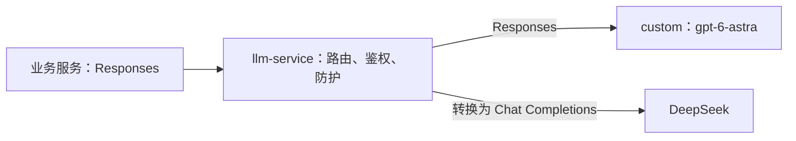

# 统一 Responses 协议迁移

2026-10-20，业务模型调用统一使用 `POST /v1/responses`。模型别名、调用方令牌和以 `/v1` 结尾的基址继续使用现有配置；上游协议由 llm-service 的 `upstreams.<name>.wire_api` 决定。

活动上游仍在 [llm-service/k8s.yaml](../llm-service/k8s.yaml) 的 `active_upstream` 集中选择。custom 显式配置 `wire_api: responses`；DeepSeek 使用原有 Chat Completions 出站协议和参数，网关将其普通响应及流转换成 Responses。业务无需随上游更改入口或解析代码。

接入参数、工具历史、JSON 输出及 typed SSE 的规范见 [INTEGRATION.md](../llm-service/INTEGRATION.md)。公共接口使用无状态的受支持子集，调用方传完整历史及 `store: false`；不支持的会话和结构明确报错。模型拒绝、截断和失败终态不能当作成功正文。

## 迁移范围与上线版本

| 范围 | 结果与镜像标签 |
|---|---|
| llm-service | `03f6b68`；配置 `llm-service-config-159bb26d128b` |
| RAG | `03f6b68` |
| GuanLiao、QianFu、ShaPan、TeWu、XuYe | `03f6b68`；ShaPan API、agent worker、sim worker 同步镜像 |
| School of One 的 duel、combo、training 三个 Judge | `03f6b68`；各自依赖基座先重建 |
| research、scientific、百家争鸣八人格、game review、content 模型服务 | `ac61414`；共 12 个 CrewAI 模型工厂 |
| 文献检索 JSON 客户端 | `ac61414` |
| meme 可选直接 JSON 客户端 | `ac61414`；CronJob 后续任务模板已更新 |
| TaShuo | 源码及测试已迁移；当前集群无该 Deployment |

发布顺序为网关、业务镜像、业务滚动更新。已核对网关和 17 个业务 Deployment 的版本、更新副本及可用副本，meme CronJob 模板指向新镜像。共享 CrewAI 基座和三个 School Judge 基座均已重建并推送。

DSH、Hermes、Pi 使用各自配置的外部提供方，不属于 llm-service 使用方。其配置记录见 [agents-custom-llm.md](../panghu_chat/docs/agents-custom-llm.md)。

旧公共 Chat 路由暂保留用于发布回滚；本轮业务源码和已上线使用方均已迁移。DeepSeek 出站的 `/v1/chat/completions` 由网关适配器使用。

## 验证证据

- 网关 125 项测试通过，覆盖协议转换、鉴权、档位、限流、防护、工具历史、typed SSE、失败及截断、用量和大型终态帧。
- 五个游戏 Provider 的 37 项契约回归通过；TypeScript 编译通过。XuYe 16 项、三个 Judge 3 项、RAG 生成链路 4 项测试通过。
- CrewAI 适配 9 项回归在本地 1.15.1 及实际 ARM 镜像的 1.15.28 上通过。ARM 镜像使用 OpenAI SDK 2.54.0。工具历史从 executor 原始消息转换一次，覆盖新版库已自行转换历史的情况。
- 真实 custom 上游验证了文本、多轮历史、JSON、typed SSE 和工具两轮；真实 DeepSeek 经 Responses 入口验证了普通及流式转换。
- 线上 RAG 生成函数、五个游戏实际 Provider、三个 Judge 实际 SDK 函数调用成功。XuYe 完整消费流式成功终态，ShaPan 明确排除了产品 fallback。
- 线上 game review 实际工厂完成工具两轮，文献实际 JSON 客户端返回有效 JSON；meme 新镜像的公共客户端及 helper 导入成功。
- research、scientific、content 的实际工厂均完成最小 `.call`；百家争鸣按名册的内部模型别名构造了 8/8 个 Responses 工厂，并验证其中一个人格的真实调用。

验证使用最小模型调用，RAG 的检索结果在临时验证进程中隔离；未为验收执行完整发布任务。

主仓实现提交为 `03f6b68`，Agent 适配修复及子模块指针为 `ac61414`。最终子模块为 `panghu_agent@64a6188`、`panghu_game@7747411`。规格保存在本仓对应的独立 OpenSpec 项目 `ec663f5a-53d3-4a0e-9037-933eb788d183`，change 为 `add-custom-responses-upstream`。
