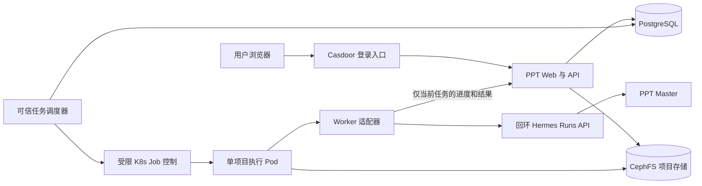

# PPT Master 独立网站：Hermes 执行后端设计

状态：已获用户授权开始实现，当前在执行器与公开资料样稿验证阶段；完整网站尚未实现、未部署，生成质量尚未验收。
OpenSpec change：`add-hermes-ppt-workbench`；权威提案、规范和实施任务存于本仓库映射的 OpenSpec Service 项目。

## 1. 目标与第一版范围

其他用户通过独立网站上传资料、确认大纲、生成演示文稿、预览和继续修改。网站维护用户、项目、任务及版本；Hermes 提供 Agent 执行，完整 PPT Master Skill 提供制稿流程。用户不能访问所有者的 DSH、Hermes Dashboard、Pi 或内部 Agent API。

第一版包含：Casdoor 登录、私有项目列表、材料上传、页数/受众/用途/风格设置、大纲与风格方案确认、异步生成、逐页预览、整份或指定页面的文字修改意见、历史版本、PPTX 下载、任务取消和可重试错误。先支持 Markdown、带文本层 PDF、DOCX 作为资料，PNG/JPEG 作为配图；扫描件 OCR、任意网页抓取、用户上传 PPTX 模板、音视频、旁白和动画留到后续。使用服务自带且已验收的模板/主题。

第一版不做拖拽编辑原生 PPT 对象、在线协作、匿名分享、自动发布、多个 Agent 后端切换。已确认全局只执行一个任务，每项目只允许一个活动任务；其他任务排队，关闭网页不停止执行。

### grill-me 访谈确认

以下是用户明确确认的需求，区别于后文尚待实测的工程配置：

- 首批用户为少量受邀账号，不开放公众注册使用；核心场景为已有资料转 PPT。
- 成品定位为可编辑草稿，允许用户在 PowerPoint 中调整细节；文字、形状可编辑，有明确源数据的图表应能在“编辑数据”中修改数值，不能用形状图表冒充。
- 网页提供大纲确认和逐页文字反馈；每份 3–20 页，默认页数仍为建议配置。
- 允许归纳改写，不编造事实、数字或引用，不以联网研究悄悄补充。关键数据缺失时提问，或明确标注待补充；方案和成品披露资料覆盖不足。
- 允许向服务指定的外部模型发送必要正文和图片，上传前明确告知并取得确认；不把本地保存宣传成完全离线。
- 费用由所有者承担。用户将最初的“月度硬预算”调整为先观察实际情况：初期不设金额上限，不声称已有月度支出保护；按用户统计生成与修改用量，已产生费用的失败任务也记账。每用户额度机制保留，数值/周期和执行启用时点由样稿实测后确定，未配置时明确显示未启用。
- 源材料、正式产物和恢复检查点保留到用户主动删除；设置存储上限并显示占用，容量不足时暂停新增而不是自动删除已有项目。短期日志和临时文件仍可按工程保留策略清理。
- 先用公开资料做 5–8 页样稿，覆盖资料忠实度、中文排版、原生数据图表和至少一轮逐页修改；由所有者在 PowerPoint 中检查，通过后再邀请用户。
- 访谈当轮仅授权同步设计与任务；用户随后明确要求开始实现。当前按执行器/样稿先行顺序推进，尚未取得样稿的 PowerPoint 人工验收。模型接入核查为 `gpt-6.1-sol`；实际费用、耗时和用户额度仍待实测。

## 2. 已确认的依据与尚未确认的能力

- 本地 PPT Master 调研与源码基线：`c350bc31e6d43b7bcf5234183d650ba8f9f4c9d7`，Skill 6.7.2。是 Agent Skill + Python 工具链，主流程有设计确认、规范/锁与最终质量门。
- 本次只读线上检查：Hermes 包元数据 0.21.5，存在 `api_server.py` / `api_server_runs.py`，容器内可连接回环 8642。未进行认证调用或真实模型任务。
- 本地 Hermes 文档定义 Runs、Sessions、SSE、stop、审批和创建幂等键。源码/文档能力不等于线上契约已验收；专用实例启动后先通过 `/v1/capabilities` 和无费用契约探针核对，再跑收费样稿。
- Hermes API Server 默认工具集排除 `clarify`。`/approval` 是工具安全审批，不是 PPT 大纲确认；产品使用阶段结果 + 下一轮任务实现用户确认。
- 主节点 ARM64、Debian 12、约 16GB 物理内存；大节点可用但集群有既有负载。两台小 NanoPC 不作为默认执行节点，一台另为 NotReady。Kubernetes 调度余量与宿主机 `free` 的 available 不同。
- 集群已有 PostgreSQL、Ceph RBD/CephFS、Casdoor、Vault/ExternalSecrets、Calico 和 VPS/frp 入口。已有私人 Hermes 包含研究调度/发布和 Git 接线；新服务不复制这些权限、记忆、会话或凭据。

待验证且会影响实施：Hermes 实际 Runs 请求/返回、会话重载、工作目录设置与工具执行目录、API 进程可控停止、ARM64 依赖和浏览器渲染、PPT Master 阶段拆分兼容性、费用和生成质量。

## 3. 组件与职责

代码归属确定为 `panghu_agent/ppt_service/`，独立 namespace `ppt-service`。[项目入口](../panghu_agent/ppt_service/README.md)已建立；下面是后续实施布局，当前未创建应用代码。

- `web/`：React + TypeScript + Vite，项目和版本列表、材料表单、大纲确认、页面预览与修改面板。
- `api/`：FastAPI，验证用户身份和资源归属；维护项目、输入快照、阶段、队列、事件、产物；提供下载。使用现有 PostgreSQL 的独立数据库/角色。
- `dispatcher/`：可信调度进程，认领数据库队列、创建固定模板 Job、监测租约、协调停止与异常回收。数据库是持久队列，第一版不另建 Redis 消息队列，也不使用 Hermes Cron 调度按需任务。
- `worker/`：一个 Job 只处理一个项目的一个阶段。Worker 启动无 Dashboard/定时任务的专用 Hermes Gateway，API 仅监听 `127.0.0.1:8642`；预创建并持久保存 session_id，再提交关联的 run；消费 SSE/查询状态、上传候选结果清单；结束时停止 Gateway 并退出。Job 主进程负责子进程清理，不能因残留 Gateway 永不完成。第一版禁用 detached delegation 和后台 shell；父 run 完成不证明后台子任务完成，只有同步工具和已证明退出的进程树可以进入收集阶段。
- `images/`、`k8s/`、`build.sh`、`deploy.sh`：ARM64 固定版本镜像与仓库惯例部署。版本和锁定文件随实现落库。

网络方向必须与上图一致：公共 API 不提供内部 Hermes 代理，Hermes 不需要对其他 Pod 开监听端口；可信控制器的 Kubernetes 权限不能进入 Worker。

## 4. 网页体验

### 创建项目

填写标题、用途、受众、目标页数、语言、风格和补充要求；上传前明确显示正文及必要图片会发送给服务指定的外部模型，用户确认后才进入会发送材料的步骤。上传后显示解析成功/失败和可用文本摘要。第一版建议默认 8 页，已确认允许 3–20 页；每文件 25MiB、每项目最多 10 个文件/100MiB 为暂定工程限额。服务器在读取流和解析阶段都执行限制，不仅依赖浏览器。

### 确认大纲

规划任务返回标题、逐页目的/要点、风格、配图策略、来源与缺失信息。页面允许修改并提交反馈，或确认后生成。将确认内容保存为不可变 `plan_revision`，同时绑定材料快照；后续材料改变使旧确认失效。没有确认，不能进入正式生成。

### 生成与预览

界面显示排队、解析、规划、生成、检查、渲染等实际阶段；无法知道完成百分比时不显示伪造百分比。生成结束后显示按顺序编号的页面图片、内容摘要和版本信息。用户可选择页面或整份输入修改意见。修改任务基于明确的 `base_version_id`，生成新版本；旧版本保持可下载。

### 失败、取消和返回项目

关闭网页不会取消任务。回到项目后通过任务快照和事件游标恢复显示。错误区分材料解析、模型连接、执行时限、质量门、渲染和导出；显示可执行建议，避免展示密钥、内部路径和原始堆栈。可取消排队/执行中的任务；请求取消后显示“正在停止”，直到执行器退出才变为已取消。

## 5. 业务状态与 Hermes 执行状态分离

项目阶段：`draft → planning → awaiting_confirmation → generating → ready`；失败保留 `last_successful_version` 和当前出错任务。修改时为 `revising`，完成回到 `ready`。规划反馈会启动新一轮 planning。

任务阶段：`queued → starting → running → collecting → validating → succeeded`，错误进入 `failed` / `interrupted`；取消为 `cancelling → cancelled`。合法活动状态由数据库约束与项目锁控制，不能只靠前端按钮禁用。活动任务 lease 超时后先核对 Job/进程；未确认旧执行停止前不启动替代任务。

- Hermes `completed` 只表示这一轮 Agent 完成，不能直接等同成品可交付；同 UID Worker 的报告也只是候选。
- 调度器确认执行 Pod 全部退出、无写入者后，可信发布器按 no-follow 规则复制候选文件为私有快照，在快照上以独立受限校验进程重跑必需质量门、OOXML/页数检查与预览；再按 attempt/fencing token/非取消条件原子发布、标记成功。解析与渲染在校验沙箱执行，不在公网 API 进程内执行。
- 规划任务成功只进入 `awaiting_confirmation`。
- PPT 大纲等待发生在网站，上一轮执行 Pod 可以退出。每个通过验收的方案/版本绑定不可变恢复检查点，保存停止 Gateway 后的一致性 Hermes home/会话数据库、显式 session_id、设计源/spec lock、输入映射和工具版本。生成从确认方案检查点克隆，修改从指定 base_version_id 的检查点克隆，不能读取某个项目“最新 runtime”冒充旧版状态；失败/取消尝试不得提升为基线。
- 每次执行内部路径固定为 `/work/inputs`、`/work/project`、`/work/home` 与 `/work/base`，把对应检查点恢复到本次专用挂载。规范与会话不得依赖会被清理的宿主 staging 绝对路径。若上游保留外部引用，检查点必须包含依赖或验收阻断。
- 设计规范、spec lock 等必须由 PPT Master 正式流程生成并校验。规划输出不是质量门的替代；如果所固定版本不支持安全拆分，先调整适配方式并验证，不伪造锁文件/通过报告。
- 工具安全审批默认拒绝或按固定服务策略处理；不把任意命令批准按钮开放给普通用户。需要额外权限的任务失败并交由运维处理。

## 6. 数据模型与对外接口

最小数据表：

| 表 | 关键字段 |
| --- | --- |
| projects | id、owner_subject、title、stage、active_job_id、confirmed_plan_revision、latest_version_id |
| assets | id、project_id、storage_key、display_name、sha256、media_type、bytes、parse_status |
| plans | id/revision、project_id、input_snapshot_hash、outline、design、user_feedback、confirmed_at |
| jobs | id、project_id、kind、input_snapshot、base_version_id、status、attempt、lease/fencing_token、Hermes session/run ID、Job UID、deadline、error_code |
| job_events | job_id、单调 seq、业务类型、过滤后的 payload、时间；唯一键(job_id, seq) |
| versions | id、project_id、job_id、parent_version_id、manifest、artifact_root、status、created_at |
| idempotency_keys | owner_subject、route、key、request_hash、response/job_id、expiry |
| usage_records | owner_subject、project_id、job_id、attempt、phase、model、provider_request_id、input/output tokens、reported_cost/currency、cost_status、outcome；按可用供应商请求标识去重 |
| user_quotas | owner_subject、enabled、period、generation/revision limits；实测后配置，未启用时显式展示状态 |

ID 由服务端生成。`owner_subject` 使用经验证的 OIDC issuer + sub，不以可变邮箱作为主键。用户提交的 task/session/path/owner 都不能改变服务器映射。

建议 API 前缀 `/api/v1`：

| 方法与路径 | 行为 |
| --- | --- |
| POST /projects | 建私有项目 |
| GET /projects；GET /projects/{id} | 项目列表与阶段/任务/最新版本快照 |
| POST /projects/{id}/assets | 流式上传并入库，自动分配存储键 |
| POST /projects/{id}/plans | 提交规划或带反馈重新规划，返回 202 + job_id |
| POST /projects/{id}/plans/{revision}/confirm | 原子确认当前材料快照和指定方案，不自动重复生成 |
| POST /projects/{id}/generations | 基于已确认方案提交生成，返回 202 |
| POST /projects/{id}/revisions | 指定 base_version_id、页面编号与意见，返回 202 |
| GET /jobs/{id}；GET /jobs/{id}/events | 状态和持久业务 SSE；支持 Last-Event-ID |
| POST /jobs/{id}/cancel | 幂等取消，返回当前取消状态 |
| GET /projects/{id}/versions | 版本列表 |
| GET /versions/{id}/slides/{number}/preview | 授权后的 PNG/JPEG 页面预览 |
| GET /versions/{id}/download | 授权后下载已发布 PPTX |
| DELETE /projects/{id} | 标记删除、停止活动任务、后续受控清理 |

规划、确认、生成、修改和取消支持 `Idempotency-Key`；同一用户/路由/键 + 相同请求返回原结果，不同内容返回 409。每项目并发变更用 revision 条件防止两个标签页覆盖确认。对他人的项目、任务、SSE、预览和下载统一返回 404。

业务 SSE 类型建议：`job.queued/started`、`stage.changed`、`plan.ready`、`artifact.ready`、`job.succeeded/failed/cancelled`。Hermes 原始工具参数、推理和模型流不直接转发；进度只包含允许字段。落库后再广播，网络断开后可重放；游标过期返回明确需刷新快照的响应。

## 7. Hermes 适配与执行协议

每个任务有不可变的输入快照、项目会话关联、阶段指令和尝试号。Worker 只从当前任务授权入口领取自己的材料清单；不接收用户指定的 API URL、session_id、系统提示词路径或输出目录。

1. 启动固定版本 Gateway，关闭 Dashboard、Cron、记忆跨项目检索、Git 接线与不需要的工具；验证阶段工具集与工作目录。
2. 验证回环 API 的 capabilities/健康和会话契约；明确选择配置的模型，不静默切换 provider。
3. 先创建/打开本阶段检查点会话并保存 session_id，再用当前 Job 的稳定请求键提交 `POST /v1/runs`，请求显式关联该会话，保存返回 run_id。不能假定创建 run 响应总会返回 session_id。超时先查询/按同键重试，不能无条件再启动一个任务。
4. 持续消费事件并补查状态；把真实活动映射为业务事件。API 默认并发设 1，外层仍以数据库和执行槽位为准。
5. 阶段输出写到约定目录与 JSON manifest；Worker 可预检 schema、相对路径、文件类型、页数、输入快照和质量报告，但不能自行发布或把任务标为 succeeded。可信发布器在完整 Pod 停写后的私有快照上独立复验，Agent 文本和自写报告都不是可信验收证据。
6. 取消先调用 stop，持续观察实际退出；超过停止宽限则由调度器 foreground 删除整个 Job，等待其所有所属 Pod/UID 终止后再释放槽位。不能仅删除 Pod，否则 Job controller 可能补建；不得因 stop HTTP 成功就显示已取消。
7. 进程重启、Gateway 崩溃、OOM、硬超时：标记 interrupted/failed，保留上一版。会话一致性检查点仅支持下一次受控继续，不承诺进行中工具事务自动恢复。

Job 模板固定 `restartPolicy: Never`、`backoffLimit: 0`、`activeDeadlineSeconds`，禁用隐式容器/Job 重跑。Worker 启动须以 attempt+fencing token 在数据库代理接口原子认领一次，重复启动即退出；认领后的崩溃只能走新 attempt。节点故障与重复 Pod 仍通过认领和停写证明防重，不假设配置可保证物理 exactly-once。

断线先重连和查询已保存 run_id；没有证明安全的阶段不自动重新运行。初始只自动重试未启动的 admission/短暂网络错误；已执行的模型或文件副作用任务由用户点击重试并创建新 attempt。外层任务状态与产物检查点是权威，不依赖 Hermes 状态无限期保留。事件和回调携带 fencing token；过期执行器的回调不能覆盖新状态或发布成品。

## 8. 多用户文件与权限边界

单独会话、profile、cwd 和提示词均不构成文件安全边界。第一版使用单项目 Pod：CephFS 中以服务器生成 ID 存储，Worker 仅挂载该项目子目录，不能看到存储根或其他项目。旧版本只读保存；当前尝试在独立 staging 中创作、验证，通过后由可信 API 复制/提交为新不可变版本。Agent 不拥有已发布版本存储的写挂载。

实现时将每项目数据拆为 `inputs/`、`checkpoints/<revision>/`、`attempts/<attempt>/` 与 `published/`：从基线检查点复制出本尝试的 home/创作文件，Worker 输入只读、当前 home/project 可写、当前 base_version 只读；不挂整个项目根、历史检查点或发布目录。可信发布器在整个执行 Pod 退出后创建私有快照和不可变检查点。API 与清理进程可读写服务存储根，但它们不执行上传文件或 Agent 输出脚本。Worker 回调令牌只允许当前 job 的认领、心跳、候选状态/清单，不允许访问其他项目、终结为 succeeded、发任意用户消息或创建新任务。它可能被同 UID 的 Agent 读取，不能把这个令牌当作额外隔离层。

可信 dispatcher 的 ServiceAccount 限本 namespace 的 `jobs create/get/list/watch/delete`、`pods get/list/watch`，无跨 namespace、Secret 读取、exec 或 Pod delete 权限；通过 foreground 删除 Job 回收 Pod。Worker `automountServiceAccountToken: false`。RBAC 的 create Job 本身不能限制模板字段，因此配套准入策略约束 Job 模板与实际 Pod：固定镜像 digest/命令/ServiceAccount、非 root、禁止特权/hostPath/hostNetwork、约束 init/sidecar、env/envFrom、Secret/CSI/projected-token 卷、服务 PVC 子路径、网络标签和只读挂载。仅可信控制器可创建执行 Job；允许原生 Job controller 创建通过同样约束的 Pod，用户 API 不能携带 Pod spec。以控制器 SA 实测合规模板可创建/观察/取消、越权模板被拒；单项目子目录挂载和启动失败时的拒绝行为需实测。

Worker 非 root、drop ALL、seccomp RuntimeDefault、只读根、受控 /tmp 与资源限额；无个人 home、Git SSH、Kubernetes token、宿主目录或 Docker socket。专用模型凭据仍可能被 Agent 同进程权限读取，使用独立服务 key 和最小权限，不宣称凭据对 Agent 隐藏。金额上限按已确认策略初期不设；密钥权限隔离、用量统计和服务停用能力仍需具备，不能将其描述为已启用费用上限。

NetworkPolicy 默认拒绝；Worker 只允许 DNS、当前任务 API 回调和必选的受控出站代理。普通 NetworkPolicy 无法按 HTTPS 域名/路径放行，所以模型请求必须通过验证上游域名、端口、DNS/重定向私网目标与 TLS 行为的代理，不直接开放全部公网 443。第一版只使用固定服务模板和用户上传配图，禁用外部素材搜索、生图与任意网页抓取以收缩出站面。代理也只放行固定模型端点；不得提供到任意地址的通用 CONNECT。私有网段、节点、元数据、个人 Agent、Vault、Kubernetes API、数据库和 registry 对 Worker 拒绝；镜像依赖在构建期安装。Fake-IP/透明代理必须验证真实链路，不为方便放开内网；API/dispatcher 仅按职责放行数据库和控制面。

## 9. 认证、上传与预览

第一版沿用 Casdoor + oauth2-proxy，但使用独立 OIDC client/cookie 和服务准入名单；身份由受信代理注入的稳定 sub 映射。只允许代理访问 API，外部同名头必须剥离/重建；上线验收实际反向代理请求头，不能把 `X-Auth-Request-*` 响应头误当作已转发的用户身份。无可验证 sub 时拒绝登录态 API。所有变更接口执行 CSRF/Origin 校验。

上传不保留用户路径，限制流大小、文件数、解压比、解析页数与解析时间；DOCX 压缩炸弹、宏文件、加密 PDF、损坏文件和不支持媒体类型均明确拒绝。解析在受限进程/容器执行，不在公网 API 主进程运行。用户材料按数据处理，不作为系统指令；真正的隔离靠挂载和网络边界。

网页只展示静态 PNG/JPEG 预览，原始 SVG 不以同源可执行文档形式提供。服务端下载通过资源 ID 定位，拒绝路径遍历、符号链接、非普通文件和超大输出。生成文件只能写入 staging；确认整个执行 Pod 退出后，可信发布器拒绝链接并复制为私有快照，独立复验后再事务发布，以停写和快照消除检查期间来源变动。下载使用附件头，用户显示名称转义，设置 `nosniff` 与适当缓存隔离。

## 10. 生成与交付验收

交付定位为可编辑草稿：正文和形状可编辑；材料中有明确源数据的受支持图表必须采用 PPT Master 的显式数据/metadata 路线并检查嵌入工作簿，使用户能在 PowerPoint 编辑数据。不支持的图表应解释限制、提问或使用明确披露的替代，不能静默降级为形状后声称数据可编辑。图片保持图片对象。默认保留规范、SVG、图表数据和可恢复会话，但只向用户展示需要的业务文件。

正文、图表数值和引用要能追溯到用户材料。允许压缩、重组和改写；缺关键数据时在网站提出补充问题或标注待补充，不捏造数字、事实或引用，不调用联网研究补齐。样稿验收需包含资料缺失案例，检查问题/标注能经过确认和后续修改流程。静态检查不能证明全部内容事实正确，须将来源对照纳入样稿人工验收。

显式请求 PPT Master 的视觉审查，并提供 ARM64 Playwright/Chromium 与中文字体。浏览器渲染 SVG 是预览手段，不证明 PowerPoint 最终渲染；PPTX 仍需检查 OOXML/页数/原生图表工作簿与质量报告。第一版样稿至少包含中文、长文本、图片和有源数据图表；用目标 Microsoft PowerPoint 人工打开核对字体换行、可编辑性和图表数据。若预览来自 SVG，页面标注预览与 PowerPoint 显示可能不同。

版本只有在所有必需校验和预览完成后原子发布；任何解析、质量门、导出、渲染失败保留旧版，不能发布半成品。收费模型样稿记录模型、时长、token/费用口径、峰值资源和人工修复量。

## 11. 资源、配额和生命周期

初始执行 Job request 500m/1GiB，limit 2 CPU/4GiB；工作区总 PVC 先按 20GiB，按用户/项目计量并设置上限。数值为验收起点，不是已测最低配置；部署前核对大节点 allocatable、现有 requests/limits、taint 和 Ceph 健康。资源不足时排队或拒绝，不默认挤占小节点。

初始硬时限规划 10 分钟、生成/修改 30 分钟（包含渲染），停止宽限 30 秒，解析单独受限。供应商请求超时、Worker 心跳、总墙钟时限分别设置；Hermes 空闲超时不是费用/总时长上限。每用户最多 2 个等待任务、全局最多 20 个等待任务为暂定队列配置，模型并发 1 已确认；队列超额返回可读错误。费用由所有者承担，观察期不设金额硬上限；按用户/项目/任务/尝试持久记录规划、生成、修改和失败中的已发生用量。供应商费用为 unknown 时保留未知状态，不记为零，也不展示虚假的人民币价格。每用户额度机制可配置，次数/周期待实测后确定，未配置时明确显示未启用；配额检查和认领要原子化，不能因刷新或新建项目绕过。供应商账单需与本地记录对账，不把单并发或 token 估算冒充支出硬限额。

项目源材料、正式产物和不可变恢复检查点保留到用户主动删除；存储配额耗尽只暂停新增上传/生成，告知当前占用，不自动清除已有项目。短期原始执行日志默认 7 天、已结束任务业务事件 30 天，成功/失败 staging 默认 7 天。方案和正式版本绑定的不可变恢复检查点随项目保留，不被 staging 清理误删。删除先停止任务并撤销回调授权，确认停写后异步清理本项目；幂等记录按明确窗口清理。备份覆盖数据库映射、检查点、工作区与发布清单，并做一致性恢复验收。

## 12. 实施阶段与验收门

1. **执行器与样稿验证**：先用公开资料做 5–8 页中文样稿，验证资料忠实度、缺失数据处理、可改数据的图表、中文排版和至少一轮逐页修改。构建独立 ARM64 镜像，核对认证 Runs/Sessions/capabilities、工作目录、完整 Skill、规划后恢复以及从旧版修改，记录费用/耗时/资源；由所有者在 PowerPoint 检查。样稿通过再展开完整业务和邀请用户；不修改私人实例。若阶段拆分或会话恢复不成立，先修正方案。
2. **后端与隔离**：数据库迁移、项目权限、受限上传、不可变输入、任务/租约/幂等、固定 Job 模板和准入、单项目挂载、回调授权、版本发布、取消与异常恢复。
3. **网页闭环**：登录、创建项目、大纲确认、进度恢复、预览、指定页反馈与下载，测试两个用户及两个标签页并发。
4. **部署验收**：真实 Worker 验证文件和网络边界；材料恶意指令、路径/符号链接、跨用户 API/SSE/下载、模型失败、Pod 重启/OOM、停止超时、断网重连、磁盘满和重复提交；PowerPoint 手工验收与备份恢复。

设计阶段不部署服务、不开域名、不动现有私人 Agent。待实施时域名可采用 `ppt.panghuer.top`（候选，尚未配置），走当前 VPS/frp + Casdoor 路线；公开上线以认证、隔离和样稿验收为门槛。

## 13. 参考

- [PPT Master 调研](../../research/repos/ppt-master/README.md)
- [Hermes Runs API 文档](../../hermes-agent/website/docs/user-guide/features/api-server.md#L432)
- [Hermes 程序集成文档](../../hermes-agent/website/docs/developer-guide/programmatic-integration.md#L117)
- [当前私人 Hermes 部署](../panghu_chat/hermes/README.md)
- [平台认证与入口](platform-auth-ingress-survey.md)
- [平台 Kubernetes 约定](platform-k8s-conventions.md)
