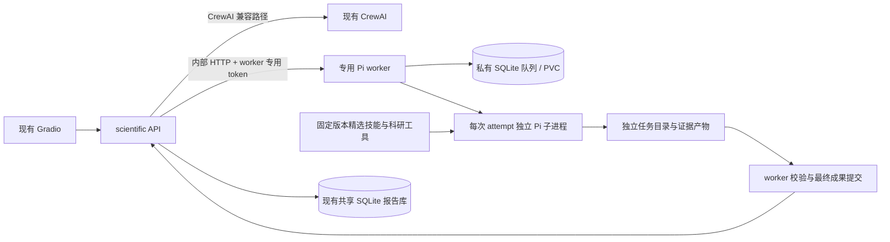

# scientific-research 独立 Pi worker 设计

日期：2026-10-21；状态更新：2026-10-22。Change ID：`add-scientific-pi-worker`。生产 worker/API/UI 已部署并经真实任务验证；最终验收 44/47，剩余 F4、E7、I1.2。最新部署证据见文末；早期未部署/待配置结论保留为历史。

## 1. 目标与当前事实

scientific-research 负责提交、进度、报告与历史；Pi 执行非交互科研任务。首版使用一个专用 worker，一次运行一个独立 Pi 子进程。保留 CrewAI，试运行通过后才切换默认后端。Hermes/DSH、多 agent 协同和多副本调度延后。

实施前的源码基线（下述旧 API/UI 行为已由本 change 调整）：

- [当前 API](../../panghu_agent/app/api/scientific_agent.py) 在后台线程中调用 CrewAI；启动时 blanket 清理 pending/running 任务。完成顺序是先标 done 再保存报告，保存异常被吞掉，邮件异常可能把任务改回 failed。
- [现有 UI](../../panghu_agent/app/ui/scientific_agent.py) 每 5 秒轮询，最多 20 分钟；只识别 done、failed、running。报告 id 与 task id 相同。
- [共享 SQLite 客户端](../../panghu_agent/tools/sqlite_client.py) 的用户并发检查与插入不原子。共享 SQLite HTTP 服务没有现成的多语句事务接口，不把 UPDATE RETURNING 经 /query 当作持久化 claim。
- [Pi 工作台](../../panghu_chat/pi/README.md) 是交互式 pi-cage，cage 只绑回环；它不是科研任务 API。
- [模型接入记录](../../panghu_chat/docs/agents-custom-llm.md) 记载 Pi 使用 custom-llm 的 Responses 配置，但成功对话仍待确认。不能据此声称科研 worker 已可用，不能复活已退役的 pi-trusted 路由。
- `.scientific-agent-worktree` 是已有独立工作树，其中 CrewAI 技能集成记录不能算 Pi 验收；实现前先确认其所属分支和已发布改动，禁止覆盖或清理。

以上是源码/历史记录核实，不是本次线上验证。Pi 版本、精确 CLI/RPC、技能发现、模型工具调用都必须通过工作包 A 实测。

## 2. 首版拓扑与职责



选择长驻轻量控制进程 + 每任务新 Pi 进程，避免首版新增 Kubernetes Job 控制器、RBAC 和分布式队列。worker 仅一个副本，调度并发 1，Recreate 更新，持有专用 RWO PVC。以后扩大并发必须重新设计文件隔离与队列所有权。

- API：外部兼容、受控后端选择、报告投影/下载、邮件。Pi 后端不在 API 中运行模型。
- worker 控制进程：接受并持久化任务、用户并发门控、排队、deadline、取消、租约、子进程管理、产物校验、可下载成果与发布确认。
- Pi 子进程：按受控任务输入调用工具，生成证据与报告；不持有队列 DB、worker token、共享 SQLite、邮件、Vault、Kubernetes 凭据。
- 控制进程与 Pi 是同一 worker Pod 的不同权限进程：队列/鉴权文件归控制 UID，Pi 子进程使用独立 UID，禁止读取控制目录及继承敏感环境；挂载和目录权限必须做实际越权测试。若运行时不能建立此边界，A/E 必须改为受限 sidecar 或一次性 Pod 后重新评审，不能宣称目录约定实现了安全隔离。
- 不挂载人用 Pi 的 HOME/workspace/PVC，不调用浏览器终端，不修改其 Service、OAuth、frpc 或网络策略。

模型路径：首选验证现有 scientific llm-service 路由是否兼容所选 Pi provider/API 和 tools。使用 worker 独立 caller 凭据，不继承人用 Pi 的模型文件。若不兼容，由 A/E 记录具体协议差异，选择独立 worker custom-llm 配置，凭据仍走 Vault/ExternalSecret；配置缺失或调用失败时不切换供应商、不降级到私人密钥。

## 3. 外部 API v1：兼容优先

原有路径、HTTP 200 提交语义及核心字段保留：

| 接口 | 首版行为 |
|---|---|
| POST /scientific-research | 原 topic/email/user_id；新增可选 engine=crewai\|pi、mode=brief\|review、timeout_seconds |
| GET /scientific-research/{id} | 原 id/topic/status/user_id/report/error；新增 engine/state/stage/attempt/report_id/error_code/notification_status/时间戳 |
| GET /scientific-reports | 保留数组响应、搜索分页和 keywords 的 JSON 字符串格式 |
| GET /scientific-reports/{id} | 保留原字段与 id=task_id |
| GET /scientific-download/{id} | 保留 UTF-8 Markdown 下载 |
| POST /scientific-research/{id}/cancel | 新增，幂等；返回当前任务；已终结不重写结果 |
| GET /scientific-research/{id}/artifacts | 新增，仅公开白名单产物元数据 |
| GET /scientific-research/{id}/artifacts/{artifact_id} | 新增，由服务解析 opaque ID，禁止直接使用客户端路径 |
| GET /scientific-health | 保留 status/llm_configured；新增 backend/worker_ready/能力摘要，不以 env 存在代替实际可用 |

默认 engine 在 canary 前仍为 crewai，通过 SCIENTIFIC_DEFAULT_ENGINE 切换；每任务持久化 engine，默认配置变化不影响在途任务。Pi 不可用返回明确 503；不静默回退 CrewAI。未知 engine/mode 返回 422。

旧 topic 长度 1..500、email/user_id 长度 <=200 保留。新增 timeout_seconds 默认 1800，范围 60..3600，由服务上限再次约束。mode 默认 review；brief 产物格式相同但允许较小研究范围。首版不把结果自动称为系统综述。

Pi 请求必须携带经现有受信 UI 传入的非空 user_id。API 当前只在集群内部使用，user_id 本身不构成认证；保持现有入口信任边界，不新增直达公网 API。worker 对 user_id 做原子并发检查，但不声称客户端可自行提交的身份能防冒用。

支持 Idempotency-Key（首版 Pi），作用域为受信用户 + engine；相同 key/规范化载荷返回同一 id，异载荷返回 409，受限长度，长期绑定至保留期。API 派生确定性 UUID（服务固定 namespace、用户/key 哈希）；无 key 使用随机 UUID。提交超时后以同一 id 重试，不生成另一个任务。相同 id 不同输入返回 409。

公共 status 固定 pending/running/done/failed；state 提供详细状态，防止旧 UI 把取消或超时一直显示为排队：

| 内部 state | 公共 status | 含义 |
|---|---|---|
| queued | pending | 已持久化，等待执行 |
| running / cancel_requested | running | 正在执行或停止进程中 |
| validating / publishing | running | 校验或等待报告发布 |
| succeeded | done | 校验通过且报告可搜索/下载 |
| failed / cancelled / timed_out | failed | 终态及明确 error_code |

stage 使用 search/screen/extract/synthesize/write/validate/publish；没有可靠百分比时 progress=null，不把耗时换算成完成率。UI 20 分钟停止轮询不取消后台任务，保留任务 ID 可重新查询。

## 4. API ↔ worker 内部 HTTP 契约

前缀 `/v1`，仅集群 Service。固定协议版本 `schema_version: "1"`。Bearer token 来自专用 ExternalSecret，API 与控制进程持有，Pi 子进程不继承。缺 token fail closed。所有 task_id 必须验证 UUID。

- PUT /v1/tasks/{task_id}：原子持久化任务与并发门控；新建 201，同载荷重放 200，冲突 409，同用户活动任务 429。响应持久化后才表示已接受。
- GET /v1/tasks/{task_id}：返回任务快照，含递增 revision、attempt、state、stage、时间戳、error；不存在 404。
- POST /v1/tasks/{task_id}/cancel：排队直接取消；运行中转 cancel_requested，停止进程树后终结；重复调用幂等。完成与取消以 worker DB 的条件更新胜出顺序裁决。
- GET /v1/tasks?publication=pending&cursor=...&limit=...：列举待发布且已校验的 Pi 任务；稳定游标分页，供 API 重启后补同步。
- GET /v1/tasks/{id}/result：仅 publishing/succeeded 可返回经过校验的报告、manifest 和 result_digest；不得读运行中的半文件。
- POST /v1/tasks/{id}/publication-ack：{attempt,result_digest,report_id}；必须匹配已校验最终成果，幂等转 succeeded，过期结果 409。
- GET /v1/tasks/{id}/artifacts 及 /artifacts/{artifact_id}：仅已登记白名单文件，校验路径、大小、digest；禁止暴露会话、环境、数据库、任意原始日志和凭据。
- GET /v1/health：分别报告进程存活、队列可写、Pi 版本/能力已验证、模型配置就绪；不返回 token/完整模型配置。

ResearchJob 固定字段：schema_version/task_id/input_digest/topic/user_id（内部 opaque 用户标识）/engine=pi/mode/timeout_seconds/created_at/execution_deadline_at/skill_bundle_revision/runtime_revision。email 仅在 API 的通知记录中持久化，不交给 Pi。worker 使用本地 UTC 时钟存储时间，时区仅在 UI 展示时转换。

ResearchResult 固定字段：schema_version/task_id/attempt/report_markdown/report_sha256/result_digest/artifacts/provenance/validation；provenance 至少包含实际 model、Pi/Node 版本、镜像 digest、技能 revision/hash 和检索时间区间。未知 token 用量为 null，禁止猜测。精确字段类型、错误码、重放与摘要算法以 [协议补充契约](contracts.md) 为准。

## 5. 持久化、恢复和报告发布

worker 私有 SQLite 是 Pi 生命周期的权威来源；共享 SQLite 保留原历史报告用途。不新增通用 SQLite 事务接口，不让 Pi 任务依赖旧 helper 的全局 _SERVICE 或 blanket stale 清理。

专用存储示意：

```text
/data/control/queue.sqlite       # 仅控制进程可读写
/data/control/submissions/      # 输入与调度元数据
/data/tasks/<uuid>/attempts/<n>/ # 本次 attempt 的 Pi home/workspace
/data/results/<uuid>/<digest>/  # 控制进程校验后复制的不可变白名单成果
```

控制进程原生 sqlite3 事务中实现接受+同用户活动唯一门控、claim、attempt 递增、lease token/expiry、revision 递增和终态条件更新。API 不写入队列文件。Pi 子进程不可访问其他任务目录；单次 attempt 使用新的 HOME 和 cwd，前后做读权限测试，不以换 cwd 代替隔离。

首版 max_attempts=2。仅基础设施中断/进程异常允许受限新 attempt；结构错误、引用校验失败不自动多轮修复。每次重试保留 task_id，新目录、新 attempt；总 deadline 不延长，阶段与重复检索记录如实保留。模型 429/5xx 在 deadline 内有限退避，达到上限明确失败。

worker 重启：先获取独占实例锁，恢复 queued；旧 running/validating attempt 失效，清理遗留进程，在总 deadline/次数内重排，否则 failed；publishing 使用已校验不可变结果继续发布。API 重启不改变 worker 状态。取消/超时发送 TERM 到 Pi 进程组，最多 10 秒后 KILL，确认子孙进程结束，终态后拒绝过期 attempt 写入。

报告发布采用可恢复协议，不声称跨两个数据库原子提交：

1. worker 校验并复制最终成果，持久化 result_digest，state=publishing。
2. API 周期性 reconciler（默认 10 秒，不依赖浏览器轮询）拉取待发布结果，以 task_id 为唯一键，幂等保存共享 scientific_reports；随后读回核对内容 digest。
3. 写入失败时继续 publishing，保留成果并重试同步，不重跑 Pi；execution_deadline_at 只约束排队、执行和校验，进入 publishing 后不再触发执行超时，storage_unavailable 是非终态诊断，status 仍为 running。
4. 进入 publishing 是成果提交边界：此后取消返回当前任务，不再取消或替换结果，避免报告已保存却任务被取消。API 用匹配 attempt+result_digest 的 publication-ack 确认，worker 转 succeeded；GET 此时映射 done。
5. 报告插入必须使用科学专用 INSERT ... ON CONFLICT DO NOTHING，再读回验证 report_sha256；不得复用 INSERT OR REPLACE 的旧 save_report 覆盖异源报告。崩溃在保存与 ack 之间时重放并核对；同 ID 异内容停止发布并报警。
6. 摘要定义：report_sha256 是 report_markdown 原始 UTF-8 字节的 SHA-256，服务端不改换行。result_digest 是按 [协议补充契约](contracts.md) 中 CanonicalJSON 算法规范化不可变 result envelope 的 SHA-256，排除 result_digest 本身，包含 report_sha256、task_id、attempt、provenance 和受控 artifacts 的有序清单；manifest 不列自身，避免循环。具体类型与测试向量由契约附录固定。

API 新增科学专用 Pi index/notification 表或封装，保存 engine/id/email/投影状态；表通过服务专用模块建立，避免并发改写共享 sqlite_client。Pi 任务不加入旧 clear_stale_tasks() 清理集合；查找先依据 engine index 查询 worker，worker 暂不可达返回可重试 503，不回落为旧 CrewAI 任务。

派单意图状态为 prepared/accepted/rejected/ambiguous：API 在调用 worker 前持久化 prepared；worker 201/200 后记 accepted；明确 409/422/429 后记 rejected，禁止 reconciler 再投递；网络超时或崩溃窗口属于 ambiguous/prepared，用同 id 查询和重放。持久化失败则不调用 worker。对 ambiguous 的外部响应为 503，detail 包含可恢复 task_id 和 retryable=true，明确任务可能已接收；不发“已拒绝且绝不会执行”的误导信息。API 启动及周期 reconciler 只恢复 prepared/ambiguous，不重放 rejected。

首版并发规则按 engine 分开：Pi 原子限制每用户一个 queued/running/validating/publishing；CrewAI 保持旧门控，灰度期间同用户可各运行一个。此为有意的混合后端行为变化，不声称全科学服务原子限一；需要跨 engine 全局门控时另建统一 admission。publishing 阻塞 Pi 用户新提交，提示报告待发布；管理员可恢复存储或显式处理，不自动丢弃成果。

执行租约由控制进程每 5 秒续期，TTL 30 秒，watchdog 至少每 10 秒检查。过期后先终止并确认旧进程树退出、fence attempt，再按次数/期限重排；旧进程未能停止则停止接新任务并报 degraded，不能并发启动替代 attempt。

成果 30 天到期后，删除大型文件但保留队列终态快照、engine index 和幂等映射至少 180 天；报告正文按现有报告库策略保留。到期 artifact 返回 410，任务和已发布报告仍可查，禁止把找不到产物误当 CrewAI task。幂等 key 在记录保留期内始终绑定同一任务，到期再提交视为新请求。

通知单独状态 pending/sent/failed，成功报告不因邮件失败降为 failed。默认不在 fixture/canary 发送邮件。无邮件服务幂等能力时，只保证尽力投递，记录“可能已投递”歧义，不承诺 exactly-once 邮件。

## 6. 科研成果契约 v1

| 产物 | 最小内容 |
|---|---|
| searches.jsonl | source/query/searched_at/status/result_count（未知 null）/error，失败和部分结果也记录 |
| papers.jsonl | paper_id、title、authors、year、doi/pmid/url、来源、metadata/abstract/full_text 可用性与取得时间 |
| screening.jsonl | paper_id、include/exclude/uncertain、reason、适用标准 |
| evidence.jsonl | evidence_id、paper_id、发现、方法、局限、access_level、locator（页/段/摘要标识） |
| claims.jsonl | claim_id、正文标记、evidence_ids、支持/冲突/不足的说明 |
| report.md | 研究范围、方法、发现、局限、参考文献；引用使用 [n]，bibliography 映射到 paper_id |
| references.json | 唯一 n 到 paper_id 的映射，不重复编号；必须有可核查标识符或来源 URL |
| validation.json | 每项检查的 pass/fail/unknown、错误、警告、校验器版本 |
| manifest.json | schema_version、task/attempt、每个 artifact_id/受控相对路径/media_type/size/sha256 和 provenance |

控制进程重新计算文件大小与 sha256，不相信模型填写的 manifest。必须防绝对路径、../、编码路径穿越、符号链接逃逸、重复 ID、超大文件和外部文件引用；限总成果 50 MiB、单报告 2 MiB，原始 PDF 默认不公开下载。模型原始会话只供受限运维，默认不持久化含敏感工具输入的原文。

硬失败：缺报告/必需产物、格式无效、引用编号缺失或指向不存在文献、claim 指向不存在 evidence、全文表述与访问等级矛盾、越界文件。外部标识符验证超时标 unknown 并展示局限，不伪造“已核实”。零文献可以产生“证据不足”报告，但不能编造结论、引用或筛选数量。

校验器只能验证结构、一致性和可核查元数据；不能证明每条科学结论正确。全文/摘要限制必须出现在报告中。不得未经完整过程记录把普通综述标为系统综述。

## 7. 精选技能与工具

候选：paper-lookup、scientific-critical-thinking、scientific-writing、citation-management、peer-review。来源为 [K-Dense scientific-agent-skills](https://github.com/K-Dense-AI/scientific-agent-skills)，[Agent Skills 规范](https://agentskills.io/specification)。是否使用每个候选取决于逐项审查，不把候选等同于已安装。

固定 upstream commit、每技能路径/hash/许可证/本地补丁/工具依赖；保留来源与合法署名，移除自动向科研参考文献加入厂商推广引用的执行指令。运行时不从 latest 自动更新、不临时安装未审核技能。第三方网页、论文和技能内容不得修改服务权限或读取凭据。

复用 framework-neutral 学术查询函数，避免在 Pi worker 引入 CrewAI BaseTool 依赖。工具实现必须记录真实请求、失败和证据访问层级。增加 PDF 解析依赖前验证平台架构和实际需求。Parallel/OpenRouter 等可选 SaaS 不作为默认必需服务；未配置时明确禁用。

## 8. 部署与边界

E 独占 worker 镜像与科学专用 manifests/scripts。优先构建精简 Node/Pi + 控制运行时镜像，固定 Pi 包、Node、基础镜像与多架构 digest；不运行 cage/ttyd/OAuth。若使用 pi-cage 作为基础也必须显式替换入口并验证不启动网页监听。

worker Service 仅内部控制端口，入站只允许 scientific API；default-deny，明确 DNS、模型服务和所需公共 HTTPS 出站。限制集群 API、Vault、Redis、共享 SQLite、人用 Pi、node/LAN、metadata；避免复制 OAuth sidecar 出站规则。公共 443 放行意味着广泛公网访问，不称为域名白名单。fake-IP/透明代理环境必须用 TLS 和实际应用响应验收，TCP connected 不算成功。

实现确认的 Linux 权限例外：控制进程 UID0，drop ALL 后仅保留 CHOWN、DAC_OVERRIDE、SETUID、SETGID、KILL；每次 Pi attempt 使用 SQLite 持久化且永不复用的唯一非 root UID/GID，清空所有子进程 capabilities/groups，设置 no_new_privs 与 RLIMIT_NPROC。该例外用于切换任务 UID、读回隔离成果和清理脱离进程组的同 UID 后代；容器仍不特权、只读根、seccomp，无服务账号 token/hostPath/hostNetwork/socket。控制进程使用 pidfd 与 /proc UID 扫描确认清理，不能证明停止则 degraded 并保留 fence。该实现不依赖宿主 cgroup 挂载，Linux 权限及真实容器清理仍须另行验收，生产门槛默认关闭。设置 CPU/内存/临时空间、总时限、进程数、输出与存储配额。初始 requests 250m/512Mi、limits 2 CPU/2Gi、PVC 10Gi 是待实测起点，不是测量结果。

保留成果默认 30 天；保留失败任务元数据与受控诊断信息，清理前确认不在运行/发布中。用户下载经 API 白名单转发，不把 worker URL 或内部路径暴露给浏览器。

## 9. 验收与灰度

依次通过：G0 契约/源码基线；G1 Pi 非交互与模型工具回合；G2 队列/重启/取消/幂等；G3 科研 fixture 和来源校验；G4 网络/权限/跨任务隔离；G5 报告存储故障恢复与旧接口兼容；G6 canary 与回滚。

canary 固定一个题目及受控证据，不发送邮件；比较实际成果 digest 与下载正文，记录运行时、技能、镜像、模型及资源数据。真实在线研究另验收来源可达性，不把 fixture 通过当作研究质量证明。

回滚先暂停新 Pi 接单、排空或显式取消在途任务，保留 PVC/已发布报告，默认后端改回 CrewAI。禁止用广泛 git reset/checkout、删除私人 Pi 数据或覆盖 shared latest 来回滚。部署者输出实际资源差异、回滚命令及执行证据。

## 10. 并行开发与变更控制

按 [tasks.md](tasks.md) 分配；接口 v1 由集成者独占。A 的能力验证可以先做，B/C/D 在契约冻结后并行，E 先写部署草案，待 A/B 运行方式固定再集成；F 最后验收。任何需要改字段、状态或 ownership 的工作先交给集成者合并设计，禁止多个 agent 同时改共享 API、镜像模板、锁文件或远端 OpenSpec revision。

## 2026-10-22 最终部署与验收

独立 Pi worker、专用 Vault caller/ExternalSecret、Ceph PVC 及 API/UI 已上线。CrewAI 继续默认，显式 pi/brief 经真实 arXiv/Crossref 任务验证。最终 ARM64 回归 182 项、系统隔离 7 项，全部通过且零跳过；混合后端并发、严格有界模型重试和恶意来源实际工具隔离均已纳入。

源码：panghu_agent `75ee2e699c5af71a337a5434c0b554defd4dbbf8`（已发布 codex/scientific-pi-worker）。最终 worker：`sha256:f1a4c5150463a0b5358796cb0608c2d2252480ca014d756db93c06ea9cdb4983`；UI ConfigMap：`scientific-pi-ui-f2b437737cb5`。最终浏览器任务 `c6215730-d752-4293-8013-8e67f0180281` attempt 1 成功，报告 SHA256 `7f01b9df6b8576525f09ae18bf88009b2161d1e9743a0401cbb1f41c8a7a7eff`。4 次检索、4 篇筛选、2 篇纳入摘要、3 条证据/claim、2 条引用，全部附件和正常下载字节一致，无邮件通知。

第三次 canary 还验证了运行中 API 重启及 worker/PVC 恢复，新的 attempt 分配新的 UID。最终重试策略关闭 Pi/SDK 双层自动重试，只允许明确的 HTTP429/500/502/503/504 在原 deadline 内退避，最多两次执行。网页修正队列身份头大小写及真实文件下载绑定。运行时无可靠研究阶段时返回 null，不估算百分比。

F4、E7、I1.2 保留未完成（44/47）。IPv6 无可用路由，metadata 无可用基线，人用 Pi 的目标侧策略拒绝基线，不能将这些失败当作worker出站隔离通过；其他工作负载也缺少完整的部署前后快照。没有 apply/archive，没有切换默认后端。源码/部署的实际范围与缺少的验收证据分别记录。

完整镜像/源码摘要、两次失败及两次成功的实际任务、隔离/OOM/恢复、下载限制、性能及回滚步骤见：
https://github.com/zmhhaha/armbianbegin/blob/codex/scientific-pi-worker/docs/scientific-research-pi/rollout-20261022.md

旧附录中的未部署、较早测试数量和待配置项保留为历史，不代表当前状态。结构校验不证明科研正确性；恶意来源测试证明权限约束，不证明模型拒绝提示注入；浏览器下载按钮已点击且服务端附件正确，未证实 Windows 本地落盘。
