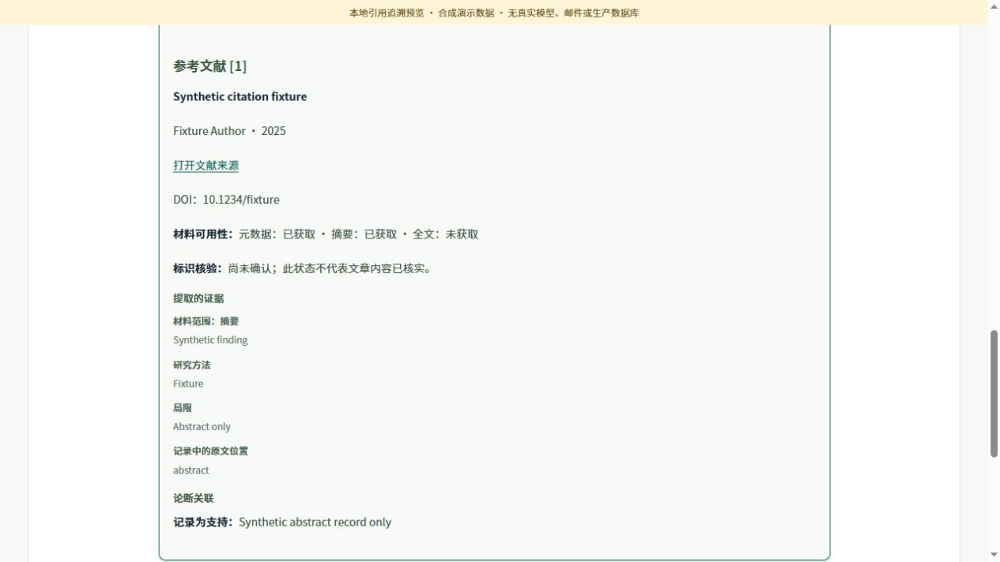

# 科研写作工作台：实施计划

用户已同意优先完成「正文引用可追溯」与「按章节修改报告」。本计划先把现有文献、证据和论断记录接入阅读流程，再引入版本与修订任务。OpenSpec 服务中的变更 `add-scientific-evidence-linked-revisions` 是规格与任务状态的权威记录，项目为 `ec663f5a-53d3-4a0e-9037-933eb788d183`。

2026-10-25 15:49:52（Asia/Shanghai）：阶段 1 引用追溯 UI 与阶段 2 章节、版本及修订准备 API 已从固定 Git 提交部署。224 项本地回归、14 项 ARM64 隔离镜像检查和 13 项生产 operator 接口检查通过。正式用户登录后的浏览器验收仍待完成。以下阶段 1/2 的本地记录保留其当时验证边界。

2026-10-25 23:25:22（Asia/Shanghai）：阶段 3/4 的 worker、API 和编辑界面已通过固定 Git 提交构建并部署，三者就绪、入口恢复。R5 真实 Pi 隔离修订、线上 operator 19 项、正式账号的引用阅读/原件下载/章节选择，以及 D2 生产专用 canary 的开始、恢复、候选比较、显式采用和独立科学审阅均通过。D2 首次保守校验拒绝的失败记录保留；第二个独立意图成功，没有放宽校验。D2 实际 worker/model provenance 的独立核对仍在单独记录，不用 API 回执或文章审阅替代。详见文末阶段 5。

## 阶段与交付

| 阶段 | 交付 | 完成条件 |
|---|---|---|
| 0 计划与规格 | proposal、design、需求场景和任务清单 | 服务端规格校验通过，标清依赖与未完成项 |
| 1 引用追溯 | 只读证据接口、正文引用入口、文献与证据阅读 | 编号能定位文献，展示摘要/全文层级、相关发现与局限；旧报告、过期或损坏资料有明确降级；原始下载不变 |
| 2 章节与版本 | 绑定正文摘要的章节索引、追加式版本记录、证据快照与修订准备 | 重复标题可区分；原报告不覆盖；基准版本与证据快照一致，跨账号隔离 |
| 3 Pi 修订任务 | 独立修订协议、固定输入、目标章节生成与完整报告校验 | 同一请求可恢复，未修改章节字节保持，引用校验通过后才产生候选 |
| 4 编辑交互 | 选择章节、预览修改、查看差异、显式采用和切换版本 | 失败/取消不改变当前采用版本；迟到结果不切换用户当前视图 |
| 5 生产验收 | 固定版本发布、回滚材料、真实账号浏览器与修订报告验收 | 桌面/手机、登录、任务恢复、版本隔离、原始下载和真实模型结果均有单独证据 |

阶段 1 可独立验证；阶段 3 依赖阶段 2，阶段 4 依赖阶段 3。每阶段完成后回填 OpenSpec，未通过的门槛保持待办。

## 代码核对形成的决定

- 当前 `[n]` 通过 `references.n → paper_id` 对应文献；论断通过 `claims.evidence_ids → evidence.paper_id` 关联证据。第一阶段复用已有产物协议。
- 追溯仅增强阅读视图。下载继续使用原始 Markdown；将正文摘要与附件的 report 摘要核对后，才能建立关联。
- `full_text_path` 是内部工作目录路径，不能作为全文下载地址。外部来源链接只允许无凭据的 HTTP(S)。获取层级与标识核验状态分别展示，不能混同为结论已证实。
- 附件默认保留 30 天，旧共享报告没有 Pi 产物。资料不可取得时保留正文，说明无法追溯的原因。
- 当前 ResearchJob v1 字段严格、topic 上限 500 字；发布后正文摘要固定，报告 ID 等于任务 ID。章节修订必须有新增协议与追加式版本存储，不能覆盖原报告或将整篇正文塞入 topic。
- 首版章节修订只使用固定快照中的已有证据，保留参考文献编号。补查文献、重排编号、多人协作和投稿导出另行规划。

## 验收方式

1. 本地契约与行为测试：关联完整性、危险输入、大小/摘要校验、身份隔离、竞争与旧报告兼容。
2. 真实 Gradio 浏览器：正文引用跳转、证据可读、手机布局、任务或版本切换；演示数据明确标注，不计为真实科研结果。
3. 生产分别记录接口、正式账号浏览器和真实 Pi 修订任务验收，不用其中一种替代另外两种。

本计划不以界面变化推断文章质量。后续真实修订验收应核对证据是否支持修改后的表述、局限是否保留，以及未经修改的部分是否完整保持。

## 阶段 1 本地交付

新增标准库引用关联模块、带身份与归属检查的 `/scientific-research/{task_id}/citations`，以及报告顶部「查看引用与证据」入口。正文编号可跳转到文末卡片，展示文献来源、材料可用性、标识核验、证据及论断关系。下载继续输出原始 Markdown。任务切换和报告库选择会清理上一份报告的引用提示。

解析前核对正文与全部附件清单，逐份按声明大小有界读取并即时校验。记录输入与关联展开后的响应均限制为 8 MiB。非法、含糊或超限资料明确降级；动态文本转义，外链过滤，内部路径不公开。进度轮询不自动请求引用资料。

- [本地验证摘要](evidence/local-validation.json)：API 目录 149/149 测试通过，包含 UI 68 项、关联模块 28 项、新接口 12 项、有界传输 6 项及专用镜像布局的独立进程导入检查。
- [浏览器验收摘要](evidence/browser-acceptance.json)：真实 Gradio 与 FastAPI、内存合成数据，验证桌面/手机、编号跳转、代码保持、过期/旧报告降级和切换提示复位。浏览器下载的 1027 字节原件 SHA256 与已发布合成报告一致。
- 所有预览明确标记演示。没有真实模型、邮件、生产数据库或正式登录操作。

阶段 1 的生产镜像构建、API/UI 发布及真实账号浏览器验收仍待完成。旧 `.research-temp/prepare-scientific-pi-workbench-build.py` 的历史白名单未包含新模块，不能直接复用为本轮打包；本轮构建必须与更新后的 Dockerfile 一起纳入 `scientific_agent/pi_citations.py`。阶段 2 的进展见下，Pi 章节修订仍待实施。

## 阶段 2 本地交付

新增 `pi_sections.py` 与 `pi_report_versions.py`，已纳入专用 API Dockerfile 和独立进程导入检查。章节索引绑定完整正文与精确 UTF-8 字节范围，支持前言、同名标题、父子章节、ATX/Setext、围栏与缩进代码排除、Unicode 和原始换行。过时的正文或章节选择返回冲突，不按标题猜测。

新增私有版本、证据快照和修订意图三张表，原报告表保持不变。显式准备修订时才保存基准原件；GET 章节和历史不创建记录。版本原件按精确内容保存和下载，内部追加登记保留 root/parent 与真实来源报告 ID。所有新接口需要受信身份，Pi 报告别名也检查原任务归属，私有记录按 owner 过滤。

`POST /scientific-reports/{id}/revision-previews` 固定正文、目标范围、指令和证据，返回 `dispatch_available=false`。它还没有派发 Pi 或生成修改；同一幂等键与指纹恢复原意图，异参冲突，新指令可以复用固定快照。来源过期但已保存有效快照时可以恢复；没有可用材料时明确阻止准备，保留原报告。

快照范围为 `recorded_evidence_only`：保存原始四份证据记录与报告，不包含实际全文文件，不跟随 `full_text_path`。公开接口只返回快照摘要、到期时间和材料范围。默认快照 30 天、意图 1 天；单份快照最多 16 MiB，每账号 10 份/64 MiB、全局 256 MiB；每账号版本最多 100 份/32 MiB、全局 256 MiB；每账号意图总数 10,000，未过期活动意图最多 100。字节配额按实际 UTF-8/快照序列化大小计算。

SQLite HTTP 每请求只执行一条 SQL，准入和配额因此放在单条条件写入内，并用稳定 ID 读回确认。独立连接测试验证并发不会突破配额，提交成功但响应丢失后能恢复。后台每 10 秒与准备写入前清理过期且未被有效意图固定的 payload，保留幂等墓碑，不静默续期；任务同步失败也会独立执行清理。

- [阶段 2 本地验证摘要](evidence/stage2-local-validation.json)：API 目录 **224/224** 测试通过，其中章节 21、版本/快照存储 37、写作接口 17；原有 149 项回归通过。新增测试使用合成资料与本地 SQLite，不调用模型、邮件或生产服务。
- 本轮未改 UI，没有新增浏览器验收；原件下载通过 FastAPI 测试验证。代码与导入布局检查通过，不代表生产镜像已构建或已发布。
- 内部 `append_candidate` 只登记经过上层校验的已发布结果；本阶段的快照完整性验证不能替代候选全文的证据与引用校验。

阶段 3 需新增 RevisionJob、共享预算与取消恢复、受限生成、完整候选校验和发布接线。证据快照不含全文，不能把 JSON 放入空目录后宣称已恢复原文；应使用明确的快照校验流程或另外保留允许使用的材料。还需处理谱系登记与候选公开的跨请求恢复窗口，避免候选先被当成新根报告导入。差异、显式采用和编辑交互在阶段 4 完成；生产数据库、正式登录、真实模型和上线验收仍待办。

## Git 发布与线上验收

功能代码提交 `e87eb0c6ca39ccb61b9922b04b06121384fba819` 已推送到 panghu_agent 的 `codex/scientific-pi-worker`。根仓库 `0ee8c4c` 固定子模块及发布脚本，`26168fb07efd3034ecbcbb340522f53b2c24e983` 修复隔离验收目录挂载。服务器从 Git 拉取固定版本，在独立检出中构建和运行脚本，未上传源码压缩包。

API 固定镜像为 `arm-cluster-master:5000/scientific-pi-api@sha256:3f9523944e57d855a70b1593d7f0c0997e90acb235d21cbe2752eb2d3a619aaa`；UI 使用不可变 ConfigMap `scientific-workbench-ui-4eba0b768b66`。只变更 API image 与 UI 源引用，保留 worker 完整 spec、现有身份/环境配置、Service、PVC 和报告。API/UI 均为 1/1 Ready，维护入口已恢复。完整快照和 guarded 回滚材料留在服务器私有发布目录。

- [生产发布回执](evidence/production-release.json)：固定 Git 来源、构建输入与实际镜像摘要、运行源码校验、排空结果、资源就绪和保留检查。
- 镜像 14 项检查包含锁定依赖、真实 lifespan、引用与固定快照、幂等及权限；生产 13 项检查使用既有报告。canary 仅经 API 新增一组基准/快照/prepared 意图，模型任务数和原件保持，不直接改库、不发邮件、不启动或取消研究。
- [Git 发布流程](release/README.md)：服务器检出、构建、验收与成对发布方法。发布控制流另通过 10 项离线恢复模拟，覆盖并发 spec/UID/RV 与入口已重开的失败窗口。

正式 Casdoor 用户登录后的浏览器验证仍待完成，operator HTTP 验收不替代该项。阶段 3—5 的实际修订、差异采用、真实模型及最终完整发布门槛继续保留；OpenSpec 变更不归档。

## 阶段 3 本地交付

新增 `RevisionJob v1` 和固定输入协议。`POST /scientific-revision-previews/{intent_id}/start` 只接受空请求，从私有意图和快照构建输入；重复提交恢复同一个任务、运行版本和截止时间。仍使用现有任务查询、取消和下载接口，返回父版本、根报告和候选版本 ID。旧 worker 缺少修订能力时，开始请求明确失败，准备好的报告继续保留。

worker 使用独立 `/v1/revisions/{task_id}`，小任务与最大 16 MiB 的固定材料分开存储，在同一个 SQLite 事务中准入，共享完整研究的用户并发、队列、超时、lease 和执行 UID。固定材料按真实字节计入账号 64 MiB/全局 256 MiB 上限；API 的活动绑定持续固定输入，不受预览 24 小时到期影响。模型进程确认退出且不可变结果包装后立即清理修订工作目录，进程安全不确定时继续保持隔离和恢复边界。

修订 profile 只启用 `read,write`，不加载整篇研究技能。模型读取固定正文、章节和四份记录，只输出 `revision-output.json`。服务端按精确 UTF-8 范围替换目标，保留其他正文、papers/evidence/references 原始字节及外部 claims。拒绝参考文献及包含它的父节、章节标题或外部 Markdown 结构漂移、未知引用/证据、重复或非正文 marker、缺失段落引用。相同证据集合不能把冲突/不足升级为 supported；同 ID 未补充证据的子集同样拒绝升级。明确声称本轮新增检索或读取全文的表述会被拦截，历史全文路径不会读取。结构检查不能自动判断科研表述是否被充分支持，真实结果仍需要审阅。

API 在派发前原子预留一个候选版本及最大 2 MiB 保存预算，所有版本写入统一计入未兑现预留。配额不足在模型调用前返回 429，普通基准导入不能抢占该空间；候选写入在同条 SQL 中兑现预留，提交成功但回执丢失不会重复计算。研究和修订使用独立 UUID namespace，避免合法账号字符串引发任务 ID 碰撞。

API 下载摘要绑定的模型输出和四份 records，独立重建完整候选并逐字节核对；通过后先登记 parent/root，再保存并读回报告，最后 ack。各请求独立提交，任一步丢失响应均可恢复。取消在提交结果未知时先持久保存，后续不再发起新 PUT，继续取消晚到任务；在原截止时间前不会把 GET 404 当成取消完成。进入 publishing 后沿用既有不可撤回边界。

- [阶段 3 本地验证摘要](evidence/stage3-local-validation.json)：API 251、修订契约/校验 48、worker 40、研究契约 8、研究产物/传输 51、runtime 基础 22、完整 HTTP 链路 22；合计 442 项，439 通过、3 平台跳过。其中本阶段新增 95 项。数据、研究输出和模型响应均为合成 fixture，没有调用真实模型、生产数据库或邮件。
- 独立复核先复现并修复了候选配额耗尽时无法结束发布、任务 ID 域碰撞；复核确认已在派发前拒绝、预留无法被抢、模糊提交不双计。主测试入口已纳入 `revisions`，API Dockerfile 的输入均在固定 Git 构建清单中。
- 完整 runtime 的另一次 40 项尝试有 4 项未通过：本地实际 Pi CLI 的版本探针超过既有 5 秒时限（直接运行约 7.4 秒），后续几项无法获得准入任务。保留原超时和环境，不将其计作真实 Pi 验收通过；详细测试名和来源在验证摘要中。

以上保留阶段 3 本地交付时的验证范围。当时尚未提交、推送、构建生产镜像或上线，不能沿用“worker 不变”的阶段 1/2 发布回执。后续 worker/API/UI 协同发布、R5 真实结果和生产验收进度见阶段 5。

## 阶段 4 本地交付

工作台加入章节选择、修改要求和固定范围预览，确认后才开始章节修订。修订有独立任务 ID、状态、取消和恢复入口；任务完成后先展示候选，作者核对修改前后和逐行差异，再显式采用。候选完成、采用和回看历史均不会自动切换正在阅读的正文。手机布局把编辑与对照区域改为纵向排列。

新增 `writing-state`、`comparison` 和 `adopt` 接口，使用追加式 `scientific_report_adoptions` 记录采用。一次条件 SQL 同时核对当前版本及序号、父子谱系、候选摘要、修订成功和已公开的精确报告。并发采用只有一个成功；提交成功但响应丢失后可用同键恢复。候选尚未公开时不能采用，旧分支候选保留阅读下载但不能覆盖当前稿。

阅读、编辑和修订跟踪分别隔离身份、报告、摘要和代次，引用与版本下载绑定正在阅读的原件。独立复核复现并修复了旧刷新、旧采用响应回退本地采用状态的竞态；客户端按 `selection_revision` 单调接收更新，同序号不同 head 拒绝。第一次准备基准允许序号 0 从无私有版本转换为初稿。差异计算有字节、行数和输出上限，超限时仍提供完整章节前后原文和精确下载。

真实浏览器还发现首次准备下载后按钮仍隐藏的问题。所选版本下载控件现始终显示，准备前禁用，校验成功后启用；切换版本明确清除旧文件并禁用。最终界面初稿与候选均只点击一次准备便能下载，实际文件分别为 1027 和 1220 字节，摘要与对应版本一致。

- [阶段 4 本地验证摘要](evidence/stage4-local-validation.json)：297 项 API/UI、48 项修订契约、18 项研究发布链路、4 项修订链路及 3 项编辑采用链路，共 370 项通过。其中新增 API/采用存储 17、UI 29、完整编辑链路 3。新增链路使用真实 API/client/worker/queue 和合成模型输出，验证显式采用、同键重放、旧分支冲突、账号隔离、采用后继续修订及原件保持。
- [阶段 4 浏览器验收](evidence/stage4-browser-acceptance.json)：真实 Gradio 6.19/FastAPI，本地合成报告，桌面及 390×844 手机实际点击、候选比较、采用和版本回看。演示不访问生产数据库，不调用真实模型，不发送邮件。

以上保留阶段 4 本地交付时的验证范围。E1—E4 的本地交付与真实浏览器交互证据单独记录；后续 Git 发布、正式账号只读浏览器检查及仍未完成的真实生产验收见下。变更不归档。

## 阶段 5 生产发布与验收边界

应用提交 `d208aee9d78a56867cf8706eea4223e16eba046d` 包含阶段 3/4 功能；根提交 `09e9b5ce21627efb896e8ec0b560a79bc5e14f34` 固定该子模块并提供本轮构建、隔离验收和发布脚本。服务器通过 Git 拉取固定来源，构建专用 worker/API 镜像和不可变 UI 源引用，没有上传源码压缩包。构建来源、相关 Git 提交、运行源码摘要和排空/就绪事件见[本轮净化发布回执](evidence/stage5-production-release.json)。

| 组件 | 线上固定内容 |
|---|---|
| worker | `scientific-pi-worker@sha256:e74b79fc43d6ddca9075326a19f26c14cb339ed5d27ee58b71221fa5aeec6114` |
| API | `scientific-pi-api@sha256:77d4e47c1528ce7274e8bb9e74facb06cbeb3a7fdd3c0830700dc5cc90b3ca9e` |
| UI | 不可变 ConfigMap `scientific-workbench-ui-240445b062fc`，源码 SHA-256 `240445b062fc6b1831bf776b18b4d8e03e70eeb521cbf66b13433a8beee4301a` |

镜像位于 `arm-cluster-master:5000`。发布前既有研究排空为 0，停止旧 handlers 后再核对；依次更新 worker、API、UI，并验证修订能力、13 条 API 路由和界面入口。三者 rollout Ready，HTTPS 根入口已恢复。旧环境、数据和卷边界保留；本轮发布自身未启动或取消研究，没有直接写数据库或发送邮件。

- [R5 真实 Pi 验收](evidence/stage5-real-pi-acceptance.json)：在同一候选 worker 镜像的独立 Pod 中，使用真实历史摘要材料调用 Pi 0.73.1 与实际模型；不挂生产 PVC、不接生产流量。首轮任务 `469abc62-2e54-4ded-a339-267b964c8654` 以 `model_error` 失败，净化记录不足以确定具体供应商原因；失败没有被隐藏或改记成功。第二轮 `806cfd4e-a785-4237-ba91-8bd6641e7a2e` 成功，未改正文前 5281、后 8312 字节以及 papers/evidence/references 原件保持。两轮独立 Pod、ConfigMap、NetworkPolicy 均按归属和 UID 精确清理。
- [独立科学审阅](evidence/stage5-real-pi/independent-review.md)通过，无阻断。背面供电两条新 claim 与 E04/E05 及摘要 [4]/[5] 一致，没有新增性能数字、跨指标排名或全文/新检索声明。候选 SHA-256 为 `6ecb51eb4461f80de7b8089e2276d765424a54680873c830e48d417b602324cc`。[公开候选与来源材料清单](evidence/stage5-real-pi/artifact-manifest.json)保存报告、修订输出、必要 provenance、验证记录及对应摘要，未复制模型日志、Pod spec 或环境配置。
- 线上 operator **19 项通过**，核对已有报告、旧报告兼容、writing-state、版本精确下载、401/404 隔离、准备幂等与不同指纹冲突。仅对既有 canary 经 API 增加一个 prepared 意图；revision_jobs/adoptions/研究任务数不变。`dispatch_available=false` 保持“准备尚未派发”的语义，恢复响应提供显式 start_url；该组检查没有调用 start 或 adopt。
- [正式账号浏览器记录](evidence/stage5-production-browser.json)通过：真实线上 Gradio、既有 Casdoor 会话，打开原报告和 15 个引用卡片、实际点击 [4] 定位、下载 14343 字节原件并核对 SHA-256 `996ee4402200ef328dfabbed847a51d74e8d2eb64f05c38c72045f3c4fd42b7c`、选择第 8 节核对精确原文；390×844 无横向页面溢出。普通账号操作限阅读、选择与下载，没有准备、启动、取消或采用；不以该记录替代真实编辑全链或所有 Casdoor 登录方式验收。
- [D2 生产 API 验收](evidence/stage5-d2-production-acceptance.json)与[独立科学审阅](evidence/stage5-d2-independent-review.md)通过。专用 canary 第二次任务 `fd86d43c-13f1-5766-a8d1-bcff2fcc9d1b` 使用根提交 `f9f13893754b79697deb94571c6cc793e6fde9e6` 的独立新意图，经生产 API start、同意图重放/恢复、succeeded、comparison、显式 adopt 和同键重放，selection_revision 从 0 到 1。所选“局限”章节只依据 RAG 与 Self-RAG 两篇已有摘要，两条新 claim 均保持 insufficient，没有跨研究优劣、独立因果贡献或消除错误的断言。候选 2376 字节、SHA-256 `4952c189cf72f72acc54ea66acfbf117581bedb8271305b02ed659212749f8ed`；原稿 1524 字节、非目标前 907/后 317 字节及 papers/evidence/references 精确保持。[公开材料](evidence/stage5-d2-real-api/artifact-manifest.json)保留前后全文、章节、claims 和证据，comparison 一致性指纹不公开。实际 worker/model provenance 由独立审计另行确认，API receipt 单独不能证明模型实际执行。
- [D2 首次诊断](evidence/stage5-d2-first-attempt.json)继续保留任务 `6402d618-747c-580a-8e90-cf49ab96ae58` 在 validate 阶段的 `unsupported_assessment_upgrade` 拒绝。它是保守判断校验拒绝，不能称为瞬时错误。原材料只有两条摘要证据，既有判断包含 insufficient；现存证据不能区分是相同 ID 子集还是完整证据集合分支，不猜测具体触发路径。第二次只明确 canary 指令保留不确定判断，没有修改 runtime、放宽校验、取消失败任务或借用普通用户。

回滚材料保存在服务器私有目录 `/root/scientific-writing-releases/revision-d208aee-20261025-r1`，包括 worker/API/UI 与入口的旧快照、预期 spec 和 guarded 回滚文件。本轮没有执行生产回滚演练。实际回滚需先重新核对活动任务、UID、新鲜 resourceVersion 和本轮预期 spec，关入口后仅恢复仍由本次发布控制的对象，旧版本就绪后重开；第三方并发变更不覆盖，追加写作记录和用户资料不删除。旧镜像与 UI ConfigMap 的精确引用在发布回执中，完整快照、原始命令输出、Secret、kubeconfig、环境和会话凭据不进入 Git。

当前已发布，R5 隔离实际模型、operator 准备检查、正式账号只读浏览器，以及 D2 生产 API 修订/显式采用与科学审阅分别有证据。[独立生产 worker/model 审计](evidence/stage5-d2-worker-provenance.json)也已通过：task/result 摘要一致，非 fixture 的 Pi 0.73.1 固定证据修订使用实际线上 worker 镜像；网关在同一执行时间内记录 3 轮成功模型调用。网关未包含任务 ID，关联依据为 caller、alias 和时间；模型名称是网关配置标识，不据此证明 custom 上游的最终实现。普通账号浏览器的 start/比较/采用全链和生产回滚演练不在上述已通过范围内。OpenSpec 回填后仍保持未归档。
